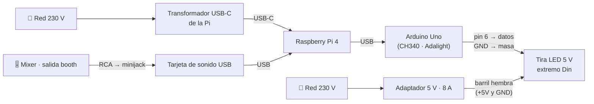

# Montaje del hardware

> Describe el montaje de referencia de Mood Table, el de la mesa del autor: una Raspberry Pi, una tira
> LED por Adalight con un Arduino Uno y una tarjeta de sonido USB. Lo marcado con ✅ se ha comprobado en
> el aparato real; lo marcado con ⏳ está **pendiente** y no debe darse por bueno.
> **Un error de cableado puede quemar la tira, el Arduino o la Pi:** sigue el orden y no te saltes las
> comprobaciones.

Este documento cubre el **hardware**. La instalación del software (clonar, `deploy/install.sh`, el
fichero de configuración y el servicio) está en el [README §1.4](readme.md#3-en-la-mesa-raspberry-pi-con-tira-real).

## 1. Piezas

| Pieza | Montaje de referencia | Estado |
|---|---|---|
| **Ordenador** | Raspberry Pi 4 Model B, 8 GB de RAM | ✅ |
| **Alimentación de la Pi** | Su propio transformador USB-C a la red, **separado** del de la tira | ✅ |
| **Sistema** | Raspberry Pi OS Lite **de 64 bits** (Debian 13 *trixie*, `arm64`), sin escritorio (§4.2). Node.js 24 no tiene versión oficial para ARM de 32 bits | ✅ |
| **Red** | WiFi | ✅ |
| **Controlador de la tira** | Arduino Uno (clon con chip USB CH340, `1a86:7523`) con el sketch [Adalight-FastLED](https://github.com/dmadison/Adalight-FastLED) (§4.1; decisión D46 de la ficha) | ✅ |
| **Tira** | 173 LEDs direccionables de 5 V tipo WS2812B, orden de color GRB (pistas `+5V`, `Din`, `GND`; una flecha marca el sentido de los datos) | ✅ |
| **Fuente de la tira** | Adaptador AC/DC YU0508: **5 V · 8 A**, clavija de barril con el **positivo en el centro**. Mide 5,36 V en la entrada de la tira, con la tira apagada | ✅ |
| **Audio** | Tarjeta de sonido USB C-Media "USB PnP Sound Device" (`08bb:2902`), captura **mono**, 44,1/48 kHz | ✅ |
| **Cable de audio** | RCA → minijack, desde la salida **booth** del mixer | ✅ |

**Cualquier controlador Adalight sirve.** La tira, el Light Box y el adaptador vinieron en un kit
"Dream Color"; el **Light Box** era un controlador Adalight con el mismo chip CH340, pero **se averió**
(§6) y lo sustituye el Uno. Un Arduino Nano con CH340 funciona igual y ocupa menos.

**Alternativa de fuente para tiras más largas:** Mean Well LRS-100-5 (5 V · 18 A), con bornes de
tornillo. Su lado de 230 V va cableado a la red en el montaje actual; este documento **no** explica cómo
cablear la red: si hay que hacerlo, que lo haga alguien con experiencia, con la tierra (`⏚`) conectada
y los bornes tapados. ⏳ Sin verificar para este montaje.

## 2. Conexiones



- **El Arduino no alimenta la tira:** se alimenta del USB de la Pi y solo manda los datos.
- **La tira se alimenta directamente de su fuente**, por la clavija de barril **hembra** de su extremo.
- **La Pi no se alimenta de la fuente de la tira.** Los saltos de consumo de la tira (de negro a blanco)
  bajan la tensión y la Pi 4 se reinicia o se ralentiza; con fuentes separadas, un fallo en la tira no
  se lleva la Pi.
- **Los datos entran por el extremo `Din`** de la tira (la flecha impresa apunta en el sentido de los
  datos). Por el otro extremo no funciona.
- **Masa común:** la masa del Arduino y la de la fuente tienen que estar unidas en la tira para que la
  señal tenga referencia. Por eso el cable de datos lleva su propio negro a `GND`.

### Los cables de la tira

Del extremo `Din` salen **dos cables**, cada uno con un rojo y un negro:

| Cable | Acaba en | Rojo | Negro |
|---|---|---|---|
| **Corriente** | Clavija de barril **hembra** (entra el adaptador) | `+5V` | `GND` |
| **Datos** | Antes, clavija de barril **macho** al conector `DATA` del Light Box; ahora, regleta de palanca hacia el Arduino | `Din` | `GND` |

- **Hay dos rojos y no son lo mismo.** Si cambias de sitio el de corriente y el de datos, metes 5 V en
  la entrada de datos. Antes de soldar, sigue cada funda de punta a punta o comprueba con el pitido del
  polímetro qué rojo conecta con el centro de la clavija de corriente.
- **Los dos negros van juntos a `GND`.**
- **Arduino ↔ cable de datos**, con una regleta de palanca (tipo Wago): **pin 6 → rojo (`Din`)** y
  **`GND` → negro**. ⏳ Los pines Dupont sujetan regular en la regleta; queda mejorar esta conexión
  (cable pelado o soldado).

### Proteger el primer LED

El primer LED recibe la señal directamente del controlador y es el que más sufre: en este montaje
**los LEDs 1 y 2 murieron** tras desenchufar y volver a enchufar los cables (§6). Para que no vuelva a
pasar:

- **Orden al conectar:** primero la **corriente** de la tira y los **datos al final**. Al desconectar,
  al revés: los datos primero. Nunca metas datos en una tira sin alimentación.
- ⏳ **Resistencia de unos 330 Ω (220-470) en serie con `Din`**, lo más cerca posible de la tira. Limita
  la corriente que entra al primer LED si algo va mal. Es la protección habitual en tiras WS2812B; **en
  este montaje no está puesta** (riesgo asumido por el autor).

## 3. Potencia: la fuente manda

A blanco total, cada LED WS2812B consume unos **60 mA** (la cifra que usa la ficha: 5 V · 18 A ≈ 300
LEDs). Con 173 LEDs:

| Brillo | Consumo a blanco total | ¿Cabe en 8 A? |
|---|---|---|
| 100 % | ≈ 10,4 A | **No** |
| 75 % | ≈ 7,8 A | Justo, sin margen |
| 25 % (tope del sketch) | ≈ 2,6 A | Sí |

- **El sketch limita el brillo al 25 %** (`Brightness = 64`, §4.1). Es lo que protege la fuente mientras
  el programa que manda los colores no tenga límite propio (Hyperion no lo tiene).
- Con Mood Table, declara en el fichero de configuración el **límite de potencia** de la fuente; el
  motor baja el brillo de cada frame para no superarlo (E8). Con ese límite puesto se puede subir el
  tope del sketch.
- ⏳ En tiras largas, la tensión cae hacia el final (los últimos LEDs se ven más rojizos o tenues). Se
  mide con el polímetro en §5; si cae mucho, se alimenta también por el otro extremo.

## 4. Montaje paso a paso

Haz todo **con todo desenchufado de la red** y enchufa solo cuando lo diga el paso.

1. **Pi.** Graba Raspberry Pi OS Lite de 64 bits en la tarjeta SD con Raspberry Pi Imager, que deja
   configurados la WiFi, el usuario y el acceso por SSH (§4.2). Alimenta la Pi con su transformador.
2. **Arduino.** Cárgale el sketch Adalight (§4.1) y conéctalo por USB a la Pi.
3. **Tira, alimentación.** Antes de conectar la tira, comprueba con el polímetro la salida de la fuente
   (§5, medidas 1 y 2). Después conecta el adaptador a la clavija hembra de la tira y enchúfalo.
4. **Tira, datos (lo último).** Conecta el cable de datos al Arduino: rojo al pin 6, negro a `GND`. Va
   después de la alimentación para proteger el primer LED (§2).
5. **Audio.** Conecta la tarjeta de sonido por USB a la Pi y el cable RCA → minijack desde la salida
   **booth** del mixer a la **entrada** de la tarjeta.
6. **Comprueba** que la Pi ve todo (§7) y sigue con la instalación del software (README §1.4).

### 4.1. Cargar Adalight en el Arduino

Se usa el sketch [Adalight-FastLED](https://github.com/dmadison/Adalight-FastLED) (licencia GPL-3, de
un tercero: no se copia al repositorio). Desde un ordenador con el Arduino conectado por USB:

```bash
brew install arduino-cli
arduino-cli core install arduino:avr
arduino-cli lib install FastLED
git clone https://github.com/dmadison/Adalight-FastLED.git
```

En `Adalight-FastLED/Arduino/LEDstream_FastLED/LEDstream_FastLED.ino`, cambia estos valores:

| Valor | En este montaje | Por qué |
|---|---|---|
| `Num_Leds` | `173` | Los LEDs reales de la tira. Si pones más, sobran sin problema; si pones menos, los últimos no se encienden |
| `Brightness` | `64` | Tope del 25 % para no pasar de los 8 A del adaptador (§3) |
| `PIN_DATA` | `6` | El pin donde va el rojo de datos |
| `SerialSpeed` | `115200` | La velocidad que usan Hyperion y el motor |

`LED_TYPE` (`WS2812B`) y `COLOR_ORDER` (`GRB`) ya vienen bien para esta tira. Compila y carga (el
puerto aparece como `/dev/cu.usbserial-…` en macOS):

```bash
cd Adalight-FastLED/Arduino/LEDstream_FastLED
arduino-cli compile --fqbn arduino:avr:uno .
arduino-cli upload --fqbn arduino:avr:uno -p /dev/cu.usbserial-XXXX .
```

**Orden de color en Mood Table:** el sketch ya reordena los canales a GRB, así que en el fichero de
configuración **la tira se declara como `rgb`**. Si la declaras `grb`, el orden se aplica dos veces y
el rojo y el verde salen cambiados.

**Contar los LEDs sin contarlos uno a uno:** con el sketch cargado con más LEDs de los que hay, manda un
único frame con todo en rojo, un LED verde cada 10 y uno **blanco** cada 50 (el blanco no depende del
orden de color). La cuenta sale de lo que se ve al final de la tira: en este montaje, 3 blancos, 2
verdes y 3 rojos = 173.

### 4.2. Grabar el sistema de la Pi

Con [Raspberry Pi Imager](https://www.raspberrypi.com/software/) (en macOS, `brew install --cask
raspberry-pi-imager`) y un lector de tarjetas SD. Elige **Raspberry Pi 4**, luego **Raspberry Pi OS
(other) → Raspberry Pi OS Lite (64-bit)**, y como destino la tarjeta: comprueba el tamaño para no
borrar otro disco. Lite no trae escritorio: la mesa no tiene pantalla y así no compite con el motor.

En la personalización:

| Pantalla | Valor en este montaje | Por qué |
|---|---|---|
| Hostname | `moodtable` | Se llega a la Pi como `moodtable.local`, aunque el router le cambie la IP |
| Localisation | Zona `Europe/Madrid`, teclado `es`, país de la WiFi `ES` | El país fija los canales de WiFi que puede usar |
| User | `pi`, con una contraseña **propia** (no la antigua de fábrica) | `sudo` la pide; por SSH no se usa |
| Wi-Fi | La red de casa | La mesa se conecta por WiFi (§1) |
| Remote access | SSH **solo con clave pública** | Sin contraseñas por la red |
| Raspberry Pi Connect | Desactivado | Es acceso remoto por internet; la mesa no lo necesita |

**En Remote access se pega la clave, no la ruta del fichero.** Imager guarda tal cual lo que hay en el
campo: si escribes `~/.ssh/id_ed25519.pub`, la Pi apunta ese texto como clave y rechaza la conexión. En
macOS, copia la clave con:

```bash
pbcopy < ~/.ssh/id_ed25519.pub
```

y pégala: es una sola línea que empieza por `ssh-ed25519 AAAA`.

**El primer arranque tarda unos 3 minutos** (amplía la partición, aplica la configuración y se reinicia
una vez). Después, desde el ordenador:

```bash
ssh pi@moodtable.local
```

**Si algo de la personalización salió mal, vuelve a grabar la tarjeta.** La configuración se aplica
una sola vez, en el primer arranque. Corregir después los ficheros de la partición de arranque
(`user-data`, `meta-data`) no la vuelve a aplicar: se probó en este montaje y la Pi siguió igual.

**Para comprobar que la tarjeta se ha grabado de verdad**, vuelve a meterla en el lector (Imager la
expulsa al terminar): en una tarjeta recién grabada la partición de Linux ocupa unos 2-3 GB (`diskutil
list` en macOS) y crece al tamaño de la tarjeta en el primer arranque. Si ocupa toda la tarjeta, no se
ha regrabado.

## 5. Comprobaciones con el polímetro

Basta un polímetro digital básico con tensión continua y continuidad (el de este montaje es un
autorrango, así que no hay que elegir escala). **Cable negro en `COM`, rojo en `VΩmA`; nunca en `10A`**,
que es para medir corriente. Todas las medidas son de 5 V: no hay peligro, pero **no acerques las puntas
a bornes de 230 V**.

| # | Qué | Cómo | Valor esperado | Medido |
|---|---|---|---|---|
| 1 | La fuente da 5 V | Rueda en `V⎓`. Fuente enchufada, sin tira. Punta roja dentro de la clavija (centro), negra fuera | Entre 4,9 y 5,3 V | — |
| 2 | Polaridad | Misma medida | **Positiva.** Si sale negativa, **no conectes la tira** | — |
| 3 | Llega corriente a la tira | Rueda en `V⎓`, tira conectada. Roja en `+5V`, negra en `GND`, en las pistas de entrada | ≈ 5 V | ✅ 5,36 V |
| 4 | Caída al final | Igual, en el último LED, con la tira en blanco y brillo bajo | ⏳ umbral por fijar | ⏳ |
| 5 | Llegan datos | Rueda en `V⎓`, **con la Pi encendida y enviando**. Roja en `Din`, negra en `GND` | Algo por encima de 0 que baila (es la media de los pulsos) | ✅ 1,2-1,3 V con el Light Box sano |
| 6 | Sin cruces entre pistas | Rueda en continuidad (`·)))`), **todo desenchufado**. Puntas en dos soldaduras vecinas | **No pita** | ✅ |
| 7 | Cable de datos entero | Continuidad, **todo desenchufado**. Cada extremo del rojo de datos con la soldadura `Din`; el negro con `GND` | **Pita** | ✅ |

- La medida 3 sale algo por encima de 5,3 V (el máximo recomendado para WS2812B) porque se toma con la
  tira apagada; con LEDs encendidos baja.
- **La medida 5 solo vale con la Pi encendida:** el controlador se alimenta de su USB, y sin ella no
  manda nada y siempre sale 0. Un valor **fijo cerca de 5 V** tampoco es bueno: es una línea clavada en
  alto, no datos (§6).
- Entre el `Din` de un LED y el del siguiente **no hay continuidad**: la señal pasa por dentro del chip
  del LED. Es normal que no pite.

**Primer encendido:** brillo bajo y pocos LEDs encendidos; sube poco a poco.

## 6. Diagnóstico: la tira no enciende

Una tira WS2812B con corriente pero **sin datos válidos se queda apagada del todo**, así que "apagada"
no dice si falla la alimentación o los datos. El orden que funcionó en este montaje:

1. **Software** (desde la Pi): el controlador aparece en `lsusb` y el programa que manda los datos tiene
   el puerto abierto y escribe en él (§7).
2. **Alimentación:** medida 3. Si no hay 5 V, el problema es la fuente, la clavija o el cable.
3. **Datos tras el primer LED:** medida 5 en el `Din` entre el LED 1 y el LED 2.
4. **Datos en la entrada:** medida 5 en las soldaduras de entrada (hay que abrir el termorretráctil del
   empalme). Si hay datos en la entrada y no después del LED 1, **el LED 1 está muerto**.
5. **Puente de prueba:** con un trozo de cable pelado solo en las puntas, une la soldadura `Din` de la
   entrada con el `Din` de un LED más adelante. Si la tira se enciende a partir de ese LED, el anterior
   está muerto. Con calma: si el cable resbala a `+5V`, metes 5 V en la salida del controlador.
6. **Controlador:** compara la medida 5 **con el cable de datos conectado y sin él**. Sin él sale 0; si
   con él sale un valor **fijo cerca de 5 V** y el puente a otros LEDs tampoco enciende nada, el
   controlador tiene la línea clavada en alto. Desenchufarle el USB 10 segundos lo reinicia; si sigue
   igual, está averiado.

**Software conocido para comparar.** Si la tira no enciende con Mood Table, saber si falla el hardware o
el código nuevo es más fácil con un programa que ya funcionaba. En este montaje, al instalar el sistema
de 64 bits se usó **una tarjeta SD nueva** y se guardó la anterior (Raspbian de 32 bits con Hyperion, el
software de la v1): cambiar de tarjeta vuelve a Hyperion en un minuto. Cada tarjeta tiene su propia
identidad SSH, así que tras cambiarla el ordenador avisa de que la clave del equipo ha cambiado. Es
esperado; se borra la antigua con:

```bash
ssh-keygen -R moodtable.local
```

**Lo que se encontró** en este montaje:

- **LEDs 1 y 2 muertos** (5-oct-2026): 5,36 V en la entrada, datos en la entrada del LED 1 y nada
  después; con el puente al LED 3 la tira se encendía, y al LED 2 no. **Reparado** cortando la tira entre
  el LED 2 y el LED 3 y soldando los cables a la entrada del LED 3 (16-oct). La tira pasa de 175 a 173
  LEDs.
- **Light Box averiado** (16-oct): tras la reparación, con el Light Box conectado `Din` marcaba 4-6 V
  fijos (0 V sin él), y ni el puente al segundo LED encendía nada. Reiniciarlo no lo arregló. Con un
  Arduino Uno con Adalight en su lugar, la tira se enciende entera.

**Cómo se reparó la tira** (hace falta soldador; el estaño sin plomo funde mejor con flux):

1. Desenchufa la corriente de la tira y los datos del controlador.
2. Corta la tira por la línea blanca entre el último LED muerto y el siguiente, por el medio de las
   pistas de cobre.
3. Desuelda los cables del trozo que sobra: una gota de flux, la punta del soldador sobre la soldadura y
   un tirón suave del cable.
4. Estaña las tres pistas del nuevo primer LED y suelda: los dos negros a `GND`, el rojo de datos a
   `Din` y el rojo de corriente a `+5V` (§2).
5. Medida 6 entre soldaduras vecinas y medida 7 del cable de datos antes de enchufar; después cubre el
   empalme con termorretráctil o cinta aislante.

## 7. Comprobar que la Pi ve el hardware

Desde la Pi (por SSH, `ssh pi@moodtable.local`). Primero, que el sistema sea de 64 bits:

```bash
dpkg --print-architecture
```

Tiene que decir `arm64`. Con `armhf`, el sistema es de 32 bits aunque `uname -m` diga `aarch64` (el
kernel sí es de 64 bits): era el caso de esta Pi antes de reinstalarla. Con ese sistema, Node.js 24 no
se puede instalar.

```bash
lsusb
```

Deben aparecer `QinHeng Electronics CH340 serial converter` (el Arduino) y
`Texas Instruments PCM2902 Audio Codec` (la tarjeta de sonido; se anuncia como C-Media).

```bash
ls -l /dev/serial/by-id/
```

El Arduino aparece como `usb-1a86_USB2.0-Ser_-if00-port0 -> ../../ttyUSB0` (el Light Box se llamaba
`usb-1a86_USB2.0-Serial-if00-port0`: el nombre depende de cada placa). **En la configuración usa la ruta
`/dev/serial/by-id/…`**: `ttyUSB0` puede cambiar de número al reiniciar o enchufar otro dispositivo
serie.

```bash
arecord -l
```

La tarjeta aparece como `card N: Device [USB PnP Sound Device]`. Usa su nombre,
`plughw:CARD=Device,DEV=0`, no el número `N`, que también puede cambiar: en este montaje pasó de la
`card 2` a la `card 1` al reinstalar la Pi sin la pantalla de la v1.

**Permisos:** el usuario que ejecuta el motor tiene que estar en los grupos `dialout` (puerto serie) y
`audio` (tarjeta de sonido).

**Puerto ocupado:** si en la Pi sigue instalado Hyperion (la v1), tiene abierto el puerto del Arduino y
el motor no puede usarlo. Con el sistema nuevo del paso 1 (§4.2) no está.

**¿Se están mandando datos?** Mientras un programa escribe en el puerto, su fecha de modificación avanza:

```bash
stat -c %y /dev/ttyUSB0; sleep 12; stat -c %y /dev/ttyUSB0
```

Si las dos horas son distintas, se está escribiendo.

## 8. Audio: nivel de entrada

- Estas tarjetas suelen tener **entrada de micrófono**, y la salida booth es de **nivel de línea**:
  puede saturar y los efectos reaccionarían a tope todo el rato. ⏳ Comprobar con música real y, si
  satura, bajar la ganancia de captura con `alsamixer` (tecla `F4`) o usar un cable atenuador
  ([MOO-53](https://linear.app/7daysofrain/issue/MOO-53)).
- La tarjeta captura en **mono**: del RCA solo se usa un canal (normalmente el izquierdo). Para analizar
  la música basta.
- **El mando booth del mixer cambia cuánto reaccionan los efectos.** Ajústalo una vez y no lo toques
  durante la sesión.

## 9. Pendientes

- ⏳ Resistencia de 330 Ω en serie con `Din` (§2).
- ⏳ Conexión fija entre el Arduino y el cable de datos, sin pines Dupont en la regleta (§2).
- ⏳ Medidas 1, 2 y 4 de §5.
- ⏳ Nivel de audio con música real: [MOO-53](https://linear.app/7daysofrain/issue/MOO-53).
