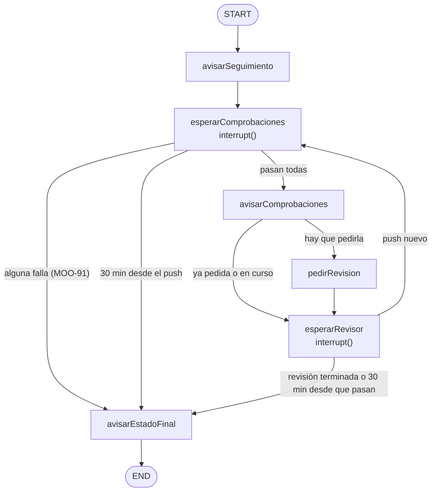

# Design

> Decisiones tomadas al refinar `MOO-81` y al explorar el change con el usuario (27-oct), a partir de
> PB, de D64-D73 y de una prueba en una PR de sparring (#77). La decisión 4 es de `MOO-91`; las demás,
> de `MOO-90`, y `MOO-91` reutiliza la 5.

## Context

- **Lo que hay** (README §2.2, D73): un driver que cada 60 s lee GitHub y reanuda el hilo de cada PR
  con una foto (último SHA, comprobaciones exigidas, estado del revisor y hora). El grafo no consulta
  GitHub y cada aviso va en su propio nodo:

  ```mermaid
  flowchart TD
      S([START]) --> SEG["avisarSeguimiento"]
      SEG --> EC["esperarComprobaciones<br/>interrupt()"]
      EC -- "terminadas (pasen o fallen)" --> AT["avisarComprobaciones"]
      EC -- "30 min desde el push" --> FIN["avisarEstadoFinal"]
      AT --> ER["esperarRevisor<br/>interrupt()"]
      ER -- "push nuevo" --> EC
      ER -- "revisión terminada o 30 min desde el push" --> FIN
      FIN --> E([END])
  ```

- **Lo que no podía cambiar y cambia:** el PAT de GitHub es de solo lectura y el sistema no escribe en
  GitHub (`specs/pr-tracking`, D71). Pedir la revisión es comentar en la PR.
- **Lo que se comprobó el 27-oct en la #77** (PR de sparring, cerrada sin integrar):
  - Una **GitHub App** con *Issues* en escritura no puede comentar en una PR: GitHub responde 403 y
    `x-accepted-github-permissions: issues=write; pull_requests=write`. Hacen falta **los dos**.
  - Con los dos, la App comenta, pero **Codex la rechaza** a los 4 s: *«To use Codex here, create a
    Codex account and connect to github»*. Una App no puede tener cuenta de Codex.
  - El mismo `@codex review` escrito por el mantenedor: Codex pone su bloque `codex-review-state` en
    `running` con el SHA del último push a los 15 s y termina en 1 min. En la #64 y la #67, a los 18 y
    17 s. En la #69, terminó a los 2 min.
  - La *Automatic review* tampoco es fiable: en la #67 y en la #77 contestó *«create an environment»*
    y no revisó. En la #71 (Dependabot) no hizo nada.
- **`pr-stop` (`MOO-74`)** pone la guarda de «PR detenida» en el driver: ningún nodo corre en una PR
  detenida, tampoco el nuevo. Se archiva antes que este change, que toca requisitos distintos de
  `pr-tracking`.

## Goals / Non-Goals

**Goals:**

- Que pedir la revisión sea un nodo más del grafo, con la decisión de si se pide en una regla pura,
  sin que el grafo consulte GitHub (D73).
- Que «no pedirla dos veces» se pueda reconstruir de GitHub tras un reinicio, sin persistencia propia
  (D66), como la etiqueta de `pr-stop`.
- Que el núcleo no sepa qué revisor hay detrás (BA3): «pedir la revisión» es del dominio; `@codex
  review` es del adaptador.

**Non-Goals:**

- Medir cuánto tarda el revisor desde la petición con más PR: los dos relojes reutilizan los 30 min,
  y la medición se rehace si dan falsos «necesita intervención».
- Leer la hora de la petición de GitHub (decisión 5).

## Decisions

### 1. La petición sale con el PAT del mantenedor, firmada y con una marca oculta

- **El comentario** (comprobado en la PR de sparring #87, paso 1.1 de `tasks.md`: el revisor revisa
  el push como con un `@codex review` solo, con disparador *Manual request*, y la firma no cambia la
  revisión):

  ```
  @codex review

  Lo pide el PR Babysitter: las comprobaciones de `abc1234` han pasado.
  <!-- pr-babysitter:review-request {"sha":"<SHA completo>"} -->
  ```

  La primera línea es lo que Codex atiende. La segunda cumple BE4: el autor es el mantenedor, pero el
  texto dice que lo pide el sistema. La marca oculta, con el SHA, es lo que el sistema relee
  (decisión 3) y lo que, con BH4, le servirá para no confundir sus comentarios con los del mantenedor.
- **El token** es el mismo PAT *fine-grained* de D71, limitado a `mood-table-v2`, que pasa a tener
  *Issues* y *Pull requests* en **escritura**. Sigue sin *Contents*: no puede subir commits, y
  integrar por la API exige *Contents* en escritura, cosa que se comprueba a mano (paso 1.11).
- **Alternativas descartadas** (al explorar, 27-oct):
  - *Una GitHub App* (`pr-babysitter[bot]`): BE4 queda clarísimo, pero el revisor no la atiende
    (BA7, #77). Se creó para la prueba y el mantenedor decide si la borra.
  - *Una cuenta de máquina vinculada a ChatGPT*: probablemente sí la atendería, pero cuesta otra
    cuenta de GitHub, otra de ChatGPT con acceso a Codex y su entorno. Se puede añadir más adelante
    sin tocar el núcleo: el token ya lo da un proveedor (`github.ts`).
  - *Un revisor propio en local* (p. ej. con Ollama): elimina BA7, pero choca con PB §5.3 y §6.2 y
    su calidad habría que medirla. Se apunta en la Visión de PB.
- **Debería ser D76** en `docs/idea-mood-table.md` §10 (después de D74 y D75 de `pr-stop`; si este
  change se integra antes, el siguiente libre). Matiza D71 (el PAT ya no es de solo lectura) y
  completa D68.

### 2. Pedir la revisión es un nodo del grafo, detrás de un puerto nuevo



- **Puerto `ReviewRequests`** en `core/ports.ts`, con dos métodos: si el sistema ya ha pedido la
  revisión de un SHA (`requested`) y pedirla (`request`). Lanza como `GitHubReader` (decisión 6).
- **Adaptador** en `adapters/codex-review.ts`, junto al lector del bloque: sabe que la petición es
  `@codex review`, escribe la firma y la marca, y reconoce la marca solo en los comentarios del
  mantenedor (decisión 3). Escribe a través de un `createComment` nuevo del adaptador de GitHub, como
  ya lee a través de `listComments`. Otro revisor (BA3) sería otro adaptador del mismo puerto.
- **En la foto**, un campo nuevo, `reviewRequested`: si hay petición del sistema para el último push.
  Lo rellena el driver en `snapshotOf`, en paralelo con las comprobaciones y la revisión.
- **El nodo `pedirRevision`** va después de `avisarComprobaciones` y antes de `esperarRevisor`, y hace
  una sola cosa: la petición. Como los avisos, nunca va en el nodo que espera: LangGraph repite desde
  el principio el nodo interrumpido, y la petición se repetiría en cada vuelta.
- **Del borrador a lista para revisar** no necesita nada: `isTracked` excluye los borradores, así que
  el driver arranca el hilo al pasar a lista, y con las comprobaciones ya terminadas la primera foto
  lleva directa a pedirla.
- **Alternativa descartada:** pedirla en el driver, fuera del grafo, como hace `pr-stop` con sus
  avisos. Pero la petición depende del punto del seguimiento (después de pasar las comprobaciones de
  un push) y del push que se sigue, que son del grafo.

### 3. No se pide dos veces: dos señales que ya están en GitHub

Una regla pura en `core/tracking.ts`, sobre la foto, decide si hace falta pedirla:

| Señal en la foto | Qué cubre | ¿Se pide? |
|---|---|---|
| El bloque del revisor apunta al último push, **en cualquier estado** (`running` o `completed`) | La *Automatic review* y la petición a mano del mantenedor, en cuanto el revisor empieza | No |
| `reviewRequested`: hay una marca del sistema con el último SHA, en un comentario **del mantenedor** | Las peticiones del propio sistema, también tras un reinicio | No |
| Ninguna de las dos | — | Sí |

- **Solo cuentan las marcas de la cuenta del token** (`GITHUB_MAINTAINER`, porque el PAT es suyo:
  D71). El repo es público: si contara la marca de cualquiera, bastaría copiarla en un comentario para
  que el sistema no pidiera nunca la revisión (BE6).
- **El hueco de unos 18 s, aceptado:** si el mantenedor escribe `@codex review` justo cuando pasan las
  comprobaciones, el sistema puede pedirla también antes de que el revisor marque el push. Un `@codex
  review` sin marca no dice de qué push es, y leerlo sería adivinar. Como mucho, una revisión
  repetida.
- **Un push que cambia en el momento de pedir:** `@codex review` revisa el último push cuando llega,
  no el SHA de la marca. Si cambia justo entonces, el revisor revisa el nuevo, y al pasar sus
  comprobaciones la primera señal evita pedirla otra vez.
- **El revisor atascado en `running`** (#64) cuenta como «ya en curso»: no se vuelve a pedir, y la PR
  acaba por tiempo con «la revisión no ha terminado». Volver a pedirla es de BH4.

### 4. Si falla una comprobación, al estado final sin pasar por la revisión

- `afterChecksWait` distingue **pasan** y **fallan**: hoy devuelve `checksFinished` para las dos.
  Pasan va a `avisarComprobaciones`; fallan, directo a `avisarEstadoFinal`, sin el aviso de
  comprobaciones terminadas (decidido con el usuario: el aviso final ya dice todo, y el de
  comprobaciones terminadas existe para decir «ahora espero al revisor»).
- **`finalState` solo cuenta la revisión si se esperaba**, es decir, si las comprobaciones pasaron
  (decisión 5, `reviewSince`). Si no, nunca dice «la revisión no ha terminado», ni en un fallo ni
  cuando una comprobación no termina a tiempo. Sí dice «el revisor tiene hallazgos» si el revisor ya
  había terminado ese push con hallazgos: es lo que se sabe en ese momento, mientras siga la
  *Automatic review*.
- **Un aviso de fallo con una foto vieja:** si el nodo del aviso se reintenta y entretanto ha llegado
  un push, el aviso es del push anterior. El hilo termina y el driver lo vuelve a empezar con el push
  nuevo, con el aviso de que sigue la PR (`specs/pr-tracking`, *push nuevo*). Se acepta: es el mismo
  caso que ya tiene el estado final.

### 5. Dos relojes con el mismo tiempo de espera

- El push que sigue el hilo (`TrackedPush`) gana un campo, `reviewSince`: la hora de la foto en la que
  el sistema ve pasar las comprobaciones. Lo fija `afterChecksWait`.
- `afterChecksWait` sigue contando desde `seenAt` (el push). `afterReviewWait` cuenta desde
  `reviewSince`. Un push nuevo crea un `TrackedPush` sin `reviewSince`, como hoy.
- **El mismo `TRACKING_TIMEOUT_MINUTES` (30) para los dos.** Las comprobaciones tardaron hasta
  10,5 min y la revisión, desde la petición, de 1 a 2 min en la #69 y la #77. La revisión más lenta
  medida, 20,7 min, contaba desde el push y en paralelo, así que desde la petición es menos.
- **Por qué desde la foto y no desde la fecha del comentario:** el sistema pide la revisión en la
  misma vuelta en la que ve pasar las comprobaciones, así que las dos horas se separan unos segundos.
  Y cuando no la pide (decisión 3), no hay comentario. Tras un reinicio, el hilo vuelve a empezar y
  los relojes con él, como ya acepta D73.
- **Alternativa descartada:** un solo reloj más largo (45-60 min) desde el push. Va contra lo que
  decidió el usuario en `pr-tracking` (enterarse antes de un atasco del revisor).
- Sin D#: es un umbral (BQ5), y va a `docs/umbrales-para-specs.md`.

### 6. Si GitHub rechaza la petición, la PR no se queda parada

| Qué devuelve GitHub | Qué hace el nodo | Qué nota el mantenedor |
|---|---|---|
| 401 (token rechazado) | Lanza `GitHubUnauthorizedError`; el nodo queda pendiente y se reintenta | El aviso de token del issue buzón, como hoy |
| Red, 5xx, límite de la API | Lanza; el nodo queda pendiente y se reintenta en la vuelta siguiente | Nada, si se arregla solo |
| Otro 4xx (p. ej. 403 sin permisos) | Lo deja en el log y sigue a `esperarRevisor` | A los 30 min, «necesita intervención: la revisión no ha terminado» |

- **Por qué no reintentar un 403:** no se arregla solo (el PAT no tiene el permiso), y un nodo
  pendiente para siempre deja la PR sin ningún aviso, que es el fallo de `MOO-50`. Siguiendo a la
  espera, el reloj de la revisión garantiza que el mantenedor se entera.
- **Una petición puede repetirse** si GitHub la acepta pero la respuesta no llega y el nodo se
  reintenta con la foto que tenía. Es el mismo trato que los avisos («MAY llegar dos veces»): raro, y
  como mucho una revisión de más.

### 7. Una lectura más por PR y vuelta

- `requested` lee los comentarios de la PR, igual que el lector del bloque. Son dos lecturas de la
  misma lista por PR y vuelta. Con 3 PR, (1 + 1 + 3 × 3) × 60 = **660 peticiones por hora**, frente a
  480 hoy y a un límite de 5.000.
- **Alternativa descartada:** compartir una lectura entre los dos adaptadores (un puerto que devuelva
  el bloque y la marca juntos, o una caché por vuelta). Ahorra 180 peticiones por hora que sobran, a
  cambio de mezclar dos responsabilidades o de añadir estado en los adaptadores.

## Las cinco decisiones de arquitectura

| Decisión | En esta historia |
|---|---|
| **1. Qué se reparte entre agentes** | Nada: sigue sin haber agentes. La revisión la hace un servicio externo, al que el sistema solo se la pide. |
| **2. Qué contexto recibe cada uno, y si es incorrecto** | El grafo recibe en la foto si la revisión ya está pedida o en curso. Si la foto es vieja, el peor caso es una petición repetida (decisiones 3 y 6). |
| **3. Dónde vive el estado, y si algo falla a mitad** | En GitHub: el bloque del revisor y la marca de la petición. Tras un reinicio se relee; una petición que falla por la red se reintenta, y una que GitHub rechaza deja que el reloj avise (decisión 6). |
| **4. Qué decisiones no necesitan LLM** | Todas: si se pide, cuándo y qué estado final toca son reglas puras. |
| **5. Cuándo vuelve el control a la persona** | Cuando falla una comprobación, cuando la revisión no termina a tiempo y, como siempre, en el estado final. |

## Risks / Trade-offs

- **[El revisor lee la firma como instrucciones de la revisión]** (`@codex review` admite un foco
  detrás) → El paso 1.1 prueba el texto exacto en una PR de sparring antes de escribir el adaptador.
  Si la lee, la firma va antes de la mención o se queda solo la marca oculta.
- **[En GitHub, la petición parece del mantenedor]** → La firma dice que es del sistema, y la marca
  lo dice a máquina. Cuando BH4 atienda los comentarios del mantenedor (`MOO-79`), tiene que ignorar
  los que llevan la marca: se anota al refinar esa historia.
- **[El PAT puede más cosas]** → Con *Issues* y *Pull requests* en escritura puede, por ejemplo,
  cerrar una PR o quitarle la etiqueta `babysitter:stop`. El código solo crea comentarios, y el
  requisito «solo escribe en GitHub para pedir la revisión» lo fija. No puede subir commits ni
  integrar (paso 1.11).
- **[Mientras siga la *Automatic review*]** → Suele empezar antes de que pasen las comprobaciones, y
  la primera señal de la decisión 3 evita la petición. Si no ha empezado, se pide y el revisor puede
  revisar dos veces ese push. Se acaba al apagarla (*Migration Plan*).
- **[El revisor atascado en `running`]** → Aceptado: acaba por tiempo y lo resuelve BH4.
- **[`pr-stop` y este change modifican `pr-tracking`]** → Tocan requisitos distintos, y `pr-stop` se
  archiva antes (`MOO-74` bloquea `MOO-81`). Si el orden cambia, el `openspec archive` de este change
  se revisa a mano.

## Migration Plan

1. **Antes de las pruebas a mano**, el mantenedor da al PAT *Issues* y *Pull requests* en escritura
   (GitHub → *Settings* → *Developer settings* → *Fine-grained tokens*) y lo actualiza en el `.env`
   del contenedor si lo regenera.
2. **Desplegar:** reconstruir la imagen y `docker compose up -d` (README §2.4). No hay nada que
   migrar.
3. **Con las dos tareas integradas**, el mantenedor apaga la *Automatic review* en los ajustes de Codex
   (D68). Desde entonces, el revisor solo revisa cuando se lo pide el sistema o el mantenedor.
4. **Volver atrás:** la imagen anterior, y el PAT otra vez de solo lectura. Si ya se apagó la
   *Automatic review*, volver a encenderla.
