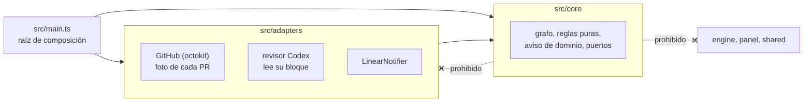
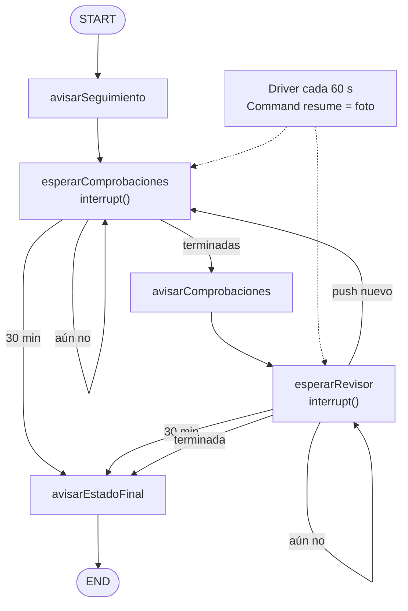

# Design

> Decisiones tomadas al explorar el change con el usuario (25-oct), a partir de `MOO-73`, de PB y de
> las decisiones D63-D69. Por tarea: `MOO-83` (paquete, contenedor, credenciales, polling y canal)
> 1, 2, 3, 4, 5, 9 y 10 · `MOO-84` (seguimiento hasta el estado final) 6, 7 y 8. La decisión 9 la
> monta `MOO-83` con el primer aviso, y `MOO-84` la completa.

## Context

- **No hay nada construido.** PB es una épica nueva (D63). D64 (no integra), D65 (TypeScript y
  LangGraph.js, un hilo por PR, `interrupt()`, *checkpointer* de SQLite) y D66 (contenedor, polling,
  GitHub como fuente de verdad) fijan el marco. Lo que queda abierto es el canal (BQ1) y la forma
  concreta.
- **Lo que GitHub da, comprobado en la API y en las PR #57-#68:**
  - Las comprobaciones que exige `main` salen del *ruleset* (`GET /repos/{o}/{r}/rules/branches/main`).
    Hoy son seis: `lint`, `typecheck`, `test`, `e2e`, `sonar-issues` y `SonarCloud Code Analysis`.
    Cada una es un *check run* del SHA (`GET …/commits/{sha}/check-runs`). En un repo público se
    pueden leer sin permisos; el token sirve para el límite de 5000 peticiones por hora.
  - Codex deja **un único comentario** por PR, de `chatgpt-codex-connector[bot]`, que va editando. Su
    bloque `<!-- codex-review-state:v1 {…} -->` lleva `code_review.commit_sha`, `status`
    (`running`, `completed`), `has_any_findings` y `has_unresolved_findings`.
  - En 3 de 12 PR (#64, #65, #67) el bloque se quedó en `running` y la PR se integró. En la #67, Codex
    dejó además un comentario de que el repo no tenía entorno. En la #62, `has_unresolved_findings`
    seguía en `true` con los hilos ya resueltos: no sigue a los hilos.
  - Tiempos desde el push (aproximados, con la fecha del commit): comprobaciones de 1,7 a 10,5 min, y
    Codex `completed` sobre el último push de 1,3 a 20,7 min.
- **Lo que Linear da, comprobado en su documentación:** una app OAuth con `actor=app` publica como la
  app y no como quien la instala. Con el *grant* `client_credentials` se obtiene un token de servidor
  a servidor sin navegador, que dura 30 días. La integración de GitHub ya guarda cada PR como
  *attachment* de su tarea (MOO-82 tiene la #68), y `attachmentsForURL` lo encuentra por la URL. La API
  de *Agents* de Linear funciona solo con webhooks.
- **El repo:** `packages/*` entra solo en Vitest, la cobertura, Sonar, `pnpm typecheck` y la CI. La
  regla de fronteras declara cada elemento a mano (`eslint.config.js`). El motor ejecuta TypeScript
  directamente con Node 24 (`node src/main.ts`), sin compilar.

Motivación y alcance: `proposal.md`. Requisitos: `specs/pr-tracking`, `specs/module-boundaries` y
`specs/quality-gates`.

## Goals / Non-Goals

**Goals:**

- Que toda la lógica de seguimiento sean funciones puras sobre una foto de GitHub, probadas con
  Vitest sin red, sin LangGraph y sin reloj real.
- Que el núcleo no sepa nada de Codex, GitHub ni Linear: cambiar de revisor (BA3) o de canal es
  cambiar un adaptador.
- Dejar montado lo que reutilizan BH2-BH5: el paquete, el contenedor, el driver, el grafo con un hilo
  por PR y el puerto de aviso.

**Non-Goals:**

- **Persistir el estado** (`SqliteSaver`): llega con BE7.
- **Un modelo común de hallazgo** (pieza 3 del borrador del stack): en esta historia solo importa si
  el revisor tiene hallazgos, no cuáles. Se diseña en BH2.
- **Observabilidad y trazas** (LangSmith o Langfuse): sin LLM no hay qué trazar. Se decide en BH2,
  que es donde BE4 lo pide.

## Decisions

### 1. Avisar por Linear, con una app propia que solo puede comentar

El canal de aviso (BQ1) es **Linear**. Lo publica una **app OAuth propia** instalada con `actor=app`,
que se autentica con `client_credentials` y los scopes `read` y `comments:create`. El adaptador pide
el token al arrancar y lo renueva solo, antes de que caduque o al recibir un 401.

- **Por qué Linear:** el mantenedor ya vive allí, el aviso queda en la tarea de la PR (sirve de
  registro), llega al móvil con la app de Linear y, en BH4, la respuesta irá en el hilo del aviso, así
  que el sistema sabrá a qué PR contesta sin cruzar identificadores (BE9, BQ4).
- **Por qué una app y no la API key del mantenedor:** con su cuenta, los comentarios salen a su
  nombre y Linear no notifica a nadie de sus propios comentarios. El aviso no llegaría.
- **Por qué `comments:create`:** «solo comentarios» deja de ser una convención y pasa a ser lo que el
  token permite. Mover estados en Linear es otra historia (pregunta nueva de PB). La integración de
  GitHub ya mueve `In Progress`, `In Review` y `Done`, y dos escritores sobre el mismo estado se
  pisarían.
- `docs/instructions/linear.md` tiene una sección nueva para este actor. La §8 sigue siendo la de
  Claude Code por MCP: son dos actores con tokens distintos.

**Alternativas descartadas:**

- **Telegram:** también sirve para avisar y para contestar por polling, pero los avisos no quedan
  junto a la tarea.
- **ntfy:** el más simple para avisar, pero contestar por él es incómodo, y BE9 pide el mismo canal
  para avisar y escalar.
- **Un comentario en la PR:** necesita una identidad propia en GitHub (App o cuenta bot), porque con
  el PAT del mantenedor GitHub no le avisa de sus propios comentarios. Además, mete unos tres
  comentarios por push en la PR que lee Codex.
- **La API de *Agents* de Linear:** solo funciona con webhooks (D66).

**→ D70** en `docs/idea-mood-table.md`, junto con la decisión 2.

### 2. Cada aviso va a la tarea de la PR y pasa por un puerto

- **Destino:** la tarea que devuelve `attachmentsForURL` con la URL de la PR. Si no hay ninguna (una
  PR sin enlazar) o el aviso no es de una PR (decisión 3), va al **issue buzón**: un issue fijo del
  proyecto, «PR Babysitter · avisos del sistema», cuyo ID está en la configuración. **No es hijo de
  `MOO-67`**: abierto para siempre, impediría que la épica se cerrara sola (*parent auto-close*).
- **Mención:** cada aviso menciona al mantenedor (su usuario de Linear, en la configuración). Así la
  notificación llega aunque no esté suscrito a esa tarea.
- **Puerto `Notifier`** en el núcleo: recibe un **aviso de dominio** (la PR con número, título y URL;
  el tipo: sigue, comprobaciones terminadas o estado final; el estado y el motivo) y lo publica.
  `LinearNotifier` es el único adaptador. Otro canal sería otro adaptador y una línea de
  configuración, y varios a la vez, un adaptador que reparte. **Solo envía:** la respuesta del
  mantenedor se diseña en BH4, con el caso real delante.
- **Texto**, en español, una línea por dato. Por ejemplo:

  ```text
  @mantenedor · #74 · Avisar de cada PR lista para revisar
  Necesita intervención: falla e2e
  https://github.com/7daysofrain/mood-table-v2/pull/74
  ```

**Alternativas descartadas:** sacar la tarea de `Fixes MOO-n` en la descripción de la PR. No cubre
las PR de archivado (`Refs MOO-n`), y duplica un enlace que la integración ya guarda. Poner el buzón
como hijo de la épica (ver arriba).

### 3. Credenciales mínimas: GitHub de solo lectura

- **GitHub:** un PAT *fine-grained* del mantenedor, limitado a `mood-table-v2`, con permisos de
  **solo lectura** (Metadata y Pull requests). Los tokens *fine-grained* no ofrecen el permiso Checks
  (es solo de GitHub Apps), y no hace falta: en un repo público, los *check runs* se leen sin permiso
  propio (comprobado el 25-oct sin token). En esta historia el sistema no escribe nada en GitHub, así
  que D64 se cumple sin matices: ni integrar, ni hacer push, ni comentar.
- **Linear:** ver la decisión 1.
- **Secretos** en variables de entorno del contenedor, desde un `.env` que no se commitea. Hay un
  `.env.example` con los nombres y sin valores.
- **Si GitHub rechaza el token (401)**, el sistema avisa **una vez** al issue buzón de que no puede
  leer GitHub, y sigue intentándolo en cada vuelta. Cuando vuelve a leer, puede avisar otra vez si
  vuelve a fallar. Sin este aviso, un token caducado pararía el sistema en silencio, que es el fallo
  de `MOO-50`.

**Riesgo para BH3, apuntado en PB como pregunta abierta:** para hacer push hace falta
`Contents: write`, y ese permiso también deja integrar PR por la API. En GitHub no existe «push sí,
merge no» en el token. En BH3, «sin permiso de merge» (D64, PB §6.2) tendrá que salir del *ruleset* u
otro mecanismo, y BE4 (comentarios que se identifican como del sistema) apunta a una GitHub App.

**Alternativas descartadas:** montar ya la GitHub App (clave privada, JWT, token de instalación) para
algo que esta historia no necesita. El cliente de GitHub recibe el token de un proveedor, así que
cambiarlo en BH3 es tocar un adaptador. También se descarta un PAT sin permisos para repos públicos:
leería cualquier repo, y PB pide limitarlo a este.

**→ D71.**

### 4. Fallos: GitHub se salta la vuelta y Linear recibe cada aviso al menos una vez

- **Si falla una lectura de GitHub** (red, 5xx, límite de la API), el driver se salta esa vuelta para
  las PR afectadas: no reanuda ningún hilo con una foto incompleta. El tiempo de espera solo se evalúa
  con una foto buena. Si GitHub está caído mucho rato, al volver puede llegar un «necesita
  intervención» por tiempo agotado, y eso es verdad: nadie terminó a tiempo.
- **Si Linear no acepta un aviso,** el nodo del aviso falla y LangGraph se queda en el último
  checkpoint bueno, con ese nodo pendiente. En la vuelta siguiente, el driver ve el nodo pendiente
  (`getState`) y lo vuelve a ejecutar antes de reanudar nada más. Si Linear guardó el comentario pero
  la respuesta se perdió, el aviso llega dos veces. Se acepta: **un aviso repetido molesta, uno
  perdido es el fallo de `MOO-50`**.
- **Si se cae el proceso,** Docker lo reinicia (`restart: unless-stopped`) y el estado se reconstruye
  desde GitHub (decisión 9).

**Alternativas descartadas:** deduplicar los avisos leyendo los comentarios de Linear antes de
publicar. Es más código y otra lectura por aviso, para evitar un duplicado que casi nunca pasará.

### 5. Un paquete del monorepo con sus propias fronteras y zod solo dentro

`packages/pr-babysitter` (`@moodtable/pr-babysitter`), con la misma forma que el motor:



- **Fronteras** (`specs/module-boundaries`): elementos nuevos `pb-core`, `pb-adapter` y `pb-main` en
  `eslint.config.js`. El núcleo solo importa del núcleo. El paquete no importa nada de `engine`,
  `panel` ni `shared`, y ninguno de ellos importa de él. Con sus casos en
  `tooling/boundaries.test.ts`.
- **Validación con zod, solo en este paquete:** `StateSchema` de LangGraph lo usa (D65). Con zod se
  valida también lo que llega de fuera: el JSON del bloque de Codex y las respuestas de GitHub y
  Linear. TypeBox sigue en el motor y en `shared`. Como los paquetes no se importan entre sí, las dos
  librerías no se cruzan nunca. zod pasa al catalog (hoy solo está como dependencia transitiva).
- **Se ejecuta como el motor:** `node src/main.ts`, sin compilar.
- **Cobertura:** solo `src/main.ts` queda fuera, igual en `vitest.config.ts` y en
  `sonar-project.properties`. Los adaptadores de red **no** van a `*.hardware.ts`: se prueban con
  fixtures, entre ellos los comentarios reales de Codex de #57-#68 (`running`, `completed` con y sin
  hallazgos, SHA de un push anterior) y respuestas grabadas de GitHub y Linear.

**Alternativas descartadas:**

- **Un repo aparte:** duplica la CI, Sonar, el lint y pnpm, y saca el sistema de lo que se evalúa
  (ejes 2 y 3).
- **TypeBox también aquí:** dos librerías de validación en el mismo paquete, y LangGraph pide zod de
  todas formas.

**→ D72.**

### 6. Las comprobaciones salen del *ruleset* de `main`

En cada vuelta, el adaptador de GitHub lee las comprobaciones que exige `main` y, para cada PR, los
*check runs* de su último SHA. La foto lleva, por cada comprobación exigida, si ha terminado y si ha
pasado. Una comprobación **termina** cuando tiene un *check run* completado. **Pasa** si su conclusión
es `success`, `neutral` o `skipped` (`sonar-issues` se salta y cuenta como superada, `linear.md` §7).
**Si una exigida no tiene *check run*, no ha terminado.**

- **Por qué del *ruleset*:** justo después de un push todavía no hay *check runs*. Con «todos los que
  haya», una lista vacía daría por terminadas las comprobaciones. Además, es una sola fuente de
  verdad: si se añade una comprobación al *ruleset*, el sistema la espera sin cambiar código.

**Alternativas descartadas:** una lista fija en la configuración, que se desincroniza del *ruleset*;
y «todos los *check runs* del SHA», que da el falso «terminadas» de antes.

Sin D#: es un detalle de esta capability (`specs/pr-tracking`).

### 7. El revisor se lee de un único comentario, y lo que no se entiende no ha terminado

El adaptador del revisor lee **solo** los comentarios de la cuenta del revisor
(`chatgpt-codex-connector[bot]`, en la configuración) y saca de su bloque `codex-review-state` un
estado de dominio: **SHA revisado**, **terminada o no** y **con hallazgos o no**.

- **Terminada** = `status` es `completed` y `commit_sha` es el último SHA de la PR. Es la comprobación
  de `workflow.md` §4.4, más estricta.
- **Con hallazgos** = `has_any_findings`. No se usa `has_unresolved_findings`, que no sigue a los hilos
  (#62).
- **Sin bloque, o con un JSON que no pasa zod** = no ha terminado. El sistema no se rompe ni inventa
  un estado. Al final se agota el tiempo y el aviso dice que la revisión no ha terminado (el caso de la
  #67).
- **BE6 por estructura:** los comentarios de otras cuentas no llegan al núcleo. Un usuario de GitHub no
  puede tener `[bot]` en su login, así que filtrar por esa cuenta no se puede suplantar.
- **BA3:** el núcleo solo ve el estado de dominio. Cambiar de revisor es otro adaptador y otra cuenta
  en la configuración.

Sin D#: aplica `workflow.md` §4.4 y BA1, que ya existen.

### 8. Polling cada 60 s y un tiempo de espera de 30 min

- **Polling cada 60 s**, configurable. Cada vuelta hace una petición para la lista de PR abiertas,
  una para el *ruleset* y dos por cada PR seguida (*check runs* y comentarios). Con 3 PR son unas 480
  peticiones por hora, frente a un límite de 5000. Un minuto de retraso en un aviso no le cambia nada
  al mantenedor.
- **Un solo tiempo de espera de 30 min**, configurable, para comprobaciones y revisión juntas. Cuenta
  desde que el sistema **ve** el push (la primera foto con ese SHA), no desde la fecha del commit, que
  puede ser anterior al push. Es algo menos del doble del peor caso medido (20,7 min). El usuario lo
  bajó de 45 a 30 min: prefiere enterarse antes de un atasco de Codex (3 de cada 12 PR) aunque alguna
  revisión lenta dé un «necesita intervención» de más.
- Los dos números van a `docs/umbrales-para-specs.md`, con la medición.

Sin D#: son umbrales (BQ5), y su sitio es `docs/umbrales-para-specs.md`.

### 9. Un grafo de LangGraph con un hilo por PR, despertado por el driver



- **Un hilo por PR** (`thread_id` = número de la PR). No uno por push: BH3 y BH4 necesitan memoria
  entre pushes («se agotan N iteraciones», «la misma comprobación falla dos veces seguidas», PB §4.1).
- **El grafo no consulta GitHub.** El driver lee GitHub y reanuda cada hilo con
  `Command({ resume: foto })`. La foto lleva el SHA del último push, si es borrador, las comprobaciones
  (decisión 6), el estado del revisor (decisión 7) y la hora. Con la hora dentro de la foto, el tiempo
  de espera se prueba sin relojes falsos.
- **Las aristas condicionales son funciones puras** `(estado, foto) → siguiente nodo`, con sus propios
  tests de Vitest, sin LangGraph. Cubren casi todos los escenarios de `specs/pr-tracking`.
- **Cada aviso va en su propio nodo, nunca en el que espera.** Al reanudar, LangGraph ejecuta otra vez
  el nodo interrumpido desde el principio: un aviso antes de un `interrupt()` en el mismo nodo se
  repetiría en cada vuelta.
- **Lo que decide el driver, fuera del grafo:**
  - Una PR que aparece (abierta, del mantenedor, contra `main` y no borrador) y no tiene hilo activo:
    arranca el hilo. También al arrancar el proceso, para cada PR que ya estaba abierta.
  - Un hilo terminado (END) cuya PR tiene un SHA distinto del que cerró: arranca otra ejecución en el
    mismo hilo, que empieza por el aviso de seguimiento.
  - Una PR que deja de estar en la lista (cerrada o integrada) o que vuelve a borrador: se deja de
    seguir sin avisar. Si vuelve a estar lista, se trata como nueva. Lo de volver a borrador es
    *(asumido)*: la historia no lo dice, y avisar de algo que el mantenedor acaba de hacer él mismo
    sería ruido.
  - Un hilo con un nodo de aviso pendiente (decisión 4): se reintenta antes de nada.
- **`MemorySaver`** en memoria, porque `interrupt()` necesita un *checkpointer*. Al reiniciar se pierde
  todo y el driver reconstruye desde GitHub. Se repite el aviso de seguimiento, como acepta el non-goal
  de BE7, y el tiempo de espera vuelve a contar desde el reinicio. Pasar a `SqliteSaver` (D65) en BE7
  es cambiar una línea en la raíz de composición.

**Alternativas descartadas:**

- **Un reductor puro sin LangGraph hasta BH2:** es más simple e igual de testeable, pero BH2 tendría
  que rehacer el esqueleto. Además, la forma «esperar algo de fuera» con `interrupt()` es la misma que
  usará BH4, y aquí se aprende sin un LLM de por medio. Las aristas son ese reductor repartido, así que
  si LangGraph diera problemas la lógica se salvaría entera.
- **Un hilo por push:** el push nuevo saldría casi gratis, pero se pierde la memoria entre pushes que
  necesitan BH3 y BH4.

**→ D73.** Matiza D65: el `SqliteSaver` llega con BE7, y hasta entonces el *checkpointer* es en
memoria.

### 10. Un contenedor con Docker Compose

- `packages/pr-babysitter/Dockerfile` construye desde la raíz del monorepo con
  `pnpm deploy --filter @moodtable/pr-babysitter`, de forma que la imagen lleva solo ese paquete y sus
  dependencias, sobre Node 24.
- `packages/pr-babysitter/compose.yaml`: un servicio con `env_file: .env` y
  `restart: unless-stopped`. No abre ningún puerto (D66).
- Corre en una máquina de casa durante el desarrollo (D66). Cuál es una pregunta abierta: no cambia
  nada de este change.

Sin D# propia: aplica D66.

## Las cinco decisiones de arquitectura

| Decisión | En esta historia |
|---|---|
| **1. Qué se reparte entre agentes** | **Nada: no hay ningún agente.** El grafo es un flujo determinista. BH2 añade el primer LLM (el triador). |
| **2. Qué contexto recibe cada uno, y si es incorrecto** | El grafo solo ve la foto (decisión 9). Un bloque del revisor ausente o ilegible cuenta como no terminado. Los comentarios ajenos no llegan al núcleo (decisión 7). |
| **3. Dónde vive el estado, y si algo falla a mitad** | `MemorySaver`, con GitHub como fuente de verdad. Un fallo de GitHub se salta la vuelta; un aviso que falla se reintenta, al menos una vez; si el proceso se cae, se reinicia y se reconstruye (decisiones 4 y 9). |
| **4. Qué decisiones no necesitan LLM** | **Todas:** qué PR seguir, push nuevo, comprobaciones, revisor, tiempo de espera, estado final, motivo y texto del aviso. |
| **5. Cuándo vuelve el control a la persona** | Con el estado final «necesita intervención» (falla una comprobación, el revisor tiene hallazgos o se agota el tiempo), cuando el sistema no puede leer GitHub, y siempre en el merge (D64). |

## Risks / Trade-offs

- **[Codex se atasca en `running` en 3 de 12 PR]** → Cada atasco da un «necesita intervención» a los
  30 min, con el motivo. Es justo lo que hoy pasa sin que nadie se entere.
- **[El formato del bloque de Codex no está documentado y puede cambiar]** → zod lo valida, y si no
  pasa cuenta como no terminado, sin romperse. Los fixtures reales hacen que un cambio de formato
  rompa un test y no pase en silencio.
- **[La mención de una app en Linear podría no notificar como la de una persona]** → Se comprueba en la
  prueba a mano de `MOO-83`. Si no notifica, se añade al mantenedor como suscriptor de la tarea antes
  de comentar, lo que necesitaría el scope `write` (y habría que volver a hablarlo).
- **[Un aviso puede llegar dos veces]** → Aceptado (decisión 4).
- **[Tras un reinicio se repiten avisos y el tiempo de espera vuelve a empezar]** → Aceptado hasta BE7.
- **[El PAT caduca]** → Aviso al buzón (decisión 3). La fecha de caducidad la elige el usuario al
  crearlo.
- **[Los tests del paquete corren en cada PR del producto]** → Son milisegundos, sin red ni LLM.
- **[`attachmentsForURL` devuelve varias tareas para la misma PR]** → Se usa la primera y se anota en
  el log. Con una tarea por PR (`workflow.md` §2) no debería pasar.

## Migration Plan

No hay nada que migrar. Antes de `MOO-83`, el usuario prepara a mano lo que pide ser admin o crear
credenciales:

1. La app OAuth en Linear, con `actor=app`, *client credentials* activadas y los scopes `read` y
   `comments:create`.
2. El PAT *fine-grained* en GitHub (solo `mood-table-v2`, solo lectura).
3. El issue buzón en el proyecto *Mood Table* (lo puede crear el agente si el usuario se lo pide).

Para desplegar: `.env` en la máquina de casa y `docker compose up -d`. Para quitarlo:
`docker compose down`. El sistema no escribe en GitHub, así que pararlo no deja nada a medias.

## Open Questions

- **En qué máquina de casa corre** (sistema operativo, si está siempre encendida). No cambia el
  código: es el `compose.yaml` donde sea.
