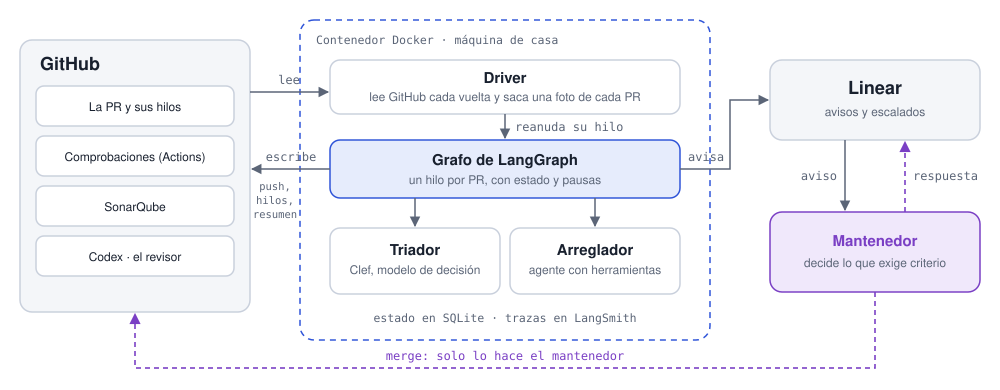
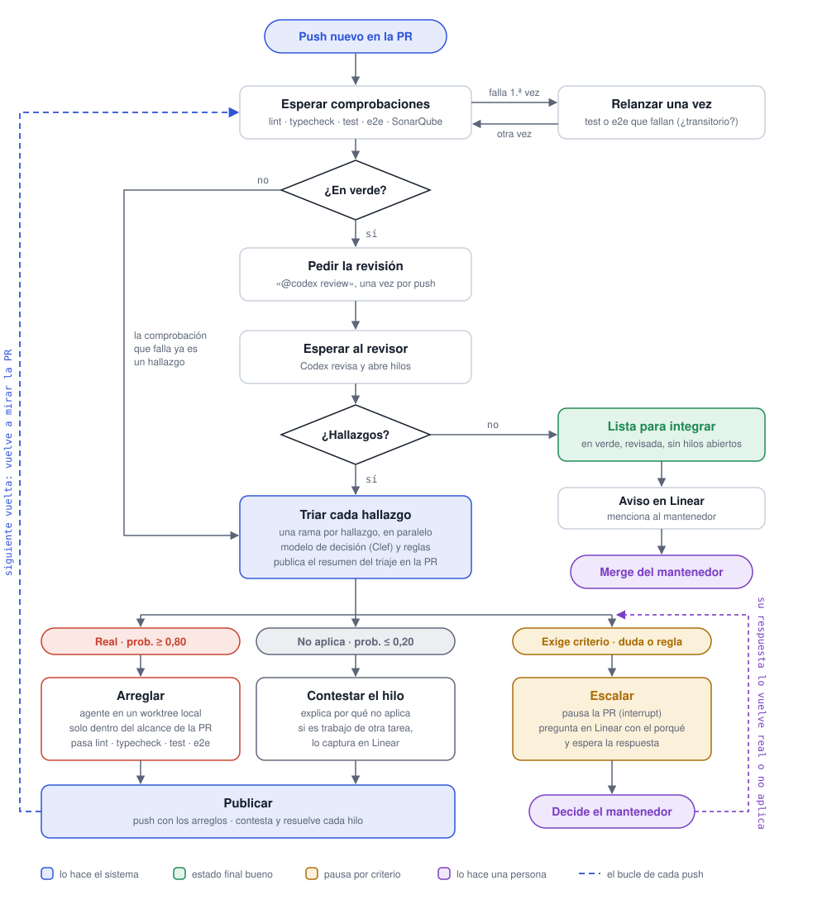

# PR Babysitter

Conduce cada PR desde que se abre hasta dejarla **lista para integrar**: espera a las comprobaciones,
pide la revisión, tría cada hallazgo, arregla lo que es real y pregunta al mantenedor solo lo que exige
criterio. **El merge siempre es del mantenedor.**

El qué y el porqué están en [`docs/pr-babysitter.md`](../../docs/pr-babysitter.md) (documento `PB`:
expectativas, política de escalado, glosario). Las decisiones técnicas, en
[`docs/idea-mood-table.md`](../../docs/idea-mood-table.md) §10, de D63 en adelante. Este README solo
enseña cómo encajan las piezas.

## Quién habla con quién

- **GitHub** es la fuente de verdad. El sistema lo consulta por polling y no abre nada hacia dentro.
- **Driver:** en cada vuelta lee las PR abiertas, saca una foto de cada una y reanuda su hilo del grafo.
- **Grafo de LangGraph:** un hilo por PR, con estado entre pushes y pausas con `interrupt()`.
- **Triador:** clasifica cada hallazgo con un modelo de decisión (Clef) y reglas en código.
- **Arreglador:** un agente con herramientas que arregla en un worktree local y publica.
- **Linear:** avisa al mantenedor y recoge su respuesta cuando escala.

En el código, `src/core` tiene el grafo, el driver y el triaje sin E/S; `src/adapters`, las
integraciones (GitHub, Linear, modelo de decisión), y `src/main.ts` los une.

## Qué pasa con cada push

Cada push recorre el grafo hasta un estado final. Si el arreglador publica, hay un push nuevo y el bucle
vuelve a empezar, hasta que la PR queda lista o hace falta el mantenedor. Qué hace cada nodo lo fijan las
specs [`pr-tracking`](../../openspec/specs/pr-tracking/spec.md) y
[`pr-triage`](../../openspec/specs/pr-triage/spec.md).

> A 21-nov-2026 funcionan el seguimiento, la petición de revisión, el relanzamiento y el triaje en modo
> sombra. Arreglar (BH3) y escalar (BH4) están por construir.
