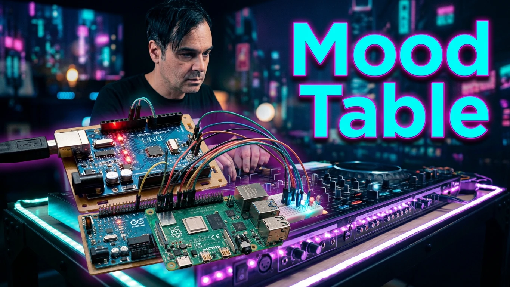
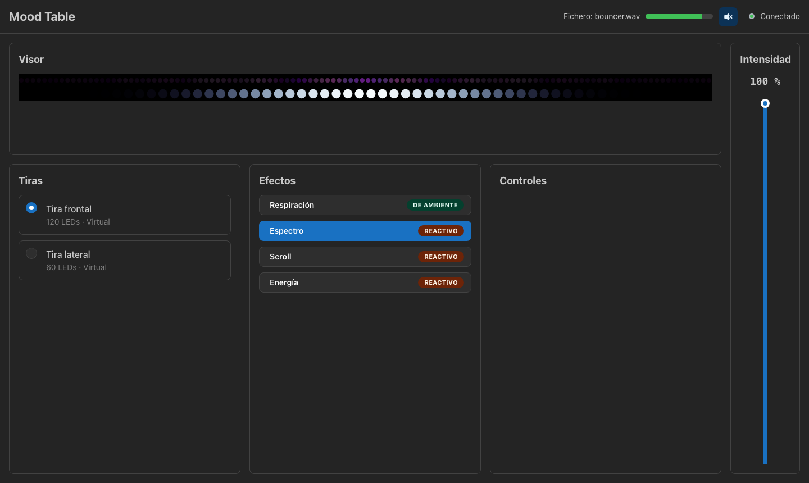
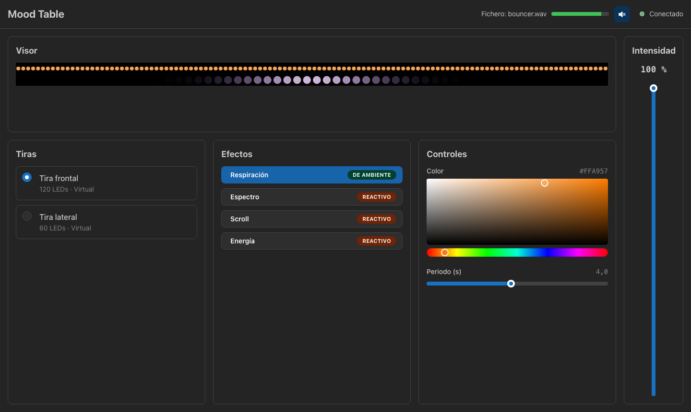
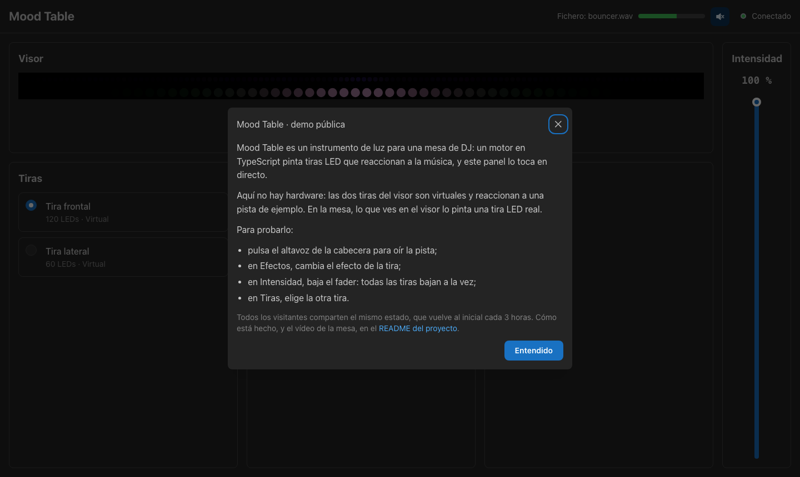
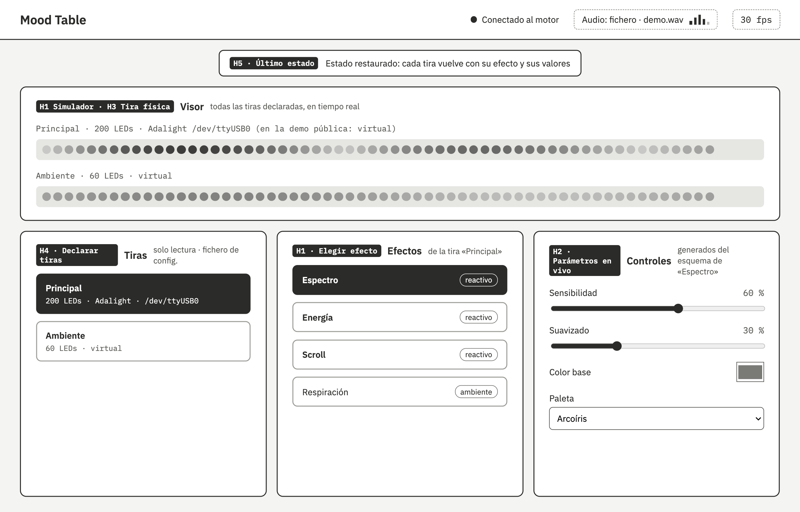
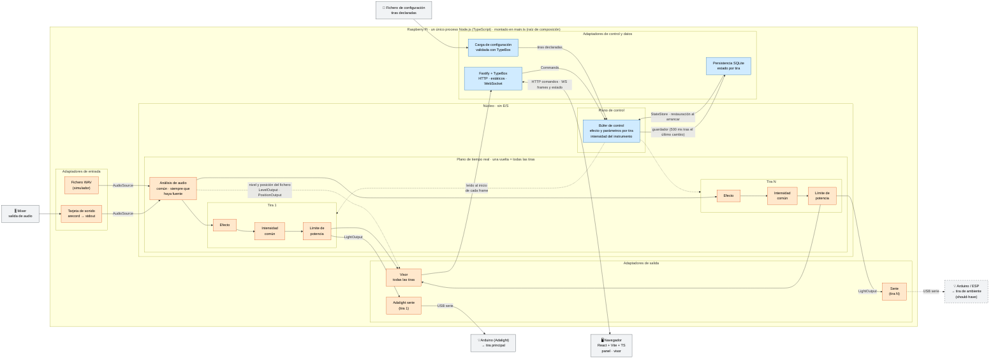
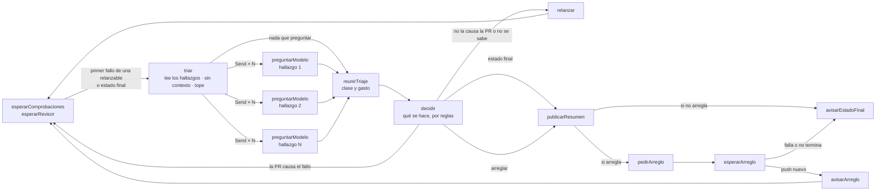
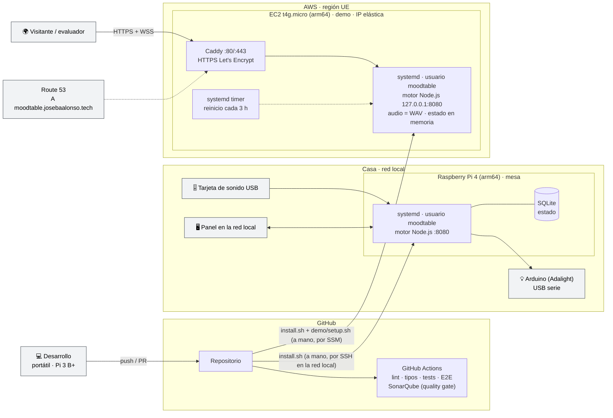
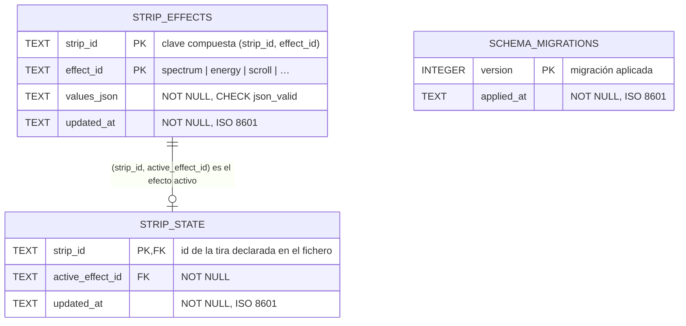

<h1 align="center">Mood Table</h1>

<p align="center">
  <a href="https://youtu.be/SKcjWI1v5Rw">
    
  </a>
</p>

<p align="center">
  <strong>Instrumento de luz para la mesa de DJ.</strong><br>
  Tiras LED que reaccionan a la música, tocadas en directo desde un panel web, en una Raspberry Pi y sin conexión.
</p>

<p align="center">
  <a href="https://moodtable.josebaalonso.tech"></a>
  <a href="https://youtu.be/SKcjWI1v5Rw"></a>
  <a href="https://github.com/7daysofrain/mood-table-v2/actions/workflows/ci.yml"></a>
  <a href="https://sonarcloud.io/summary/new_code?id=7daysofrain_mood-table-v2"></a>
  <a href="https://sonarcloud.io/summary/new_code?id=7daysofrain_mood-table-v2"></a>
</p>

<p align="center">
  <a href="https://youtu.be/SKcjWI1v5Rw">Ver el vídeo de la mesa</a> ·
  <a href="https://moodtable.josebaalonso.tech">Probar la demo</a> ·
  Proyecto final del máster <strong>AI4Devs</strong> (LIDR)
</p>

## Índice

0. [Ficha del proyecto](#0-ficha-del-proyecto)
1. [Descripción general del producto](#1-descripción-general-del-producto)
2. [Arquitectura del sistema](#2-arquitectura-del-sistema)
3. [Modelo de datos](#3-modelo-de-datos)
4. [Especificación de la API](#4-especificación-de-la-api)
5. [Historias de usuario](#5-historias-de-usuario)
6. [Tickets de trabajo](#6-tickets-de-trabajo)
7. [Pull requests](#7-pull-requests)

---

## 0. Ficha del proyecto

### **0.1. Tu nombre completo:**

Joseba Alonso

### **0.2. Nombre del proyecto:**

Mood Table

### **0.3. Descripción breve del proyecto:**

Instrumento de luz para la mesa de DJ: un motor de efectos propio, reactivo a la música, que se toca en vivo y funciona sin conexión. En el MVP se controla desde un panel web local; la visión es tocarlo con una pantalla táctil en la mesa o un controlador tipo Traktor F1, que se conectarán al mismo puerto de mandos. Un simulador (audio desde fichero + tiras virtuales en el visor del navegador) permite desarrollarlo y demostrarlo sin hardware.

Del propio desarrollo nació un segundo sistema, el **PR Babysitter**: un agente que sigue cada PR del repo hasta dejarla lista para integrar. No es producto, sino la herramienta con la que se construye la Mood Table (§1.5).

### **0.4. URL del proyecto:**

**https://moodtable.josebaalonso.tech**: la demo pública, sin login. El motor reproduce un fichero de audio y pinta dos tiras virtuales en el visor; se toca desde el mismo panel que la mesa. Cómo probarla, en §1.4; cómo está desplegada, en §2.4.

> Puede ser pública o privada, en cuyo caso deberás compartir los accesos de manera segura. Puedes enviarlos a [alvaro@lidr.co](mailto:alvaro@lidr.co) usando algún servicio como [onetimesecret](https://onetimesecret.com/).

### 0.5. URL o archivo comprimido del repositorio

https://github.com/7daysofrain/mood-table-v2

> Puedes tenerlo alojado en público o en privado, en cuyo caso deberás compartir los accesos de manera segura. Puedes enviarlos a [alvaro@lidr.co](mailto:alvaro@lidr.co) usando algún servicio como [onetimesecret](https://onetimesecret.com/). También puedes compartir por correo un archivo zip con el contenido


---

## 1. Descripción general del producto

> Describe en detalle los siguientes aspectos del producto:

*La fuente de verdad del producto (problema, alternativas, usuarios, expectativas, historias y alcance) es el [PRD](docs/PRD.md). Esta sección lo resume.*

### **1.1. Objetivo:**

> Propósito del producto. Qué valor aporta, qué soluciona, y para quién.

**Propósito.** Mood Table convierte la mesa de DJ en un instrumento de luz: la tira LED reacciona a la música que suena y el DJ modula esa reacción en tiempo real, igual que modula el sonido con el mixer.

**Qué soluciona.** Es la reescritura de un proyecto personal (2021-2024) que funcionaba pero era una amalgama de piezas ajenas: Hyperion para el ambiente, dancyPi para la parte reactiva, un orquestador Node que las unía por sockets, y la configuración repartida en cuatro sitios, cada uno con su propia cuenta de LEDs. Añadir un efecto propio obligaba a meterse en las tripas de un tercero y, sobre todo, no se podía probar nada sin la mesa montada. Mood Table lo sustituye por una pieza central propia: un motor con un único modelo de tira y de estado, donde cada efecto es código con sus parámetros declarados.

**Alternativas.** Hay herramientas maduras que hacen buena parte de lo mismo; la más cercana es [LedFx](https://docs.ledfx.app/) (Python + React, en una Raspberry Pi, con panel web y salida Adalight). Mood Table no pretende competir con ellas: se construye por **propiedad** (un instrumento propio, pequeño y entendible de punta a punta) y por **aprendizaje** (hacerlo con Spec-Driven Development y agentes de código). Detalle en el PRD §1.2.

**Valor.**
- **Efectos propios**, fáciles de crear y de probar.
- **Control en vivo** de los parámetros mientras suena la música.
- **Autonomía**: se enciende la Pi y vuelve como estaba, sin portátil ni internet.
- **Desarrollo y demo sin hardware** gracias al simulador (audio desde fichero + tiras virtuales en el visor).

**Para quién.** DJs y makers con una Raspberry Pi y una tira LED que quieren una iluminación reactiva que puedan tocar y ampliar. El caso de referencia es la mesa del autor, pero nada está atado a ella: el número de LEDs, el chip de cada tira (que fija su orden de color) y el límite de potencia se configuran, y los efectos se añaden como módulos de código.

### **1.2. Características y funcionalidades principales:**

> Enumera y describe las características y funcionalidades específicas que tiene el producto para satisfacer las necesidades identificadas.

**MVP (must-have)**. Cada historia lleva un código (H1-H5) con el que se cita en el resto del documento.

- **H1 · Probar el instrumento en el simulador.** Sin hardware, con un fichero de audio o la tarjeta de sonido como fuente, las tiras virtuales reaccionan a la música en el visor del navegador, en tiempo real, y si la fuente es un fichero, se oye en el panel.
- **H2 · Tocar los parámetros en vivo.** Mientras suena la música, eliges el efecto de cada tira y mueves sus controles, que el panel genera a partir del esquema que declara cada efecto; la luz responde al instante.
- **H3 · Pintar la tira física.** Lo que muestra el visor se reproduce en la tira real de la mesa, conectada a un Arduino con el sketch Adalight por protocolo Adalight (serie). Cualquier controlador Adalight sirve igual (D46).
- **H4 · Declarar mis tiras.** Las tiras se declaran en un fichero de configuración (salida, número de LEDs, chip y límites de potencia), y el motor, el límite de potencia y el visor lo respetan. El sistema admite varias tiras, cada una con su propio efecto.
- **H5 · Arrancar en el último estado.** Enciendes la Pi sin portátil y vuelve como estaba: el efecto de cada tira y sus valores.

**Efectos incluidos.** Los tres efectos reactivos de la v1, reescritos en el motor propio, y uno de ambiente. Así se demuestra que la nueva arquitectura cubre lo que hacía la anterior y que un efecto puede no usar el audio:

- **Espectro:** cada zona de la tira representa una banda de frecuencia: los graves en el centro y los agudos en los extremos.
- **Energía:** el brillo y la extensión de la luz siguen la energía del audio y los golpes.
- **Scroll:** la energía nace en el centro de la tira y se desplaza hacia los extremos.
- **Respiración** (ambiente): un color que sube y baja despacio, sin audio.

**Should-have**

- **Tira de ambiente:** una segunda tira física con su propio efecto, que no necesita audio (por ejemplo, un color que respira despacio). Es la misma pieza del sistema que la tira principal, con otro efecto: el motor ya pinta varias tiras.
- **Firmware propio** (ESP8266/ESP32): un hardware de referencia barato y muy extendido, con más LEDs y fps de los que permite Adalight y con el camino abierto al WiFi. Es una de las dos formas de conectar la segunda tira; la otra es un Arduino con Adalight.

**Visión (fuera del MVP):** Traktor F1 como mando · firmware en ESP32 con WiFi · más de dos tiras o segmentos · conexión directa por GPIO de la Pi · pantalla táctil o encoder + pantalla pequeña (los mandos, sobre el mismo puerto de mandos). En el MVP se toca desde el panel en un portátil: es una solución provisional para contener el alcance.

**Fuera por decisión:** escenas y presets · sincronía con el tempo · cuentas y login · editar tiras desde el panel · crear efectos sin programar (motivos en el PRD §5.4).

### **1.3. Diseño y experiencia de usuario:**

> Proporciona imágenes y/o videotutorial mostrando la experiencia del usuario desde que aterriza en la aplicación, pasando por todas las funcionalidades principales.

**Vídeo de la mesa:** [youtu.be/SKcjWI1v5Rw](https://youtu.be/SKcjWI1v5Rw). El recorrido completo con la tira física: panel → motor → tira de la mesa → apagar y encender → vuelve al último estado.

**Capturas del panel real**, en la demo pública (21-nov-2026):


*El panel con la tira frontal seleccionada y el efecto Espectro. En el visor, una fila por tira; arriba, la fuente de audio con su nivel, el botón de oírla y la conexión con el motor; a la derecha, la intensidad.*


*Con Respiración, la zona Controles muestra los parámetros que declara el efecto: un selector de color y el periodo en segundos. El panel no conoce el efecto: los genera desde su esquema.*


*Solo en la demo pública, un aviso explica qué es y qué probar la primera vez que se abre (`MOO-181`).*

La interfaz del MVP es **un único panel web**, técnico y pensado para escritorio, que sirve igual para la **demo pública** y para la **mesa**. El panel no sabe si detrás hay una tira física: solo ve las tiras declaradas. Pasar del simulador a la mesa es cambiar la configuración del despliegue (fuente de audio y salidas), no la interfaz (§2.1).

La **interfaz de performance** para tocar en directo (pantalla táctil, Traktor F1 o un mando propio) queda **fuera del MVP**; se conectará al mismo puerto de mandos.


*El wireframe de baja fidelidad de la Entrega 1, que fijó la estructura. El panel construido mantiene sus zonas, con tres diferencias: la intensidad se añadió después, a la derecha (`MOO-97`); los fps del motor aún no se muestran; y los efectos reactivos, portados tal cual de la v1, no tienen parámetros.*

#### Zonas del panel

- **Cabecera:** estado de la conexión con el motor y, a su izquierda, la fuente de audio activa («Fichero: bouncer.wav», «Tarjeta de sonido: Mixer de la mesa», con el nombre que le da la configuración y nunca su cadena de ALSA, o «Sin fuente de audio») con un vúmetro de su nivel; si la tarjeta de sonido se pierde en plena sesión, una etiqueta roja «Desconectada» parpadea a su lado (fija si el sistema pide menos movimiento) hasta que el motor la recupera, también en un panel que se abre durante el corte; un silencio no la dispara; y, si la fuente es un fichero, el botón de oírlo en el panel: un altavoz tachado mientras el panel calla y con ondas mientras suena. Más adelante, los fps reales del motor. Sin conexión no muestra fuente, nivel ni botón.
- **Visor:** todas las tiras declaradas, una fila de LEDs por tira, pintadas en tiempo real con los mismos frames que recibe la tira física.
- **Tiras:** lista de las tiras declaradas en el fichero de configuración, en su orden y en solo lectura: nombre, número de LEDs y salida («60 LEDs · Virtual»). Una tira física dice «153 LEDs · Adalight» y, debajo, la ruta entera de su puerto serie, partida en varias líneas si no cabe en la columna, porque lo que distingue un puerto de otro suele estar al final; los baudios no se muestran. Al abrir el panel queda seleccionada la primera; se selecciona una sola a la vez, y el resto del panel actúa sobre ella.
- **Efectos:** los efectos disponibles para la tira seleccionada (hoy, todos: *Respiración*, *Espectro*, *Scroll* y *Energía*), etiquetados como *Reactivo* o *De ambiente*, con el activo marcado. El activo es el que pinta el motor, no el del fichero ni el último pulsado: al recargar el panel se ve el mismo. Un efecto se elige al pulsarlo, sin esperar a soltar, como el pad de una controladora, y la tira cambia al momento, sin fundido ni indicadores de espera. Sin fuente de audio, los reactivos aparecen desactivados con el motivo, «Necesita una fuente de audio».
- **Controles:** un control por cada parámetro del efecto activo de la tira seleccionada, generado a partir de su esquema, sin que el panel conozca el efecto: un número con rango es un slider y un color es un selector de color (un desplegable llegará con el primer parámetro que lo necesite). Para la *respiración*, el selector del color y el slider del *periodo*, de 1 a 20 s en escala logarítmica (en la mitad del recorrido marca unos 4,5 s), cada uno con su valor a la vista. La luz responde mientras se arrastra, sin esperar a soltar, y el control sigue al dedo; en reposo muestra los valores con que pinta el motor, también al abrir o recargar el panel. Un efecto sin parámetros, como *Energía*, *Scroll* o *Espectro*, deja la zona con su título.
- **Intensidad:** a la derecha de todo y a toda la altura bajo la cabecera, un fader vertical que sube y baja el brillo de **todas las tiras a la vez**, sea cual sea su efecto, como el máster de una mesa de mezclas: arriba del todo, cada tira pinta su efecto tal cual; abajo del todo, se apagan todas. Muestra la intensidad en porcentaje entero, de «0 %» a «100 %», y no depende de la tira seleccionada: cambiar de tira no la mueve. Como los controles, la luz responde mientras se arrastra y el fader sigue al dedo; en reposo muestra la intensidad con que pinta el motor, también al recargar el panel. El motor arranca al 100 % y no la guarda (D100-D102).
- **Sin conexión con el motor,** Tiras, Efectos, Controles e Intensidad quedan vacías, solo con su título; al volver, sigue seleccionada la misma tira si continúa declarada, y si no, la primera.

#### Recorrido por las funcionalidades principales

1. **Probar en el simulador (H1).** Se abre la demo pública y se pulsa el botón de oír de la cabecera: suena el fichero de audio y las tiras virtuales reaccionan en el visor.
2. **Tocar los parámetros en vivo (H2).** Se elige otro efecto (espectro, energía, scroll o respiración) y la tira cambia al instante. Se mueve un slider (por ejemplo, el periodo de la respiración) y la luz responde mientras se arrastra. Se baja el fader de la intensidad y todas las tiras se atenúan a la vez, hasta apagarse abajo del todo, por ejemplo para preparar un drop.
3. **Pintar la tira física (H3).** En la mesa, la lista de tiras muestra la tira de la mesa con «153 LEDs · Adalight» y la ruta de su puerto serie (`/dev/serial/by-id/…`). Lo que se ve en el visor es lo que pinta la mesa, aunque no haya ningún panel abierto.
4. **Declarar mis tiras (H4).** Las tiras, su número de LEDs y su salida son las del fichero de configuración; el panel las muestra pero no las edita.
5. **Arrancar en el último estado (H5).** Al reiniciar el motor y volver a abrir el panel, cada tira tiene el efecto y los valores con los que se dejó, y el panel avisa de que el estado se ha restaurado.

### **1.4. Instrucciones de instalación:**
> Documenta de manera precisa las instrucciones para instalar y poner en marcha el proyecto en local (librerías, backend, frontend, servidor, base de datos, migraciones y semillas de datos, etc.)

Hay tres formas de probar Mood Table, de menos a más esfuerzo: la **demo pública** (sin instalar nada), el **simulador en local** (sin hardware) y la **mesa** (Raspberry Pi con una tira LED real).

> **Credenciales: no hay.** Mood Table no tiene login en ningún entorno (§2.5). La demo pública y el panel local se abren directamente.

#### 1. Probar la demo pública (sin instalar nada)

1. Abre `https://moodtable.josebaalonso.tech`.
2. Pulsa el botón de oír (el altavoz de la cabecera): suena una pista de ejemplo y las dos tiras virtuales reaccionan (**H1**).
3. En **Efectos**, cambia de *Espectro* a *Energía* o *Scroll*: la tira cambia al instante (**H2**).
4. En **Intensidad**, baja el fader: todas las tiras bajan su brillo a la vez y, abajo del todo, se apagan (**H2**).
5. En **Tiras**, selecciona la otra tira: los controles pasan a ser los suyos (**H4**).

La demo comparte el estado entre todos los visitantes y vuelve a su estado inicial cada 3 horas (a las 00:00, 03:00, 06:00… UTC; §2.4). La tira física (**H3**) y el arranque en el último estado (**H5**) se ven en el vídeo de la mesa (§2.4) o en local (abajo).

#### 2. Simulador en local (sin hardware)

**Requisitos:** Node.js 24.15 o posterior de la serie 24 (la de `.nvmrc`; con otra, `pnpm install` falla: el estado se guarda con `node:sqlite`, §3) y pnpm (`corepack enable`). Linux, macOS o Windows.

```bash
git clone https://github.com/7daysofrain/mood-table-v2.git
cd mood-table-v2
pnpm install
pnpm dev
```

`pnpm dev` arranca el motor con la configuración de `config/local.json`. Si no existe, la crea copiando la de ejemplo (`config/demo.json`: una tira virtual con *energía*, que reacciona a *Bouncer*, un tema de electro CC0 incluido en `config/audio/`), y si ya existe no la toca: es la de tu instalación, y git la ignora. Cada tira declara el efecto con el que arranca (`effect`, obligatorio), y el fichero puede declarar una fuente de audio (`audioSource`): un fichero WAV PCM de 16 bits, mono o estéreo, con su ruta absoluta o relativa a la raíz del repositorio (§3). Al arrancar, el motor escribe qué fichero ha cargado, cuántas tiras y a qué fps; si el fichero no sirve, no arranca y dice qué falla. `pnpm dev` arranca también el panel con recarga en caliente: abre `http://localhost:5173`. Es el servidor de Vite, que reenvía al motor la conexión del visor; por eso, en desarrollo, el motor tiene que escuchar en el puerto `8080` (el que tiene por defecto). El motor sirve además el build del panel en `http://127.0.0.1:8080` (la dirección que dice su línea de log), si lo has construido antes con `pnpm --filter @moodtable/panel build`; es lo que se usa en la mesa y en la demo.

**Fuente de audio:** el simulador usa un fichero de audio en cualquier sistema. La tarjeta de sonido como fuente solo funciona en Linux (ALSA): en macOS y Windows se usa el fichero.

**Base de datos:** no hay que instalar nada. SQLite es un fichero que el motor crea al arrancar, `data/instrument-state.db` en la raíz del repositorio, y git lo ignora; el campo `instrumentState` del fichero de configuración lo pone en otra ruta o lo deja en memoria (§3). **Las migraciones se aplican solas** al arrancar y **no hay semillas**: sin estado guardado, cada tira arranca con el efecto que declara y los valores por defecto de cada efecto. Si el fichero está dañado o no se puede usar, el motor arranca igualmente y lo dice en el log (§3, *Al abrir el estado*).

**Probar el arranque en el último estado (H5):** cambia el efecto y algún control, para el motor (`Ctrl+C`), vuelve a lanzar `pnpm dev` y recarga el panel: cada tira vuelve como la dejaste.

**Tests:**

```bash
pnpm test        # unitarios e integración (Vitest)
pnpm test:e2e    # flujo principal en el navegador (Playwright)
```

Antes del primer `pnpm test:e2e`, instala el navegador de los E2E (una sola vez, y otra cuando suba la versión de Playwright):

```bash
pnpm --filter @moodtable/e2e exec playwright install chromium
```

#### 3. En la mesa (Raspberry Pi con tira real)

**Hardware:** Raspberry Pi 4 con Raspberry Pi OS de 64 bits (una 3 B+ podría servir, pero no se ha medido: D47) · tira LED direccionable conectada a un **Arduino con el sketch Adalight** (u otro controlador Adalight, como un Light Box) por USB · fuente de alimentación adecuada para la tira · tarjeta de sonido USB con la salida del mixer en su entrada.

> **Montaje del hardware:** el cableado de la tira, su alimentación, el controlador Adalight (un Arduino con el sketch Adalight; el Light Box de la mesa se averió) y la tarjeta de sonido están paso a paso en [`HARDWARE_SETUP.md`](HARDWARE_SETUP.md), en la raíz del repositorio, con las comprobaciones con polímetro y cómo diagnosticar una tira que no enciende. Los pasos siguientes dan por hecho que el hardware ya está montado.

1. Conéctate a la Pi por SSH y lanza el **script de instalación** (`deploy/install.sh`, D110). No hace falta clonar antes el repositorio, pero sí internet:

   ```bash
   curl -fsSL https://raw.githubusercontent.com/7daysofrain/mood-table-v2/main/deploy/install.sh | sudo bash
   ```

   Instala `git` y Node.js 24 de NodeSource (si `/usr/bin/node` no es ya una 24.15 o posterior), activa pnpm, crea el **usuario propio** `moodtable` (§2.5), clona lo último de `main` en `/opt/moodtable`, instala las dependencias y construye el panel (unos minutos), deja el fichero de configuración base y registra el servicio `systemd` que arranca el motor al encender la Pi (§2.4). Al terminar dice la dirección del panel. El fichero base es la demo (una tira virtual y un fichero de audio de ejemplo) escuchando en `0.0.0.0`, así que el instrumento ya funciona sin nada enchufado y el panel se abre desde la red. Para instalar otra rama o etiqueta (p. ej. la de una PR), descarga el script de esa rama y pásala como argumento: `curl -fsSL https://raw.githubusercontent.com/7daysofrain/mood-table-v2/<rama>/deploy/install.sh | sudo bash -s -- <rama>`. El script se ejecuta como root, así que puedes leerlo antes en la misma URL. Si la Pi ya tiene el instrumento instalado, puedes **volver a lanzar el script** para reinstalarlo (p. ej. con lo último de `main`). Encuentra la instalación, sea la suya (`/opt/moodtable`) o la anterior de la mesa (el clon registrado como servicio, p. ej. `/home/pi/mood-table-v2`), y antes de cambiar nada pregunta qué hacer con su fichero de configuración:

   - **`conservar`**: la instalación nueva usa el mismo fichero, con tus tiras y tu tarjeta de sonido. Si el fichero guarda el estado del instrumento fuera de la instalación (`instrumentState`, §3), el script termina sin tocar nada, porque la instalación nueva lo recuperaría: elige `sobrescribir`, o quita `instrumentState` del fichero.
   - **`sobrescribir`**: la nueva usa el fichero base, y el anterior queda como copia en `/opt/moodtable/config/local.json.bck`.

   En los dos casos, el **estado del instrumento empieza de cero**: el efecto activo de cada tira y los valores de sus efectos que tenía no pasan a la instalación nueva. Cualquier otra respuesta, o lanzarlo sin terminal (`ssh` sin `-t`), termina sin tocar nada y dice por qué. El clon anterior de la mesa **se queda donde está**, con su estado, para seguir desarrollando en él; el script lo dice al terminar, porque el servicio ya no lo usa.
2. Declara tus tiras (**H4**) editando con `sudo` el fichero de configuración de la instalación, `/opt/moodtable/config/local.json` (`sudo nano /opt/moodtable/config/local.json`): puerto serie (`ls /dev/ttyUSB*`), número de LEDs, y el chip de la tira y los amperios de salida (OUTPUT) de su fuente, tal como los pone su etiqueta (§3). El orden de color no se declara: lo fija el chip. Declara también la tarjeta de sonido como fuente de audio (`audioSource`, §3), en lugar del fichero de ejemplo, con la cadena que da `arecord -l` (`HARDWARE_SETUP.md` §7). Deja `"server": { "host": "0.0.0.0" }`: sin él, el motor solo escucha en `127.0.0.1`, la propia Pi.
3. Reinicia el servicio para que el motor lea el fichero. Si algo está mal, el motor no arranca y dice en el registro qué campo falla, o qué tarjeta no puede abrir:

   ```bash
   sudo systemctl restart moodtable
   journalctl -u moodtable -b
   ```

   > **Si desarrollas en la Pi** con `pnpm dev` (en un clon tuyo, como en «2. Simulador en local»), para antes el servicio con `sudo systemctl stop moodtable`: los dos motores se disputarían el puerto serie, la tarjeta de sonido y el puerto 8080.

4. Desde cualquier dispositivo de la red local, abre `http://<ip-de-la-pi>:8080`. Lo que ves en el visor lo pinta la tira real (**H3**).
5. Desenchufa la Pi y vuelve a enchufarla: arranca sola y vuelve al último estado (**H5**).

### **1.5. El PR Babysitter: la herramienta con la que se construye**

Así se construye cada cambio, de la idea al despliegue: captura y triaje, refinamiento de la historia, desarrollo guiado por specs con OpenSpec (o directo, si el cambio no es complejo) y control de calidad en la PR, con el tiempo humano que pide cada fase. Las preguntas abiertas van por la vía del *spike*. El PR Babysitter trabaja en la fase de QA.


El producto es la Mood Table. Pero construirla con IA, una tarea por PR, hizo que el cuello de botella fuera **vigilar cada PR**: esperar las comprobaciones, pedir la revisión de Codex, leer cada hallazgo y decidir qué hacer con él. Casi todas esas vueltas solo piden atención, no criterio. De ahí salió el **PR Babysitter**, un agente que sigue cada PR del repo hasta dejarla lista para integrar y avisa al mantenedor solo cuando hace falta criterio. Integrar sigue siendo siempre humano. El qué y el porqué están en [`docs/pr-babysitter.md`](docs/pr-babysitter.md); el diseño, en §2.2; el despliegue, en §2.4.

**Qué hace hoy**, en el repo y desplegado en un contenedor Docker en casa:

- Sigue cada PR y avisa en su tarea de Linear de cómo va: comprobaciones terminadas, estado final o detenida (BH1).
- Pide la revisión de Codex cuando las comprobaciones del último push están en verde, y no antes (BH5).
- Tría **en modo sombra** cada hallazgo del revisor: lo clasifica sin actuar y publica el resumen en la PR, para medir su criterio antes de dejarle arreglar (BH2).
- Ante el primer fallo de una comprobación, decide si lo causa la PR. Si no la causa, o no se sabe, la relanza.

**Su peso en el proyecto:** 28 de las 148 PR integradas y unas 15.500 líneas de TypeScript con sus tests, frente a unas 19.200 del motor, el panel y `shared` juntos.

**Por qué es interesante para la evaluación:**

- **Arquitectura:** el mismo patrón hexagonal que el motor, en un paquete que no importa nada del producto (D72), y un grafo de LangGraph.js con un hilo por PR que sobrevive entre pushes. El triaje reparte los hallazgos en paralelo, uno por rama (*fan-out*, D115).
- **IA dentro del sistema:** el triaje no usa un LLM. Pregunta a un **modelo de decisión** (Clef en Ollama, D90), que contesta con una probabilidad, con un umbral medido (D124), un tope de gasto por PR, un presupuesto mensual y trazas en LangSmith. El arreglo sí usa un agente de código (el Claude Agent SDK, D130), uno por hallazgo y con herramientas limitadas; arreglar o no, las comprobaciones, los commits y el push los decide y los hace código determinista.
- **IA en el proceso:** se construye con la misma vía de la Mood Table (épica, historias, OpenSpec, una tarea por PR), y vigila sus propias PR (*dogfooding*).

**Lo que falta:** que conteste y resuelva sus hilos (BH3, `MOO-78`), los límites de vueltas y el reintento del arreglo (`MOO-194`), y que se pause y pregunte en los casos que exigen criterio (BH4).

**A futuro**, la intención es **independizarlo** en un proyecto propio, generalizado para cualquier repositorio, cuando funcione como se espera aquí. Por eso ya vive aislado del producto ([`docs/pr-babysitter.md`](docs/pr-babysitter.md) §5.2).

---

## 2. Arquitectura del Sistema

### **2.1. Diagrama de arquitectura:**
> Usa el formato que consideres más adecuado para representar los componentes principales de la aplicación y las tecnologías utilizadas. Explica si sigue algún patrón predefinido, justifica por qué se ha elegido esta arquitectura, y destaca los beneficios principales que aportan al proyecto y justifican su uso, así como sacrificios o déficits que implica.

Mood Table es **un único proceso Node.js (TypeScript)** que corre en la Raspberry Pi de la mesa. En su centro está el **motor**: un bucle que, en cada frame, analiza el audio una vez y pinta **todas las tiras declaradas**, cada una con su propio efecto, la intensidad común a todas, su límite de potencia si es física y su salida. Todo lo que toca el mundo exterior (la tarjeta de sonido, los puertos serie, el navegador, el disco, el fichero de configuración) está fuera del núcleo, en adaptadores que se conectan a él por interfaces.



*Naranja: plano de tiempo real, con un orden fijo en cada tira: efecto, intensidad, límite de potencia y salidas (el límite, el último, porque protege la fuente; D100). Azul: plano de control y datos. Gris: fuera del proceso. Discontinuo: should-have. El ritmo lo marca un temporizador (adaptador) que llama al bucle en cada pulso; el bucle es una función pura del instante. El MVP se demuestra con una tira física (la de la mesa, por Adalight), que el visor muestra en tiempo real, y con tiras virtuales en el simulador; el modelo admite N tiras.*

#### Patrón: hexagonal ligera (puertos y adaptadores)

El núcleo define sus **puertos** (interfaces de TypeScript) y no sabe qué hay detrás de ninguno. Los cuatro principales:

| Puerto | Para qué | Adaptadores en el MVP | Adaptadores previstos |
|---|---|---|---|
| `AudioSource` | Entregar la ventana de audio que pide el bucle en cada pulso (*pull*: el ritmo lo marca el motor, D50) | Tarjeta de sonido (`arecord` → `stdout`) · Fichero WAV | — |
| `LightOutput` | Recibir los frames de una tira | Adalight por serie (una instancia por tira física) · Visor (WebSocket: una instancia por tira, todas por la misma conexión de cada navegador; D43) | Firmware propio ESP8266/ESP32 (should-have) |
| `Commands` | Cambiar el efecto y los parámetros de una tira, y la intensidad del instrumento | API HTTP del panel | Traktor F1 (HID) · pantalla táctil |
| `StateStore` | Guardar y recuperar el estado de cada tira | SQLite (ver §3) · En memoria (tests, E2E y demo pública) | — |

Hay además dos puertos de salida menores, `LevelOutput` y `PositionOutput`, por los que el bucle entrega al visor el nivel del audio y la posición del fichero que suena.

Es una versión **ligera** de la hexagonal: los adaptadores se crean y se conectan **a mano** en la *raíz de composición* (`main.ts`, con `engine.ts`, que monta el bucle y su temporizador), que lee el fichero de configuración y decide, por ejemplo, "fuente = fichero, tira 1 → Adalight en `/dev/ttyUSB0`, todas → visor". **No hay contenedor de inyección de dependencias**, ni capas de casos de uso, ni mapeo de DTOs.

Dentro del proceso conviven **dos planos** con reglas distintas:

- **Plano de tiempo real** (naranja): audio → análisis → efecto de cada tira → límite de potencia de cada tira física → salidas, hasta 60 fps (30 en la demo pública). No puede retrasarse: trabaja con búferes preasignados y sin crear objetos en el bucle.
- **Plano de control** (azul): panel, API, configuración y persistencia. Puede ser lento, pero no debe estorbar: sus cambios se escriben en un **búfer de control** que el bucle lee **al inicio de cada frame**, nunca a mitad de un render.

**Reactivo o ambiente es cosa del efecto, no de la tira.** Todos los efectos implementan la misma interfaz y declaran si usan audio (patrón *Strategy*). Un efecto reactivo lee los rasgos del audio; uno de ambiente anima con el tiempo y los ignora. Cualquier efecto va en cualquier tira.

#### Justificación

- **Los puertos los pide el hardware, no la teoría.** Cada puerto tiene al menos dos implementaciones reales (tarjeta o fichero; Adalight o navegador; panel o F1). Sin la separación, el motor quedaría acoplado a ALSA, a los puertos serie y al navegador.
- **La tira es una entidad desde el principio.** La mesa real tiene dos tiras (una reactiva y otra de ambiente). Diseñar el bucle, los datos y la API para N tiras cuesta ahora lo mismo que para una, y evita rehacerlos cuando llegue la segunda.
- **Cada dato donde le corresponde.** Lo que sale de la hoja de características del hardware y no cambia (salida, número de LEDs, chip, límites de potencia) se **declara en un fichero de configuración** versionado y validado al arrancar. Lo que cambia mientras se toca (efecto activo y valores de cada tira) va en la **base de datos**. Una tira existe porque está cableada, así que no se da de alta desde el panel.
- **El simulador no es una pieza aparte.** Es el mismo motor con otros adaptadores (fichero WAV + tiras virtuales). Lo que se ve en la demo pública es exactamente el código que corre en la mesa.
- **El motor funciona sin audio.** Sin fuente de audio, el análisis no se calcula y la mesa puede quedarse en modo ambiente sin música. Con fuente se calcula siempre, aunque ninguna tira lo use, para que cualquiera pueda pasar a un efecto reactivo en cualquier momento (D79).
- **Librería en el borde, no framework en el centro.** El servidor HTTP (Fastify) es un adaptador más. Se descartaron frameworks *full-stack* como AdonisJS porque imponen su estructura y su ciclo de vida alrededor de una aplicación web, y aquí el centro es un bucle de tiempo real. Se descartó también un contenedor de DI: son pocas dependencias elegidas una vez al arrancar, y no justifica la "magia" de decoradores y metadatos.
- **Un solo proceso, no servicios separados.** Un usuario, una Pi y latencia crítica: repartir el sistema en servicios solo añadiría red y puntos de fallo entre el mando y la luz.

**Stack:**

| Pieza | Tecnología | Por qué |
|---|---|---|
| Motor | TypeScript sobre Node.js (arm64) | El autor puede leer y corregir lo que genera el agente; tipos compartidos con el front. Confirmado por el spike de rendimiento en la Pi (`MOO-12`, D48). |
| Panel y visor | React + Vite + TypeScript + **Mantine 9** (solo tema oscuro) | Stack conocido; comparte tipos (esquemas de parámetros) con el motor. El motor sirve el build estático: no hay servidor aparte. Mantine trae los controles que se generan del esquema (slider, lineal o logarítmico, y selector de color) con estilos estáticos y sin recursos de internet ([D40](docs/idea-mood-table.md)). |
| API | Fastify + TypeBox | Un solo esquema da el tipo de TypeScript, la validación y el OpenAPI (§4). El mismo esquema describe los parámetros de cada efecto y el fichero de configuración. |
| Transporte | HTTP para comandos · WebSocket (motor → navegador) para frames binarios y estado | HTTP se documenta en OpenAPI; el WebSocket lleva el flujo continuo (300 LEDs × 3 bytes × 60 fps ≈ 54 KB/s por tira). |
| Persistencia | SQLite con `node:sqlite`, el que viene con Node, tras el puerto `StateStore` | Transacciones seguras ante cortes de luz (§3), sin nada nativo que compilar en la Pi (D103). |
| Salida física | Protocolo Adalight por serie | Protocolo abierto que habla cualquier Arduino con el sketch Adalight (el de la mesa, D46) y controladores como el Light Box. Sin GPIO ni software de terceros. |

#### Beneficios

- **Testabilidad determinista:** con fuente = fichero y salida = memoria, un efecto produce siempre los mismos frames, así que se puede comparar contra frames de referencia ("frames dorados").
- **Desarrollo y demo sin hardware:** el simulador sale gratis de la arquitectura.
- **Extensible sin tocar el núcleo:** una tira nueva es una entrada en el fichero de configuración; la F1, la pantalla táctil o el firmware propio son adaptadores nuevos. El motor no cambia.
- **Una sola fuente de verdad** para los esquemas: panel, API, configuración y documentación salen del mismo sitio.
- **Despliegue simple:** un proceso bajo `systemd` en la Pi, que arranca solo y recupera el último estado.

#### Sacrificios y déficits

- **Un solo hilo compartido.** El bucle de frames y las peticiones HTTP se turnan en el mismo *event loop* de Node: una petición lenta retrasaría un frame. Mitigación: el plano de control solo escribe en el búfer. El spike de rendimiento no mostró tirones (`MOO-12`, D48), así que el bucle y el HTTP siguen en el mismo hilo; solo la escritura en SQLite va a un *worker thread* (D105).
- **Recolector de basura.** Node puede pausar para liberar memoria y provocar tirones. Mitigación: búferes preasignados y cero asignaciones en el bucle.
- **Latencia de HTTP en los sliders.** Mover un parámetro por HTTP es algo más lento que por WebSocket (milisegundos en red local; mientras arrastras, el panel deja como mucho una petición en camino por control y, al volver, envía el último valor). Si en uso real no se siente inmediato, `setParam` pasaría a WebSocket; el cambio es acotado porque `Commands` es un puerto.
- **Techo de Adalight por tira.** A 115.200 baudios, unos 19 fps con 200 LEDs en cada puerto serie; la mesa va a 500.000 baudios, con 59 fps a 173 LEDs (D96). Limita el número de LEDs por tira en el MVP (≤ 200-300); el firmware propio es la salida.
- **Cambiar el hardware exige reiniciar.** La configuración de las tiras se lee al arrancar. Es aceptable en un aparato que se cablea una vez.
- **Sin clave foránea hacia las tiras.** Como las tiras viven en el fichero, la base de datos no puede apuntar a ellas. Al arrancar, el motor **concilia** el estado guardado con las tiras del fichero, por su `id`: las nuevas arrancan como la primera vez y el estado de las que ya no se declaran se conserva, sin usarse (§3).
- **Montaje manual.** Sin contenedor, `main.ts` crece con cada adaptador nuevo. Aceptable con el número de piezas previsto.
- **Proceso único = punto único de fallo.** Si el proceso cae, se apaga todo, y `systemd` **no** lo reinicia: el DJ apaga y enciende la mesa, y vuelve al último estado guardado (D106).

### **2.2. Descripción de componentes principales:**

> Describe los componentes más importantes, incluyendo la tecnología utilizada

*El porqué de cada tecnología está en §2.1. Aquí se describe qué hace cada componente por dentro.*

#### Núcleo (motor)

**Bucle de frames** — TypeScript, sin dependencias de E/S.
Es una función pura del instante (`tick(now)`): no programa temporizadores. El ritmo lo marca un adaptador, el temporizador (`ticker.ts`), que lo llama a la tasa configurada (hasta 60 fps). En cada vuelta: (1) lee del búfer de control el efecto de cada tira y la intensidad, una sola vez, así que todas las tiras del pulso llevan la misma, (2) si hay fuente de audio, pide al análisis los rasgos del audio más reciente, y (3) para **cada tira declarada** llama a su efecto, aplica la intensidad y, si es física, su límite de potencia, y entrega el frame a su salida y al visor. Si un pulso llega tarde, el bucle calcula el pulso que toca por el instante y **se salta los intermedios en lugar de acumular retraso**, porque en luz en vivo importa más ir a tiempo que no perder ninguno. Cada tira tiene su búfer preasignado (`Uint8Array` de `LEDs × 3`) y no se crean objetos dentro del bucle, para evitar pausas del recolector de basura.

**Análisis de audio** — TypeScript + FFT (`fft.js`, validada en el spike de rendimiento, D48).
En cada pulso pide a la fuente de audio la ventana que acaba en el instante del pulso: el puerto es *pull*, así que el ritmo lo marca el motor y no la fuente (D50). Mientras haya fuente, mide su **nivel** (el RMS de la ventana, antes de cualquier ajuste) en cada pulso y lo envía al panel. Calcula además, en cada pulso, los **rasgos** que consumen los efectos, como la v1 (D49): una ventana de Hamming de 40 ms y una FFT, **24 bandas mel** de 200 Hz a 12 kHz (una escala parecida a la del oído) normalizadas con una ganancia automática y suavizadas, y si la ventana es silencio digital. **No detecta golpes**: *energía* marca cada uno con la subida rápida y la caída suave de su luz, y ningún efecto del MVP necesita más. Se calcula **una vez por frame** y lo comparten todas las tiras. Se calcula aunque ninguna tira tenga un efecto reactivo, para que una pueda pasar a uno en cualquier momento con el análisis ya estable (D79). Sin fuente de audio no se calcula, y el motor funciona igual.

**Efectos** — módulos de TypeScript con esquema TypeBox.
Cada efecto es un módulo con la misma forma, sea reactivo o de ambiente (patrón *Strategy*):

```ts
interface Effect<P, M> {
  id: string;                     // "spectrum", "energy", "scroll", …
  usesAudio: boolean;             // declarado: reactivo (true) o ambiente (false)
  paramsSchema: TSchema;          // TypeBox: tipos, rangos y valores por defecto
  createMemory(strip: StripConfig): M;   // memoria del efecto entre frames (no es el estado del instrumento)
  render(ctx: FrameContext, params: P, memory: M, out: Uint8Array): void;
}
// FrameContext = { time, dt, audio }: el ambiente anima con el tiempo; el reactivo, además, con el audio
```

El **esquema** es lo que permite que el panel genere los controles sin conocer el efecto y que la API rechace un valor fuera de rango. La **memoria explícita** del efecto (lo que recuerda entre frames, como la posición del scroll o el suavizado; no confundir con el estado del instrumento, que es lo que se guarda) es **por tira**, y hace que, con la misma entrada, un efecto produzca siempre los mismos frames, así que se puede testear. `usesAudio` le dice al panel cómo etiquetar el efecto, y al panel y a la API si se puede elegir sin fuente de audio (D80). El MVP incluye tres efectos reactivos, **espectro**, **energía** y **scroll** (los de la v1, reescritos), y uno de ambiente, **respiración**.

**Intensidad** — TypeScript, una para todo el instrumento.
Un máster de brillo para todas las tiras, sea cual sea su efecto: multiplica cada canal del frame por la intensidad, de 0 a 1, y redondea, como hace la *respiración* con su nivel. Va después del efecto y antes del límite de potencia, y escala el búfer de la tira en su sitio, sin crear nada; a 1 no lo toca. Ningún efecto la conoce, así que su memoria sigue igual y la respiración sigue por donde iba aunque la intensidad pase por cero. Por eso el contrato de los efectos dice que un efecto escribe todo su frame y nunca lee lo que había, y un test del registro lo comprueba con todos (D100). Es lineal sobre los valores de pantalla: la gamma de la salida Adalight va después (D96), así que el visor y la mesa siguen coincidiendo. Por debajo de un 10 %, la tira cambia de tono antes de apagarse, por los 256 escalones de cada canal.

**Límite de potencia** — TypeScript, uno por tira física (`core/power-limit.ts`).
Protege la fuente de cada tira física, algo que en la v1 hacían por debajo piezas de terceros. Va el último, después de la intensidad, así que el visor recibe el frame ya bajado (D100). Estima el consumo del frame con la **respuesta del LED** del núcleo, la gamma 2,0 que también usa la salida Adalight: un canal a `v` pide lo que pide un canal de su chip a todo brillo (20 mA en una `WS2812B`) por el PWM que se le envía, ya redondeado, entre 255, porque el LED consume en proporción a su ciclo de PWM. Usa como mucho el **80 %** de los amperios declarados de la fuente (§3.2). Si el frame se pasa, multiplica todos sus canales por un mismo factor `√k` (`k`, el presupuesto entre lo que pide), **hacia abajo**, para no pasarse, y sin dejar por debajo de 12 un canal que valía 12 o más, el valor más bajo que la gamma no apaga: un LED tenue no se apaga (D108). Si la fuente es tan pequeña que el frame bajado aún se pasa de ella, lo vuelve a bajar sin suelo hasta que cabe. Si el frame cabe, no lo toca. El presupuesto se calcula una vez al arrancar, en las unidades de la suma del PWM, así que en cada pulso solo suma y compara, sin crear nada. Al arrancar, el log dice por cada tira física su fuente, lo que usará como mucho, lo que pide en blanco total y si bajará frames. En la mesa (173 LEDs, 8 A), el blanco total pide 10,38 A y sale a 200 de 255, con unos 6,4 A. Las tiras virtuales no tienen límite.

**Búfer de control** — TypeScript.
Guarda lo que el bucle necesita **de cada tira**: su efecto activo, con sus valores y su memoria ya creados (la *ranura* de la tira). Guarda además **los valores de cada efecto de cada tira**, incluidos los de los efectos no activos, con la forma de `strip_effects` (§3.2). Implementa el puerto `Commands`: un cambio de efecto (ya validado) crea la ranura nueva **fuera del bucle**, con los valores con que la tira dejó ese efecto (los de por defecto la primera vez) y la memoria nueva, y la deja en el sitio de la tira; el bucle la recoge al inicio del pulso siguiente, entera, así que el primer frame ya lleva esos valores. De varios cambios seguidos queda el último, y elegir el efecto activo no lo reinicia. Un cambio de valores (`setValues`) no rehace la ranura: el búfer los valida con el esquema del efecto activo y sustituye la referencia a los valores de la ranura por una copia, que apunta también como los valores de ese efecto en esa tira, así que la memoria del efecto sigue y la respiración no salta de brillo. Devuelve qué ha pasado (cambiado, sin cambio, la tira no existe, necesita fuente de audio, valores que no cumplen el esquema, con el motivo) en lugar de lanzar, y avisa de cada cambio, venga del mando que venga, para que el servidor lo cuente a todos los paneles. Guarda además la **intensidad** del instrumento, que no es de ninguna tira: empieza en 1, cambia con `setIntensity` (que también valida, porque un mando futuro como la F1 entra por el mismo puerto) y avisa por su propio aviso, para que un cambio de intensidad no rehaga el mensaje de las tiras (D101). Vive en memoria y no se guarda. Lo crea `main.ts` antes que el servidor y el bucle, que dependen de él (D77), con el **estado del instrumento ya restaurado**: cada tira arranca con su efecto activo y los valores de cada efecto que dejó el DJ, y no con los del fichero. Da la foto de ese estado (`instrumentState()`), la que se guarda. Esos avisos los escucha también el **guardador** (`state-saver.ts`), que guarda el estado entero **500 ms después del último cambio** (*debounce*, D103): mientras el DJ arrastra un control no escribe, y tras un corte como mucho se pierde eso o un arrastre a medias. El adaptador SQLite escribe cada guardado en un ***worker thread*** (D105), así que la luz nunca espera a la tarjeta SD: en la mesa, algunos guardados tardan de medio segundo a tres, y con la escritura en el hilo del bucle la tira se quedaba congelada ese tiempo. Como mucho hay una escritura en curso, y de los cambios que llegan mientras tanto solo se escribe el último. El *worker* mide cada escritura: si tarda más de 10 ms, el log lo dice con lo que ha tardado; si falla, también, y se vuelve a intentar con el cambio siguiente; el motor sigue. Al pararse el motor no guarda lo pendiente: un reinicio justo después de un cambio pierde esos 500 ms, como un corte.

#### Configuración de las tiras

**Carga de configuración** — TypeScript + TypeBox.
Al arrancar, lee el fichero de configuración del despliegue, que declara las tiras (identificador, nombre, efecto inicial, salida, número de LEDs y, si es física, su puerto, sus baudios, su chip y su fuente), la fuente de audio y, si hacen falta, el pulso (`fps`), dónde escucha el motor (`server`) y dónde guarda el estado (`instrumentState`); todos los campos, en §3.2. El orden de color de una tira física no se declara: lo fija su chip (D111). Lo valida contra su esquema TypeBox: si algo está mal, **el motor no arranca** y dice exactamente qué campo falla.

**Restauración del estado** — TypeScript + TypeBox, función pura del núcleo (`restore.ts`).
Después, `main.ts` lee el estado guardado y lo concilia con las tiras del fichero, por su `id`: cambiar el nombre, los LEDs o la salida de una tira no la hace otra. Una tira sin estado guardado arranca como la primera vez, con el efecto que declara (`effect`) y los valores por defecto. Con estado, **manda lo que dejó el DJ**: su efecto activo y los valores de cada efecto. El efecto del fichero hace de **reserva** si el guardado ya no existe o necesita una fuente de audio que el fichero ya no declara; en este caso, el log lo dice. La reserva siempre se puede pintar, porque el fichero no deja declarar un efecto reactivo sin fuente. Los valores guardados de cada efecto se validan con su **esquema actual** (D104): los campos que faltan toman su valor por defecto y los que sobran se quitan, y si aun así no lo cumplen, solo ese efecto vuelve a sus valores por defecto. Los de un efecto que ya no existe se ignoran. Si el estado guardado no se puede leer, el motor arranca como la primera vez y lo dice en el log.

#### Adaptadores

| Adaptador | Puerto | Tecnología | Qué hace |
|---|---|---|---|
| **Tarjeta de sonido** | `AudioSource` | `arecord` (ALSA) como proceso hijo | Lanza `arecord` con la cadena de dispositivo declarada (16 bits, mono, 48 kHz, periodos de 10 ms) y guarda lo que entrega por `stdout` en un búfer circular de medio segundo: cuando el bucle pide la ventana, da las últimas muestras, sin mirar el instante (D50). Tira los primeros 300 ms, el chasquido que hace la tarjeta al abrirse. El motor solo no arranca si `arecord` termina antes de entregar nada (no puede abrir la tarjeta, o no hay `arecord`: solo Linux); si termina en plena sesión, la fuente da silencio, lo dice en el log y cada segundo vuelve a lanzar `arecord` con la misma cadena hasta recuperarla, sin reiniciar el motor; al recuperarla, lo dice en el log y vuelve a tirar 300 ms (D57, D60). Avisa al servidor de si está conectada o perdida, para que lo sepan los paneles (D61). Declara su umbral de silencio, para que el ruido de fondo no encienda los efectos reactivos (D58). Sin binarios nativos en Node: lanzar el proceso está en `soundcard.hardware.ts`, y el resto, con tests. |
| **Fichero WAV** | `AudioSource` | Lector WAV en TypeScript | Lee y decodifica el fichero entero al arrancar (PCM de 16 bits, mono o estéreo, que se mezcla a mono). Suena en bucle con el reloj del motor: en cada pulso da el audio de ese instante, contado desde el arranque, y al llegar al final vuelve a empezar. También dice en qué punto del fichero acaba la ventana de cada pulso (`positionAt`), con la misma cuenta, para que el panel lo oiga por ese punto (D53). Guarda los bytes que leyó, que el servidor sirve en `/audio` sin volver a leer el disco. Es la fuente del simulador y de los tests. |
| **Adalight serie** | `LightOutput` | `serialport` | Una instancia **por tira física**, en su puerto y a sus baudios (§3). Corrige cada canal con la respuesta del LED del núcleo, la gamma 2,0 de la v1, para que la tira se vea como el visor (D96, D108), añade la cabecera Adalight (`Ada` + número de LEDs menos uno + checksum) y escribe por USB serie con `serialport`, la primera dependencia nativa del motor (D92). Escribe los canales de cada LED en el orden de color del chip de la tira (`WS2812B`: verde, rojo y azul; D111), junto con la gamma: el controlador los pasa tal como le llegan, y el visor los sigue recibiendo en RGB (D100). **Nunca encola:** mientras el frame anterior no ha salido por el cable (`drain()`), descarta el nuevo, así que cada frame que pinta es el del pulso en curso y el retraso queda acotado: lo que tarda un frame en salir más un pulso (D93). En la mesa, 11 ms por frame y 59 fps a 500.000 baudios con 173 LEDs (a 115.200 eran 45 ms y 20 fps, D96); los fps van a saltos, porque un envío ocupa un número entero de pulsos. Tras sus primeros 50 envíos, dice en el log una vez la mediana y los fps. Si el puerto no se abre al arrancar (no existe, sin permiso o bloqueado por otro programa), el motor no arranca, hasta `MOO-112`; si se pierde en plena sesión, lo dice una vez en el log y deja de escribir, y el resto del instrumento sigue. Abrir el puerto está en `adalight.hardware.ts`, y el resto, con tests. |
| **Visor** | `LightOutput` | WebSocket (`@fastify/websocket`) | Una instancia **por tira** (D43). Codifica cada frame con el [protocolo del visor](docs/instructions/viewer-protocol.md) y lo envía en binario a todos los navegadores conectados, por una sola conexión por navegador (D45). Por la misma conexión, cada navegador recibe la fuente de audio al conectarse y, en cada pulso, su nivel (D51) y, si la fuente es un fichero, el punto del fichero por el que va el motor (D53). Con la tarjeta de sonido, también su estado, al conectarse y cada vez que cambia (D61). Y las tiras con el efecto que pinta cada una, al conectarse y a todos cada vez que cambia el de una (mensaje `6`, D78), y la intensidad, al conectarse, después de las tiras, y a todos cada vez que cambia (mensaje `7`, D101). |
| **API HTTP** | `Commands` | Fastify + TypeBox (`@fastify/swagger`) | Recibe los mandos del panel: `PUT /api/strips/{stripId}/effect` cambia el efecto de una tira, `PUT /api/strips/{stripId}/values`, sus valores, y `PUT /api/intensity`, la intensidad de todas las tiras (§4). Valida cada petición con los esquemas TypeBox de `@moodtable/shared` (los valores los valida el búfer de control, con el esquema del efecto activo: D87) y publica el OpenAPI generado de ellos en `/api/openapi.json` (D81). El estado no se lee por aquí: llega por el WebSocket del visor (D78). También sirve el build del panel. |
| **Persistencia** | `StateStore` | SQLite con `node:sqlite` (§3) · en memoria para los tests, los E2E y la demo pública | Guarda y carga el estado de cada tira: efecto activo y valores de cada efecto. Al arrancar, el motor recupera el último estado desde aquí, en su hilo; los guardados se escriben en un *worker* (`sqlite-writer.worker.ts`, D105). |

**Raíz de composición (`main.ts`).** Carga la configuración (`config/local.json`), crea el búfer de control con sus tiras, crea los adaptadores que indica (fuente de audio, las salidas de cada tira, API, persistencia), los conecta al núcleo y arranca el bucle con un temporizador. Abre los puertos serie de las tiras físicas después de la fuente de audio y antes del servidor, para no arrancar a medias. Cada tira tiene su lista de salidas: el visor siempre, más Adalight si es física (D43). Con `engine.ts`, que monta el bucle y su temporizador, es lo único del motor que conoce a la vez el núcleo y los adaptadores.

#### Panel y visor (front)

**Tecnología:** React + Vite + TypeScript, servido por el propio motor. No contiene lógica de luces: solo muestra y envía comandos.

- **Selector de tira:** lista las tiras declaradas; lo que se toca se aplica a la tira seleccionada.
- **Panel de control:** muestra los efectos, etiquetados como reactivos o de ambiente, y **genera los controles a partir del esquema** del efecto activo de la tira (un número con rango se convierte en slider, lineal o logarítmico, y un color en selector de color; ningún efecto del MVP tiene aún una lista de opciones). Al mover un control, envía el cambio por HTTP: mientras se arrastra, deja como mucho una petición en camino por control y guarda el último valor, que envía al volver la anterior, así que el ritmo lo marca lo que tarda la red.
- **Intensidad:** un fader vertical, lineal y en porcentaje, que no depende de la tira seleccionada y manda `PUT /api/intensity` con la misma cola que los controles.
- **Visor:** recibe los frames binarios por WebSocket ([protocolo del visor](docs/instructions/viewer-protocol.md)) y dibuja **todas las tiras** en un `<canvas>` del navegador, sin librería: una fila por tira, en el orden del fichero de configuración, con un punto de luz por LED. En cada `requestAnimationFrame` pinta el último frame recibido de cada tira, así que nunca acumula retraso. Sin conexión con el motor queda en negro, la cabecera lo avisa y el panel reintenta cada segundo hasta que el motor vuelve, sin recargar. Dibujar cada tira con su geometría declarada llega con H4.
- **Cabecera:** el estado de la conexión y, por la misma conexión del visor, la fuente de audio (D51): «Fichero: nombre», sin la ruta, «Tarjeta de sonido: nombre», con la etiqueta «Desconectada» si se pierde (D61), o «Sin fuente de audio». Si hay fuente, un vúmetro pinta su nivel en cada `requestAnimationFrame`, como el visor, en una escala de −60 a 0 dB.
- **Reproductor:** cuando la fuente es un fichero, el maker puede oírlo en el navegador con el botón de la cabecera, porque los navegadores no reproducen audio sin un gesto del usuario. Dejar de oír solo calla el panel: el motor y la tira siguen. El motor sirve en `/audio` el mismo fichero que analiza, tal cual y sin decir su ruta en disco: los bytes que leyó al arrancar, desde memoria, así que aunque el fichero cambie en el disco el panel oye lo que se analiza; y en cada pulso dice por qué punto del fichero va; el panel hace sonar el punto del último frame que muestra el visor, así que el retraso de la red afecta igual a la luz y al sonido (D53). Lo reproduce con Web Audio, con el fichero entero en memoria y en bucle, arrancado en el punto exacto en cuanto el reloj de audio está en marcha; la referencia es la mediana del último segundo de posiciones, para no seguir el temblor de la red. Unas pocas veces por segundo compara lo que suena con el visor y, si se separan más de 20 ms (la deriva entre los dos relojes, unos ms por minuto), salta al punto bueno con un empalme programado (D54). Solo compensa el retraso de salida que declara el navegador (D55). Sin conexión, calla.
- **Aviso de la demo:** solo en `moodtable.josebaalonso.tech`, un diálogo explica qué es Mood Table y qué probar la primera vez que se abre, y el navegador recuerda que se cerró (`MOO-181`). Es temporal: se quita tras la corrección (`MOO-182`).

**Tipos compartidos.** Los esquemas TypeBox (efectos, comandos, configuración de las tiras) viven en un paquete común que importan el motor y el panel. Si cambia un parámetro, el compilador avisa en los dos lados.

#### PR Babysitter (herramienta de desarrollo)

No es parte del instrumento: es el sistema que sigue cada PR del repo hasta dejarla lista para integrar (épica PB, [`docs/pr-babysitter.md`](docs/pr-babysitter.md)). Vive en su propio paquete, `packages/pr-babysitter`, con la misma forma hexagonal que el motor y sin importar nada del producto (D72). TypeScript sobre LangGraph.js (D65), validación con zod. Hoy (BH1: `MOO-73` y `MOO-74`; BH5: `MOO-81`; BH2: `MOO-75`; BH3: `MOO-77`) avisa, pide la revisión, tría los hallazgos de cada PR y arregla los reales en la rama de la PR. El triaje no usa un LLM: pregunta a un **modelo de decisión**, que contesta con una probabilidad y no con texto (D90). El arreglo sí: un agente del Claude Agent SDK, en un servicio aparte (D129, D130).

- **Driver** (núcleo). Cada 60 s lee GitHub y despierta el hilo de cada PR que sigue: las del mantenedor contra `main` que no son borrador. Arranca los hilos que faltan (también al arrancar el proceso, para las PR que ya estaban abiertas), olvida sin avisar los de las PR que se cierran, se integran o vuelven a borrador, vuelve a empezar el de una PR que ya tenía su estado final si llega un push nuevo, y reintenta en la vuelta siguiente el aviso que el canal no aceptó (si entretanto ha llegado un push, sin pedir la revisión del anterior). Un fallo de GitHub salta la vuelta (o la PR cuya lectura falla); si GitHub rechaza el token, avisa una vez al buzón.
- **Detener y reanudar una PR** (driver, `MOO-74`, D74 y D75). Una PR con la etiqueta `babysitter:stop` no avanza: el driver nunca reanuda su hilo, así que ningún nodo corre en ella, tampoco los que traigan BH2-BH5. Al ver la etiqueta deja terminar el aviso pendiente (sin pedir después la revisión, ni reintentar una petición pendiente), avisa una vez de que la detiene y olvida su hilo; si ya tenía su estado final, lo conserva para comparar el SHA. Al quitarla, avisa de que la reanuda y empieza una ejecución nueva desde el último push, sin el aviso de seguimiento y con la espera contada desde ese momento; si el estado final es de ese mismo push, solo avisa. Qué PR están detenidas lo guarda en memoria y, al arrancar, lo reconstruye de las etiquetas sin avisar de ellas. El sistema solo lee la etiqueta: la pone o la quita una persona con permiso de escritura.
- **Grafo** (núcleo). Un hilo por PR (`thread_id` = su número) que no consulta GitHub, salvo el triaje (`triar`, que lee los hallazgos) y `publicarResumen`: recibe una **foto** de la PR (último SHA, borrador, las comprobaciones que exige `main`, con cómo acabó cada una y, si falla en GitHub Actions, su intento, su run y si ese run ha terminado, el estado del revisor, cuántos hilos sin resolver le quedan del último push y de los anteriores, si el sistema ya ha pedido la revisión de ese push y la hora) cada vez que el driver lo reanuda con `Command({ resume })`. Avisa de que sigue la PR, espera a que terminen las comprobaciones, avisa, **pide la revisión** si pasan todas y ni el revisor ha empezado con ese push ni el sistema la ha pedido ya (nodo `pedirRevision`, D83), espera al revisor y avisa del estado final: **lista para integrar** o **necesita intervención**, con el motivo. Los hallazgos del revisor son sus hilos sin resolver, de cualquier push, y no lo que diga su bloque de estado (D120, change `pr-unresolved-threads`): el motivo dice si son de un push anterior, y un hilo resuelto no cuenta nunca. Si alguna comprobación falla, va directo al estado final, sin el aviso de comprobaciones terminadas ni esperar al revisor (`MOO-91`); que la revisión no ha terminado solo lo dice si llegó a pedirla. Si la que falla es **relanzable** (`test` y `e2e`, configurable) y está en su primer intento, en cuanto su run termina, sin esperar a las demás (con `test` roja, *SonarCloud Code Analysis* no llega nunca), el hilo **tría ese primer fallo** y el nodo **`decidir`** elige si la relanza (D122, change `pr-first-failure-triage`; abajo). Si el triaje da con confianza que la PR causa el fallo de alguna, no relanza ninguna: apunta en el push cuáles no relanza (`rerunSkipped`), vuelve a esperar y la PR llega al estado final por el camino de cualquier fallo, sin esperar a un relanzamiento. Si no, el nodo **`relanzar`** pide a GitHub los *jobs* fallidos de su run, una vez por push, y vuelve a esperar las comprobaciones, con los 30 min desde el relanzamiento (D119, change `pr-check-rerun`): si pasa, la PR sigue como si hubiera pasado a la primera, y si vuelve a fallar, va al estado final. Una cancelada o una ya relanzada en ese push, también a mano (su intento es 2 o más), no se relanza. Si GitHub lo rechaza, la PR necesita intervención y el aviso dice que no ha podido relanzarla; tras otro fallo, el driver se salta el nodo y decide con la foto siguiente: la petición pudo llegar a GitHub aunque se perdiera la respuesta, así que solo la repite si la comprobación sigue en su primer intento y dentro de los 30 min del push, y no lo hace si ha llegado un push nuevo o se ha detenido la PR. Con una comprobación que falla, nada que relanzar y ninguna en cola ni en curso, deja de esperar a las exigidas que no tienen *check run* cuando lleva **2 min** viendo la PR así (configurable), y el aviso dice que **no han llegado a ejecutarse**, no que no han terminado (D121, change `pr-checks-not-run`): con `test` roja, *SonarCloud Code Analysis* no llega nunca, y antes se esperaba al plazo. Si algo entra en cola o en curso, espera a que termine y el margen vuelve a empezar; sin ningún fallo, una que no ha empezado se sigue esperando hasta el plazo. Un push nuevo vuelve a la espera de las comprobaciones. Si las comprobaciones no terminan en 30 min desde que vio el push, o la revisión en 30 min desde que pasan, la PR necesita intervención. Si GitHub rechaza la petición (p. ej. el token no tiene permiso), lo deja en el log y espera igual, para que ese tiempo avise al mantenedor. Antes de avisar de que necesita intervención por una comprobación que falla, por un relanzamiento que no ha terminado o por hallazgos del revisor, el triaje clasifica cada hallazgo de la PR en *real*, *no aplica* o *exige criterio* (D91, change `pr-shadow-triage`), en tres nodos (D115, change `pr-check-triage`; el diagrama, más abajo). **`triar`** lee los hallazgos y decide sin el modelo lo que puede, en este orden: una comprobación determinista (`lint`, `typecheck` y *SonarCloud Code Analysis*, configurable) sale *real* por regla, aunque no tenga contexto o el tope esté agotado (`MOO-163`); una relanzable no llega al modelo: si ha fallado dos veces (su intento es 2 o más, también relanzada a mano) sale *real* por regla, con el caso evidente del último intento si lo hay (*timeout*, infraestructura, red o *runner* perdido), y si no se ha podido relanzar, no ha terminado o se ha cancelado, *exige criterio* con ese motivo (D119, `MOO-171`); si la descripción de la PR está vacía, sus comentarios del revisor *exigen criterio*, porque la PR no dice su alcance (`MOO-165`); después, los que no tienen contexto, los comentarios de un push anterior sin el código del último push (D120) y los que no caben en lo que queda del tope de gasto, que reserva ahí. Reparte los demás con un *fan-out* de `Send`, cada uno con la pregunta de su fuente: por una comprobación, si la causa esta PR; por un comentario del revisor, la del alcance, que son dos en la misma petición: si su arreglo cae dentro del alcance de la PR y si es trabajo de otra tarea o historia (D114, D116); y por un comentario de un push anterior, además, en la misma petición, si el último push ya lo arregla (D120). Cada uno va a su rama **`preguntarModelo`**, todas a la vez (como mucho 4), con una petición propia al modelo de decisión. **`reunirTriaje`** junta las respuestas y deja en el estado del hilo la clase, las probabilidades y el porqué de cada hallazgo, los tokens y el gasto de la PR, que LangSmith guarda en la traza; el aviso no cambia. Si GitHub falla al leer los hallazgos, `triar` se reintenta en la vuelta siguiente. Si el modelo no responde sobre un hallazgo, solo ese exige criterio, los demás salen con su clase y el aviso sale igual; lo que esa petición hubiera cobrado cuenta en el gasto. El primer fallo de una relanzable tiene su propia **ronda de triaje**, antes de relanzarla (D122): `triar` lee solo las relanzables que fallan en su primer intento (`readChecks`), sin los hilos del revisor ni las demás comprobaciones, que se trían antes del aviso final; sin el modelo, una con un caso evidente sale con él, y una sin contexto o que no cabe en el tope se queda sin pregunta; las demás van a `preguntarModelo` con la pregunta de la causa, y su gasto cuenta en el de la PR. `reunirTriaje` guarda el veredicto de cada una en el push (`firstTriage`), sin publicar nada: no se vuelven a preguntar en ese push, tampoco si el driver se salta `relanzar` tras un fallo pasajero, y un push nuevo empieza sin él. Tras cada ronda, el nodo **`decidir`** elige qué se hace por reglas, sin el modelo, y deja la acción y la regla que la toma en el estado, que LangSmith guarda en la traza: en el primer fallo, no relanzar si alguna relanzable sale *real* (GitHub relanza juntos los *jobs* fallidos del run) y relanzar en los demás casos, porque lo que no se sabe se relanza; en la final, arreglar si queda algún hallazgo *real* arreglable (BH3, más abajo) y, si no, publicar el resumen y avisar, con la regla que lo decide (D131). Ahí se enchufará escalar (BH4). Después, el nodo **`publicarResumen`** publica el triaje en la PR: un comentario firmado por push, con una fila por hallazgo (un comentario del revisor que es trabajo de otra tarea dice que **se capturaría**: la pregunta que llega al umbral y su probabilidad son el porqué) y una marca oculta con el SHA para no repetirlo si se reintenta; el de un push anterior se queda como historial. Un comentario del revisor de un push anterior dice de cuál, y vuelve a salir en el resumen de cada push hasta que se resuelve su hilo. Debajo de la tabla dice qué comprobaciones relanzó el sistema y pasaron (lo apunta el push al relanzar), y de cada relanzable relanzada, en esa línea o en el porqué de su fila, qué respondió su primer triaje: por ejemplo, «primer intento: p = 0,12 ≤ 0,20 · se capturaría», que es una nota y no una clase (BQ8). Una relanzable que no se relanzó porque la PR causa el fallo sale con lo que respondió su primer triaje, sin volver a preguntar, y la que no causa la PR dice que se capturaría. La cabecera dice si el sistema pide el arreglo de los hallazgos reales de ese push o no lo arregla (change `pr-fixer`). Si alguna relanzada pasó, el resumen se publica también en una PR lista para integrar, antes del aviso, y sin tabla si no hay hallazgos. Sin hallazgos ni nada relanzado que pasara, no publica nada. Si GitHub lo rechaza, lo deja en el log y el aviso sale igual; otro fallo deja el nodo pendiente, y el reintento no vuelve a triar. Una ejecución puede empezar sin el aviso de seguimiento (`silent`), cuando el driver ya ha avisado de que la reanuda. Cada aviso va en su propio nodo y cada espera en otro, con `interrupt()`, porque LangGraph vuelve a ejecutar el nodo interrumpido al reanudarlo (D73). Estado en memoria (`MemorySaver`) hasta BE7.
- **Reglas** (núcleo). Qué toca tras cada espera, si hay que pedir la revisión, el estado final y su motivo, y los tiempos de espera son funciones puras sobre la foto, sin LangGraph ni reloj: el grafo solo traduce cada paso a su nodo. Las del triaje también (`triage.ts`): si hay que triar, qué hallazgos caben en lo que queda del tope de gasto de la PR (el modelo de decisión estima cada petición antes de llamar, y las estimaciones se suman), la clave de cada uno, su clase y qué respuestas son del triaje en curso (la ronda). Una comprobación es *real* con una probabilidad de 0,80 o más de que la causa la PR, *no aplica* con 0,20 o menos y *exige criterio* entre las dos. Un comentario del revisor, con el umbral en las dos preguntas del alcance (D116): *real* si solo llega la de que cae dentro, *no aplica* (se capturaría) si solo llega la de que es de otra tarea, y *exige criterio* si no llega ninguna o llegan las dos. Uno de un push anterior es antes *no aplica* si llega la de que el último push ya lo arregla (D120), con las tres probabilidades en el porqué cuando no llega ninguna. Una incidencia nueva de SonarQube es *real* con una probabilidad de 0,80 o más de que su regla se cumple en ese código, *no aplica* (se aceptaría en SonarQube) con 0,20 o menos y *exige criterio* entre las dos (D118). También *exige criterio* por una regla, que se explica sin probabilidad: descartaría un hallazgo de severidad alta (un P0 o P1 que sería de otra tarea o que ya estaría arreglado, o una incidencia `BLOCKER` o `HIGH` que no aplicaría), la PR no dice su alcance, la comprobación de incidencias no anota ninguna legible, no tiene contexto (en una incidencia, su código), no se ha podido leer el código del último push de un comentario de un push anterior, no cabe en el tope o el modelo no ha respondido. Otra regla da *real* sin preguntar: la comprobación es determinista, es decir, falla solo si algo de la PR incumple su regla. Y otra, que una relanzable ha fallado dos veces; si no se ha podido relanzar, no ha terminado o se ha cancelado, *exige criterio*. El caso evidente del error (`evidentCase`) también es una función pura, que solo cambia el porqué. Qué se decide sin el modelo y en qué orden (`withoutModel`, con una rama para la ronda del primer fallo: caso evidente, sin contexto y tope) y qué se pregunta por cada fuente (`questionFor`) también son funciones puras, como qué relanzables entran en la ronda del primer fallo (`firstFailureChecks`) y qué se hace tras cada ronda (`decide()`, en `decision.ts`). El modelo solo da las probabilidades.
- **Aviso de dominio y puertos** (núcleo). El aviso dice qué pasa (sigue la PR, comprobaciones terminadas, estado final, detenida, reanudada) sin nada del canal. El de seguimiento termina con cómo detener la PR, para que la etiqueta se descubra sin leer este README. Los puertos `GitHubReader`, `ReviewReader`, `ReviewRequests` (si el sistema ya ha pedido la revisión de un push, y pedirla), `Findings` (los hallazgos de un push con su contexto, o solo unas comprobaciones, para el primer fallo de una relanzable), `DecisionModel` (la respuesta a la pregunta de un hallazgo, con la probabilidad del sí de cada pregunta sí o no que lleva, y lo que costaría preguntarlo; el nombre es el del glosario de PB: el *triador* son los nodos, y el *modelo de decisión*, la pieza que responde), `TriageSummaries` (si ya está el resumen del triaje de un push, y publicarlo), `CheckReruns` (relanzar los *jobs* fallidos de un run) y `Notifier` son interfaces del núcleo. El texto del resumen, como el del aviso, lo arma el núcleo (`triage-summary.ts`).

| Adaptador | Puerto | Tecnología | Qué hace |
|---|---|---|---|
| **GitHub** | `GitHubReader` | `octokit` | Lista las PR abiertas contra `main`, con sus etiquetas, lee las comprobaciones que exige `main` de sus reglas y, de los *check runs* de cada SHA, si cada una pasa, falla, no ha terminado (en cola o en curso) o no ha empezado (sin *check run*, D121), cómo acabó y, de una de GitHub Actions que falla, el intento y el run de su *job* y si ese run ha terminado; con dos *check runs* del mismo nombre, el más reciente. Todo validado con zod. Pide el token a un proveedor en cada petición (el PAT del `.env`; la GitHub App del arreglo solo la usa el *fixer*, D128). Un 401 da un error propio, que el driver convierte en aviso. Solo escribe comentarios en una PR (`createComment`), para la petición de revisión y el resumen del triaje, y relanzamientos de los *jobs* fallidos de un run (`rerunFailedJobs`, puerto `CheckReruns`); otro 4xx que no sea el límite de la API da el error de petición rechazada. Lee los **hilos de revisión** de una PR por GraphQL, de 100 en 100: si cada uno está resuelto y el comentario que lo abre (autor, cuerpo, fichero, la línea en su push y en el último, el SHA de su push y el trozo de diff); el login de un bot lleva `[bot]`, como en REST (D120). Para el triaje lee también el título y la descripción de una PR y, de cada comprobación que falla, su *check run* (la app que la ejecuta, cómo acabó y lo que publica), sus anotaciones y el log de su *job*, y el texto de un fichero en el commit del push (`fileAt`, para el código de una incidencia de SonarQube y el de un comentario de un push anterior; *Contents* en lectura, D117). Unas anotaciones, un log o un fichero que GitHub no da (caducado, borrado o sin permiso) no son un fallo; la red, un 5xx o el límite de la API sí, y se reintentan. |
| **Revisor (Codex)** | `ReviewReader` | zod | Lee los comentarios de la PR (a través del adaptador de GitHub), solo los de la cuenta del revisor, y saca del último bloque `codex-review-state` el commit revisado y si ha terminado. Sin bloque, o con uno que no se entiende, no hay revisión. Sus **hallazgos** no salen del bloque, cuyo `has_any_findings` arrastra los de otro push (la #166) y no sigue a los hilos (la #62), sino de sus hilos sin resolver: cuenta los que abre su cuenta, los del último push y los de los anteriores (D120). Otro revisor sería otro adaptador (BA3). |
| **Petición de revisión (Codex)** | `ReviewRequests` | zod | Pide la revisión con un comentario `@codex review`, escrito con el PAT del mantenedor (una GitHub App no vale: BA7), con una firma visible («lo pide el PR Babysitter») y una marca oculta con el SHA del push (D83). Para saber si ya la ha pedido, busca esa marca con el último SHA, solo en los comentarios del mantenedor: el repo es público y una copiada por otra cuenta no cuenta. |
| **Hallazgos** | `Findings` | zod | Con las lecturas de GitHub: los hilos sin resolver del revisor, de cualquier push, por el comentario que abre cada uno, sin las respuestas ni los que abren otras cuentas, con la insignia, la severidad (P0 y P1 son alta), el título y el texto que saca el adaptador de Codex, y su línea y trozo de diff originales (D120). Uno de un push anterior (su `originalCommit`, porque GitHub mueve `commit` al push siguiente) lleva ese push y el código del último push alrededor de su línea, 25 antes y 15 después, como una incidencia de SonarQube: la línea que GitHub le sigue en el último push o, si ya no la sabe, la suya; cada fichero se lee una vez. Si el fichero no está o la línea cae fuera, va sin código. De cada comprobación que falla, cómo acabó y su **contexto**, que arma el módulo `check-context.ts` con una estrategia por la app que la ejecuta (`app.slug`), no por su nombre (D114). En GitHub Actions, sus anotaciones útiles, todas: los errores con su fichero, su línea y su mensaje, y las informativas como resumen; se descartan las dos que deja cualquier *job* que falla (el `failure` de `.github` y el `notice` sin título). Si no queda ninguna, el paso que falla del log, entero y sin marcas de tiempo ni colores: no se queda en el primer `##[error]`, que en Playwright es solo la primera línea del error (`MOO-154`). En cualquier otra app, el título y el resumen que publica. El contexto dice de dónde sale (anotaciones, log o resumen de la app), se corta a 16 KiB y entonces lo dice, y sin él separa la comprobación que no lo da de la que no se ha podido leer. Es un módulo de este adaptador y no un puerto: hoy solo lo usa el triaje. La comprobación que lista las incidencias nuevas de SonarQube (`TRIAGE_SONAR_ISSUES_CHECK`, por defecto `sonar-issues`) se parte con el módulo `sonar-issues.ts` (D118), que lee sus anotaciones enteras, sin el corte de 16 KiB del contexto: de cada anotación de error saca la regla, su nombre, la severidad (`BLOCKER` y `HIGH` son alta), el fichero, la línea y el mensaje, y del aviso, cuántas trae; lee cada fichero una vez en el commit del push y le pone a cada incidencia el código de 25 líneas antes a 15 después, numerado y con `>>` en la suya (las 40 primeras si es del fichero entero, que la anotación marca con ` · fichero` al final del título, porque GitHub da línea a toda anotación). Una línea fuera del fichero, o un fichero que no llega, deja la incidencia sin código. Si no anota ninguna incidencia legible, la comprobación es un hallazgo como las demás. Para el primer fallo de una relanzable (`readChecks`, D122) da solo esas comprobaciones, con su contexto, y el título y la descripción de la PR, sin pedir los hilos del revisor. |
| **Modelo de decisión (Clef)** | `DecisionModel` | `@langchain/typesafe` | Una petición por hallazgo al protocolo `POST /v1/systemone`, hoy Clef en la nube de Ollama (D90, D114): en el `state`, la PR en su propio campo y el hallazgo por su clave, sin los demás; preguntas sí o no, en inglés, que lo nombran por su identidad, con sus criterios del sí y del no. Formula lo que elige el núcleo: la pregunta de la causa, para una comprobación (*«Is the failure of the required check '…' caused by the changes in this PR?»*; no la causa un test intermitente, un *timeout* o la CI), y las dos del alcance, para un comentario del revisor, sobre el mismo `state` (D116): P1, la del *spike* `MOO-120` sin tocar (*«Is fixing … within the scope of this PR's task?»*), y P2 (*«Does fixing … belong to work outside this PR's task, such as another task or story?»*), cuyo *no* dice que una decisión de diseño sobre el código de la PR no es de otra tarea. Para un comentario de un push anterior, delante de las dos del alcance y en la misma petición, con el código del último push en el `state` (D120): *«Does the code at this PR's latest push already fix …?»*; su *no* se lleva la duda (aún tiene el problema, no depende de esas líneas o el código no basta para saberlo), porque dar por arreglado lo que no lo está es el error caro. Para una incidencia de SonarQube, con su código en el `state`, si su regla se cumple en ese código (D118): *«Does the code that SonarQube rule … ('…') flags on … actually have the problem the rule describes?»*, con criterios genéricos (sí, si seguir la regla mantiene lo que el código debe hacer, aunque cueste; no, si el código muestra que la rompería, y un comentario de que es a propósito no basta). Devuelve la probabilidad del sí de cada pregunta y los tokens cobrados; si falla, un error con los tokens que ya hubiera cobrado. Antes de llamar, estima los tokens de la petición entera, para el tope. Otro modelo del mismo protocolo, o Clef en local, es configuración. |
| **Resumen del triaje** | `TriageSummaries` | — | Publica el texto del núcleo como un comentario de la PR, con el PAT del mantenedor, como la petición de revisión (D83): firmado («Triaje del PR Babysitter», modo sombra) y con una marca oculta con el SHA del push. Para saber si ya está el de un push, busca esa marca solo en los comentarios del mantenedor: una copiada por otra cuenta no cuenta. |
| **Linear** | `Notifier` | `@linear/sdk` | Publica cada aviso como comentario de la app «PR Babysitter» en la tarea que tiene la PR adjunta (`attachmentsForURL`), mencionando al mantenedor; sin tarea, en el issue buzón (D70). Pide el token con *client credentials* y lo renueva solo. Si Linear falla, lanza, y el aviso se reintenta. |
| **Fixer** | `Fixer` | `fetch`, zod | Habla con el servicio `fixer` del compose por HTTP interno (D129): pide el arreglo de un push (`POST /jobs`, que no crea otro si ya lo hay), pregunta en qué está (`GET /jobs/:pr/:sha`) y lo gastado por la PR (`GET /pulls/:pr/spent`). Valida las respuestas con el mismo esquema que el *fixer*. Si el *fixer* no contesta, lanza, y el grafo lo trata como un *fixer* que no está. |
| **Configuración** | — | zod | Lee y valida las variables de entorno al arrancar: si falta una o no vale, el proceso dice cuál y no arranca. La cuenta del revisor, la cadencia, el tiempo de espera, el modelo de decisión, su precio, el umbral y el tope del triaje tienen valor por defecto; la clave del modelo, no. Las del arreglo también (`FIX_ENABLED`, `FIX_BUDGET_USD` y `FIX_TIMEOUT_MINUTES`); sin `FIXER_URL`, que pone el compose, no arregla. |

**El reparto del triaje** (D115). El patrón es un *fan-out* de LangGraph: la arista que sale de `triar` devuelve un `Send` por hallazgo, y cada rama recibe solo su hallazgo y la PR, no el estado del hilo. Las respuestas vuelven al estado por un reductor que las junta y se queda con las de la **ronda** más alta, un número que crece con cada triaje: el hilo sobrevive entre pushes, y sin la ronda el triaje de un push llevaría las respuestas del anterior. Una rama no lanza nunca, porque un error tumbaría el paso entero con las demás. Cada ronda es la del primer fallo de una relanzable o la final, y tras las dos va `decidir` (D122): el triaje dice qué pasa, y `decidir`, qué se hace.



**El arreglo** (BH3, change `pr-fixer`, D127-D131). En la ronda final, `decidir` elige **arreglar** si queda algún hallazgo *real* arreglable. No lo es una relanzable que ha fallado dos veces, porque la PR no la causa o no está claro; y no se arregla ninguno si el arreglo está apagado (`FIX_ENABLED=false`) o la PR ya ha gastado su tope (2 $).

- **`pedirArreglo`:** con el resumen ya publicado, pide al *fixer* un trabajo con esos hallazgos, el título y la descripción de la PR y lo que le queda del tope. Es un nodo de acción, como `relanzar`: el driver se lo salta con un push viejo o una PR detenida, y pedir dos veces el mismo push no crea dos trabajos.
- **`esperarArreglo`:** se para como las demás esperas y, en cada vuelta, pregunta al *fixer* en qué está. Nada se bloquea.
- **`avisarArreglo`:** con el push nuevo, el del arreglo o uno del mantenedor, avisa de lo que se ha quedado sin arreglar, si queda algo, con su motivo: exige criterio, no pasa las comprobaciones, el agente no ha podido o se acabó el tope. El hilo sigue con ese push sin el aviso de seguimiento.

Del push que se arregla no hay aviso del estado final: diría «necesita intervención» de algo que ya se está arreglando. Si el trabajo falla sin subir nada, no termina en 60 min o el *fixer* no contesta, llega el aviso del estado final de siempre, con el motivo del arreglo. Lo que no se arregla también va en ese aviso: las relanzables que la PR no causa y el tope agotado.

**El *fixer*** (`src/fixer/`, D129, D130). Un servicio aparte del compose, con su propia raíz de composición (`src/fixer/main.ts`) y la misma regla de fronteras: importa de `src/core` solo el contrato del trabajo, y `src/core` no sabe nada de él. Guarda los trabajos y el coste de cada uno en su SQLite (`node:sqlite`), en un volumen, y los hace **de uno en uno**, en orden de llegada.

Para cada trabajo pide un token de instalación de la GitHub App (dura una hora), lee la rama de la PR, la clona sin token en el SHA del push e instala sus dependencias. Después arregla los hallazgos **en orden**: comprobaciones, incidencias de SonarQube y hilos del revisor. Por cada uno:

1. **El agente:** un `query()` del Claude Agent SDK en el clon, con `AGENTS.md` (`settingSources: ["project"]`), el hallazgo con su contexto y el alcance de la PR. Solo puede leer, buscar, editar y ejecutar `pnpm lint`, `pnpm typecheck` y `pnpm test`; lo demás se deniega sin preguntar (`dontAsk`). Tiene un tope de turnos y lo que queda del tope de gasto. No hace commit ni push.
2. **Las comprobaciones:** el *fixer* pasa `lint`, `typecheck` y `test`. `e2e` no: lo pasa la CI tras el push (matiza BE10).
3. **El commit,** si pasan: va a nombre de la App y cita su hallazgo en un *trailer* (`Babysitter-Fix: check:lint`). Si no pasan, si el agente no termina o si el diff lleva un secreto del *fixer*, deshace los cambios y el hallazgo queda sin arreglar, con su motivo.

Al pasar del tope, el hallazgo en curso no se sube y los demás no se empiezan. Al final hay **un solo push**, sin forzar: si la rama ha avanzado, GitHub lo rechaza, no se pisa nada y el trabajo queda obsoleto. Sin ningún commit no hay push.

**Raíz de composición (`main.ts`).** Monta la configuración, los adaptadores (el cliente del *fixer*, si hay `FIXER_URL`) y el driver, y da vueltas hasta que el contenedor la para.

**Depurar el grafo en LangGraph Studio** (solo en local). `pnpm --filter @moodtable/pr-babysitter studio` arranca el servidor de LangGraph en `localhost:2024` y abre Studio en el navegador (la primera vez, Chrome pide permiso para que la página acceda a la red local); no envía trazas a LangSmith. Se ven los nodos, el que se ejecuta en cada paso y el estado; cada hilo hace de una PR: se lanza con una foto escrita a mano, se para en cada `interrupt()` y se reanuda con la foto siguiente. Los avisos, las peticiones de revisión y el resumen del triaje van al log del servidor, no a Linear ni a GitHub, y el triaje usa hallazgos y un modelo falsos: un hallazgo de cada fuente, las comprobaciones con un origen de contexto distinto cada una, para ver las tres clases: el comentario del revisor sale de otra tarea (se capturaría), el de un push anterior, ya arreglado, y las comprobaciones, por turnos, *real* y *exige criterio*; el primer fallo de una relanzable no lo causa la PR, así que se relanza y el resumen dice que se capturaría (`src/studio.ts`).

### **2.3. Descripción de alto nivel del proyecto y estructura de ficheros**

> Representa la estructura del proyecto y explica brevemente el propósito de las carpetas principales, así como si obedece a algún patrón o arquitectura específica.

El repositorio es un **monorepo con pnpm workspaces**. El producto son tres paquetes: `engine` (el motor), `panel` (el front) y `shared` (los esquemas comunes). Un cuarto, `pr-babysitter`, es una herramienta de desarrollo, y `e2e` y `tooling` son miembros del workspace sin ser paquetes del producto. Se descartó un único paquete porque con paquetes separados la frontera entre motor y navegador la impone la estructura: el panel **solo puede importar lo que exporta `shared`**, así que no puede acabar lógica de luces en el navegador. Además, cada lado tiene sus dependencias y su configuración de TypeScript (Node frente a DOM). En la Pi, el script de instalación clona el repositorio, instala las dependencias y construye el panel, que sirve el motor. No se usa Nx ni Turborepo porque con estos paquetes no aportan nada que los workspaces no den ya.

```
mood-table-v2/
├── packages/
│   ├── shared/     # Esquemas TypeBox comunes: parámetros de efectos, comandos, config de la tira, formato de frames
│   ├── engine/     # Motor (un proceso Node en la Pi): núcleo y adaptadores, separados
│   ├── panel/      # Front (React + Vite): panel de control y visor
│   └── pr-babysitter/  # Herramienta de desarrollo, no producto: sigue cada PR y avisa por Linear (§2.2)
├── e2e/            # Tests E2E (Playwright) contra el motor real
├── tooling/        # Scripts del repo con sus tests: la comprobación de incidencias de SonarQube, la preparación de config/local.json para pnpm dev…
├── openspec/       # Specs de SDD: specs vivas, cambios en curso y archivados
├── config/         # Configuración de cada instalación: demo.json (simulador), cloud.json (demo pública), local.json (ignorado por git) y audio/ (el tema de la demo)
├── deploy/         # install.sh y la unidad systemd (mesa y demo), y demo/: Caddy, el drop-in y el temporizador de la demo pública
├── docs/           # PRD, ficha y decisiones, instrucciones de trabajo, openapi.yaml, el documento del PR Babysitter y los spikes
├── .github/        # CI (GitHub Actions) y Dependabot
├── .claude/        # Skills, subagentes, comandos de OpenSpec, hooks y evals de Claude Code
├── .agents/        # Skills de terceros (enlazadas desde .claude/skills/)
├── AGENTS.md       # Instrucciones para agentes de código (estándar abierto)
├── HARDWARE_SETUP.md  # Montaje y comprobación de la mesa
└── prompts.md      # Registro del uso de IA (entrega del máster)
```

**Cómo refleja la arquitectura hexagonal (§2.1):**

- Dentro de **`engine`**, el **núcleo** (bucle, análisis de audio, efectos y los **puertos**, que son interfaces del núcleo) y los **adaptadores** (audio, luz, HTTP, persistencia) viven en carpetas separadas. El núcleo no conoce ALSA, el puerto serie, Fastify ni el disco; añadir la F1 o el firmware propio es añadir un adaptador.
- Solo la **raíz de composición** (`main.ts`, con `engine.ts`) conoce a la vez el núcleo y los adaptadores.
- La regla "el núcleo no importa de los adaptadores" se comprueba con una **regla de lint** (`eslint-plugin-boundaries`, con los elementos `engine-core`, `engine-adapter` y `engine-main`; la misma regla limita el panel a la entrada de `shared`), así que no depende de la disciplina de quien escriba el código, sea persona o agente.

**Por qué un efecto vive en dos paquetes:** su **esquema** de parámetros está en `shared`, porque lo necesitan el panel (para generar controles) y la API (para validar). Su **render** está en `engine`, porque es lógica de luces y el navegador no debe tenerla.

**`e2e/` es un miembro del workspace, pero no un paquete del producto** (`@moodtable/e2e`): tiene sus propias dependencias (Playwright) y su `tsconfig`, y así el lint y la comprobación de tipos lo cubren como al resto. No importa código de los paquetes: prueba el sistema desde fuera, por el navegador. El motor por defecto de los E2E tiene una tira con *respiración* y sin audio; los specs que necesitan audio, o pararlo y arrancarlo, lanzan el suyo en un puerto libre (`e2e/engine.ts`). Los 8 specs, en §2.6.

**Carpetas fuera de los workspaces:**

- `openspec/`: las specs que guían cada cambio (Spec-Driven Development).
- `.claude/` y `AGENTS.md`: la configuración del agente de código es parte de la evidencia del uso de IA (ver `prompts.md`). Donde existe un estándar se usa: las instrucciones del proyecto van en **`AGENTS.md`**, que leen distintas herramientas (Claude Code lo recibe a través de un `CLAUDE.md` que lo importa). Donde no existe, se usa la ubicación de la herramienta: las skills (`create-story`, `refine-story`, `estimate-story`, `create-spike`, `close-spike` y `capture`), los subagentes (`estimator` y `poke-holes`), los comandos de OpenSpec, los hooks y las evals van en `.claude/`, que es donde Claude Code los busca. El firmware propio (should-have) no se ha empezado: no hay carpeta `firmware/`.

### **2.4. Infraestructura y despliegue**

> Detalla la infraestructura del proyecto, incluyendo un diagrama en el formato que creas conveniente, y explica el proceso de despliegue que se sigue

Mood Table se despliega en **dos entornos con el mismo script de instalación**: la **mesa** (producción real, una Raspberry Pi 4 en la red local) y la **demo pública** (una instancia EC2 en AWS, para que cualquiera pueda probarla sin hardware). Los dos son una máquina Linux **arm64** con el motor como servicio `systemd`. Solo cambia el fichero de configuración (qué tiras hay, de dónde sale el audio y dónde se guarda el estado) y lo que la demo añade encima: Caddy y un temporizador que la devuelve a su estado inicial. Los dos se despliegan **a mano**, sin despliegue continuo (D125).



#### Los dos entornos

| | Mesa (producción) | Demo pública |
|---|---|---|
| **Máquina** | Raspberry Pi 4 (arm64) | AWS EC2 `t4g.micro`: 2 vCPU Graviton (arm64), 1 GB |
| **Tiras** | Tira de la mesa (Adalight), visible también en el visor | Solo tiras virtuales: sin puertos serie |
| **Audio** | Tarjeta de sonido USB (`arecord`) | Fichero WAV en bucle, con licencia libre |
| **Estado** | SQLite en la tarjeta SD (§3) | En memoria; vuelve al inicial cada 3 horas, cuando un temporizador reinicia el motor |
| **Acceso** | Red local, sin autenticación | `https://moodtable.josebaalonso.tech`, sin login |
| **Despliegue** | A mano: `deploy/install.sh` por SSH desde la red local | A mano: `deploy/install.sh` y después `deploy/demo/setup.sh`, desde una sesión de SSM |

**Por qué arm64 en los dos.** Es la arquitectura de la Pi. Con una instancia Graviton en la nube, el motor y sus dependencias nativas (`serialport`, SQLite) se instalan y se prueban igual en los dos sitios, y las medidas de rendimiento de la demo son representativas de la mesa. Es un único procedimiento de despliegue, no dos.

**Por qué una máquina virtual (EC2).** El motor es un proceso de larga duración con un bucle continuo y WebSocket, así que necesita una máquina siempre disponible y no un servicio que duerma la aplicación. Una EC2 replica la mesa (Linux + `systemd`), de modo que el script de instalación es el mismo en los dos entornos.

#### Proceso de despliegue

1. **Integración continua (en cada PR).** GitHub Actions ejecuta lint (incluida la regla "el núcleo no importa de los adaptadores", §2.3), comprobación de tipos, tests unitarios y de integración, el E2E con Playwright (§2.6) y el análisis de SonarQube Cloud, con una comprobación propia que falla si el PR añade incidencias nuevas (el *quality gate* gratuito no las cuenta). Esa comprobación anota cada incidencia en su línea del PR, con su regla y su nombre, su severidad y su mensaje, hasta 10, y avisa del total (`MOO-167`). Además, Codex revisa cada PR (D62) y no se integra con hilos de revisión sin resolver. Si algo falla o no se supera el *quality gate*, el PR no se integra. Los PR van contra `main`; la rama de cada entrega es una foto de `main` (D41).
2. **Instalación y actualización (los dos entornos, a mano).** El script de instalación, `deploy/install.sh` (D110), que el maker lanza en la Pi por SSH con `curl … | sudo bash` (§1.4), y el autor en la EC2 desde una sesión de SSM. En bash, porque Node.js todavía no está instalado. Instala `git` y Node.js 24 del repositorio de NodeSource, que lo deja en `/usr/bin/node` y lo parchea con `apt upgrade` sin salir de la 24; activa pnpm con `corepack`; crea el usuario de sistema `moodtable` (sin shell de entrada, con los grupos `dialout` y `audio`); hace un clon superficial de `main` (u otra rama o etiqueta que se le pase) en `/opt/moodtable.new`, instala las dependencias y construye el panel; deja el fichero de configuración base (la demo con `server.host` en `0.0.0.0`); le da toda la instalación a `moodtable`, la mueve a `/opt/moodtable` y registra la unidad `systemd`. Todo lo que puede fallar por la red o el disco pasa antes de tocar `/opt/moodtable`. `git log -1` en `/opt/moodtable` dice qué commit está instalado. Si ya hay una instalación (la suya en `/opt/moodtable`, o la anterior de la mesa, que encuentra por el `WorkingDirectory` de la unidad registrada), primero pregunta, leyendo de `/dev/tty`, si conservar o sobrescribir su `config/local.json`; sin una de las dos respuestas termina sin tocar nada, y con conservar también si el fichero guarda el estado fuera de la instalación (lo comprueba con el Node que ya hay). Al reinstalar, el fichero conservado o el base (con el anterior como `.bck`) va a la instalación nueva, `data/` no se copia, se para el servicio, la instalación del script se aparta a `/opt/moodtable.old` y se borra en cuanto la nueva ocupa su sitio. El clon anterior no se toca. ShellCheck lo revisa en `pnpm lint`; los escenarios se prueban a mano en la mesa. Para **actualizar**, se vuelve a lanzar: reinstala con lo último de `main`. **Volver atrás** es lanzarlo con la rama o la etiqueta anterior.
3. **La demo encima (en la EC2, a mano).** En la `t4g.micro`, que tiene 1 GB de memoria, antes de `install.sh` se crea un *swap* de 2 GB, para que instalar las dependencias y construir el panel no se queden sin memoria. Después de `install.sh`, `sudo bash /opt/moodtable/deploy/demo/setup.sh` la convierte en la demo pública (D125): deja `config/cloud.json` como fichero de configuración (dos tiras virtuales, el audio de ejemplo, el estado en memoria, 30 fps y el motor solo en `127.0.0.1`), instala Caddy de su repositorio oficial con `deploy/demo/Caddyfile`, añade a la unidad el *drop-in* `deploy/demo/moodtable-demo.conf` y registra el temporizador `moodtable-reset.timer`. Al terminar reinicia el motor y comprueba que ha arrancado. Se puede volver a lanzar, y hay que hacerlo después de cada `install.sh`, que deja otra vez la configuración base. ShellCheck lo revisa también en `pnpm lint`.

**Por qué sin despliegue continuo** (D125). El diseño inicial (D30) preveía releases y un workflow de GitHub Actions que, por SSM, lanzara un `update.sh` en la EC2. No llegaba a tiempo para la entrega final, y desplegar a mano con el mismo `install.sh` de la mesa deja un único procedimiento, ya probado, sin nada nuevo que probar. El precio: integrar en `main` no actualiza la demo; hay que volver a lanzar los dos scripts. Tras cada despliegue, el autor comprueba a mano que la demo funciona.

**Servicio `systemd`** (`deploy/moodtable.service`, D106). Arranca el motor al encender la máquina, como el usuario propio `moodtable`, desde la instalación de `/opt/moodtable` y con su `config/local.json`. La registra el script de instalación (D110). Antes de lanzarlo espera a que `udev` termine con los dispositivos enchufados al encender (`udevadm settle`), para que el puerto serie del controlador Adalight y la tarjeta de sonido ya estén cuando el motor los abre; si la espera se agota, lo lanza igualmente. No espera a la red: las tiras pintan aunque no la haya, y como la mesa escucha en `0.0.0.0`, el panel se abre en cuanto llega. **No lo reinicia** si termina o se cae: queda en `failed`, con el motivo en el registro (`journalctl -u moodtable -b`), y el DJ lo recupera apagando y encendiendo la mesa. En la demo, un *drop-in* le añade `Restart=on-failure`: allí no hay un DJ que apague y encienda. Junto con el guardado del estado en SQLite, es lo que permite que la mesa "vuelva como estaba" (H5) tras un corte de luz. El estado va, si el fichero de configuración no dice otra cosa (`instrumentState`, §3), en `data/instrument-state.db` dentro de la instalación, que es toda de `moodtable`, así que puede escribir ahí. Si no pudiera, el motor arranca igual, sin guardar, y lo dice en el log.

#### Detalles de la demo pública

- **HTTPS con Caddy.** Caddy recibe el tráfico en los puertos 80 y 443, obtiene y renueva solo el certificado de Let's Encrypt y reenvía HTTP y WebSocket al motor, que solo escucha en `127.0.0.1`. La configuración (`deploy/demo/Caddyfile`) cabe en unas líneas:

  ```
  moodtable.josebaalonso.tech {
      encode zstd gzip
      reverse_proxy 127.0.0.1:8080
  }
  ```

- **Vuelta al estado inicial.** El temporizador `moodtable-reset.timer` reinicia el motor cada 3 horas, a horas fijas (00:00, 03:00, 06:00… UTC). Con el estado en memoria, cada tira vuelve al efecto que declara y a los valores por defecto, lo deje como lo deje el último visitante. El panel abierto pierde la conexión unos segundos y se reconecta solo. `systemctl list-timers moodtable-reset.timer` dice cuándo toca el siguiente.

- **DNS.** Un registro `A` en Route 53, donde está la zona de `josebaalonso.tech` (el dominio se registró en Spaceship), apunta el subdominio a la **IP elástica** de la instancia. La IP elástica no cambia aunque la instancia se pare, y no cuesta más que una IP pública automática.
- **CPU.** Las `t4g` acumulan créditos de CPU cuando están por debajo de su línea base (el 10 % de cada vCPU en la `t4g.micro`) y los gastan en ráfagas. La instancia va en modo de créditos *standard* (si se agotan, se ralentiza en lugar de facturar más) y el motor corre a **30 fps**, siempre, haya o no navegadores conectados. **Medido el 21-nov** en la instancia, durante 60 s: sin ningún navegador, el motor gasta un **1,9 %** de una vCPU; con un panel conectado, un **1,5 %**, y Caddy un 0,5 % (la diferencia es ruido de la medida). La instancia entera, por debajo del 2 %, así que acumula créditos todo el tiempo y la pausa del bucle sin navegadores no hace falta (D125). Memoria: el motor ocupa unos 145 MB y tarda unos 13 s en arrancar; mientras arranca, Caddy responde 502.
- **Red y acceso.** El grupo de seguridad solo abre 80 y 443. La administración se hace por SSM Session Manager, sin SSH. Las actualizaciones de seguridad del sistema operativo se aplican solas (`unattended-upgrades`).
- **Coste previsto.** ~6 $/mes de instancia + ~3,6 $/mes de IPv4 pública + disco: **unos 10 $/mes**, con una **alerta de presupuesto** en AWS.

#### Evidencia de funcionamiento (entrega final)

- **URL pública** de la demo: suena un tema, las tiras virtuales reaccionan y el panel cambia los parámetros en vivo. Cómo probarla, en §1.4.
- **[Vídeo](https://youtu.be/SKcjWI1v5Rw)** del flujo completo en la mesa: panel → motor → tira física → apagar y encender → vuelve al último estado.

#### PR Babysitter

La herramienta de desarrollo que sigue las PR (§2.2) no se despliega con el instrumento ni en la Pi (D66): corre en un contenedor de Docker en una máquina de casa, mientras dure el desarrollo.

- **Imágenes:** `packages/pr-babysitter/Dockerfile` se construye desde la raíz del monorepo y, con `pnpm deploy`, solo lleva ese paquete y sus dependencias de producción, sobre Node 24 y con el usuario `node`. Tiene dos *targets*:
  - `babysitter`;
  - `fixer`, que añade `git` y `pnpm` para clonar, instalar y pasar las comprobaciones. El SDK trae el binario de Claude Code de la plataforma de la imagen: no hace falta instalarlo aparte.
- **Arranque:** `docker compose up -d` en `packages/pr-babysitter/` levanta los dos servicios, `pr-babysitter` y `fixer`. Necesita:
  - su `.env` y su `fixer.env` al lado (los nombres, en `.env.example` y `fixer.env.example`);
  - la clave de la App en `~/.config/pr-babysitter/app-private-key.pem`.

  Sin `fixer.env` o sin la clave, no arranca ninguno. `restart: unless-stopped` lo levanta si cae o si se reinicia la máquina; para quitarlo, `docker compose down`.
- **Sin puertos:** solo hace peticiones hacia fuera, así que no abre nada hacia dentro:
  - a GitHub: el polling, las peticiones de revisión, los resúmenes del triaje y el push de los arreglos;
  - a Linear: los comentarios;
  - al modelo de decisión: sus preguntas;
  - a Anthropic: el agente.

  El *fixer* escucha en `http://fixer:8080` solo dentro de la red del compose.
- **Sin estado propio, salvo el del *fixer*:** al reiniciarse, el babysitter reconstruye desde GitHub qué PR sigue y cuáles están detenidas (D73, D75). El *fixer* guarda la cola y lo gastado por cada PR en el volumen `fixer-data`, así que sobreviven a los reinicios de los dos; si se borra el volumen, la cuenta del gasto vuelve a cero. Pararlo no deja nada a medias: lo único que escribe en GitHub son sus peticiones de revisión, y al arrancar no repite la de un push que ya la tiene, porque la reconoce por su marca (D83).
- **Detener el seguimiento de una PR:** se le pone la etiqueta `babysitter:stop` (solo puede quien tiene permiso de escritura en el repo). En la vuelta siguiente, hasta 60 s después, llega a su tarea de Linear el aviso de que está detenida; quitándole la etiqueta, el de que se reanuda. Para parar el sistema entero, `docker compose down`.
- **Al desplegarlo por primera vez**, hay que crear la etiqueta en el repo: `gh label create "babysitter:stop" --description "El PR Babysitter deja de seguir esta PR mientras la tenga"`. Sin ella no se puede detener ninguna PR; el sistema funciona igual.
- **La identidad de los arreglos** (D128). Una GitHub App propia, `mood-table-pr-babysitter`, instalada solo en este repo con *Contents* y *Pull requests* en escritura, *Metadata* en lectura y sin webhook. Sus commits salen a su nombre y su push lanza la CI. Su clave privada se guarda fuera del repo (en casa, `~/.config/pr-babysitter/app-private-key.pem`, con permisos `600`), y solo la ve el *fixer*: el compose se la da como secreto (`fixer-app-key`), y su `fixer.env` lleva el *client ID* (`fixer.env.example`). Antes de darle la clave al *fixer*, `main` tiene que tener el *ruleset* «solo el mantenedor integra»: una sola regla, *Restrict updates*, con el rol de administrador exento. Sin él, la App podría integrar.
- **Trazas en LangSmith** (D76). Con `LANGSMITH_TRACING=true` y una API key en el `.env` (y `docker compose up -d` para recrear el contenedor), cada ejecución del grafo llega a [LangSmith](https://smith.langchain.com), al proyecto de `LANGSMITH_PROJECT` (`pr-babysitter`): los nodos por los que pasa, el estado de entrada y salida de cada uno y sus tiempos. En la pestaña *Threads* del proyecto, cada PR es un hilo que lleva su número, porque LangGraph copia el `thread_id` a la metadata de cada ejecución. Si la cuenta de LangSmith es de la región UE, hace falta además `LANGSMITH_ENDPOINT=https://eu.api.smith.langchain.com`: sin él, LangSmith rechaza cada envío (403) y no llega ninguna traza, sin nada en el log. Las envía la librería `langsmith`, que ya viene con `@langchain/core`: no hay código propio. En el contenedor de casa están siempre encendidas; en `.env.example`, apagadas. Studio (§2.2) no lee el `.env`, así que no las envía. Qué datos salen y el límite del plan gratuito, en §2.5.
- **El arreglo** (D129, D130). La clave de la API de Anthropic va en el `fixer.env` (`ANTHROPIC_API_KEY`): el SDK no admite la suscripción de claude.ai. Tienen valor por defecto:
  - en el `fixer.env`: el modelo (Sonnet), el tope de turnos por hallazgo (40) y lo más que tarda cada comando en el clon (15 min);
  - en el `.env` del babysitter: el tope de gasto por PR (`FIX_BUDGET_USD`, 2 $) y la espera de cada arreglo (`FIX_TIMEOUT_MINUTES`, 60 min).

  La vuelta atrás es `FIX_ENABLED=false`: el sistema avisa como antes, sin pedir arreglos. El log del *fixer* (`docker compose logs fixer`) da el coste de cada hallazgo y lo que lleva gastado cada PR.
- **Modelo de decisión del triaje** (D90). Una cuenta de [Ollama](https://ollama.com) de pago por uso, sin suscripción, con créditos prepagados y la recarga automática apagada: ese saldo es el presupuesto mensual (BA5), y si se acaba, los hallazgos exigen criterio y los avisos siguen. Su clave va en el `.env` (`DECISION_MODEL_API_KEY`); el modelo (`clef:27b`), su precio (0,24 $ por millón de tokens de entrada), el umbral (0,80) y el tope por PR (0,05 $) tienen valor por defecto (`.env.example`). También las comprobaciones deterministas, que salen *real* por regla sin preguntar al modelo (`TRIAGE_RULE_CHECKS`, por defecto `lint,typecheck,SonarCloud Code Analysis`): son los nombres que exige `main`, separados por comas, y una comprobación nueva o un *job* renombrado no está en la lista, así que se pregunta al modelo. Una coma sola apaga la regla. Las comprobaciones relanzables, igual (`RERUN_CHECKS`, por defecto `test,e2e`): con una coma sola, el sistema no relanza ninguna y vuelve a avisar del primer fallo. La comprobación que lista las incidencias nuevas de SonarQube se reconoce por su nombre (`TRIAGE_SONAR_ISSUES_CHECK`, por defecto `sonar-issues`): cada incidencia que anota se tría por separado, y si se renombra el *job*, se pregunta por la causa como las demás. Para usar Clef en un Ollama local, basta con cambiar `DECISION_MODEL_BASE_URL` y poner el precio a 0.

#### Sacrificios

- **Operación a cargo del autor.** Sistema operativo, Caddy y la instancia se mantienen y se despliegan a mano; un PaaS lo daría hecho. Se compensa con scripts que se pueden volver a lanzar y actualizaciones de seguridad automáticas.
- **Una sola instancia, sin alta disponibilidad.** Si cae, la demo no está hasta que `systemd` la reinicia. Es suficiente para una demo.
- **Infraestructura sin código (IaC).** La instancia (`eu-west-1`, Ubuntu 24.04 arm64, disco gp3 de 16 GiB, IMDSv2), el grupo de seguridad, la IP elástica, el rol de SSM, el registro DNS y el presupuesto con su alerta se crearon una vez a mano, con la API de AWS; Terraform o CDK quedan fuera del MVP.
- **Sin despliegue continuo** (D125). Integrar en `main` no actualiza la demo: hay que volver a lanzar los dos scripts.
- **Coste fijo** de ~10 $/mes.

### **2.5. Seguridad**

> Enumera y describe las prácticas de seguridad principales que se han implementado en el proyecto, añadiendo ejemplos si procede

La seguridad se plantea **por contexto**, porque el riesgo no es el mismo en la mesa que en internet. Buena parte la resuelven decisiones de arquitectura, sin código adicional.

#### En la mesa (red local)

- **Sin autenticación, por decisión explícita.** Es una red doméstica de confianza, el sistema no guarda datos personales y el peor caso es que alguien de la casa cambie las luces. Queda fuera del MVP.
- **Solo local salvo que se pida.** Por defecto, el motor escucha únicamente en `127.0.0.1:8080`. La mesa declara `server.host: 0.0.0.0` para abrir el panel a la red local (lo escribe el script de instalación), y la demo pública solo escucha en `127.0.0.1`, detrás de Caddy.
- **La API no puede tocar el hardware.** Las tiras (puertos, número de LEDs, límites de potencia) se declaran en el fichero de configuración, no en la base de datos (§3). Desde la red solo se puede cambiar el efecto y sus parámetros, nunca a qué puerto se escribe ni cuánta corriente se permite.
- **El proceso no corre como root.** Es una de las razones para descartar la conexión por GPIO, que exige root. Corre con el **usuario propio** `moodtable`, un usuario de sistema sin shell de entrada que solo tiene los grupos de los puertos serie (`dialout`) y de la tarjeta de sonido (`audio`), y ningún permiso de administrador: quien comprometiera el motor desde la red local no podría usar `sudo` (D110). Es dueño de toda la instalación, código incluido; dejar el código a root no cambiaría nada para el maker, que necesita `sudo` en los dos casos para editar la configuración, y la API no puede escribir ficheros.

#### En la demo pública (internet)

- **Estado compartido y volátil.** La demo usa el adaptador de persistencia **en memoria** (su configuración declara `"instrumentState": { "type": "memory" }`, §3): nada se escribe en disco y el estado vuelve al inicial cada 3 horas (§2.4). Todos los visitantes ven el mismo visor; que uno vea lo que toca otro se asume como parte de la demo.
- **Sin hardware.** La configuración de la demo solo declara tiras virtuales y un fichero de audio de ejemplo, que se sirve en `/audio` sin su ruta en disco, así que no hay puertos serie expuestos.
- **Sin límite de peticiones ni de conexiones WebSocket: riesgo aceptado.** El diseño inicial preveía `@fastify/rate-limit` y un máximo de conexiones, y no se implementaron. Lo peor que puede hacer un visitante es cambiar el efecto o la intensidad de todos o cargar la instancia; el estado vuelve al inicial cada 3 horas y la instancia está en modo de créditos *standard*, que se ralentiza en vez de facturar más, con una alerta de presupuesto (§2.4).
- **HTTPS** con Caddy y certificado de Let's Encrypt; la instancia solo abre los puertos 80 y 443 y se administra sin SSH, por AWS Systems Manager (§2.4).

#### En todo el sistema

- **Validación de todas las entradas** con los esquemas TypeBox: tipos, rangos y rechazo de campos desconocidos. Un parámetro fuera de rango se rechaza antes de llegar al motor. El fichero de configuración se valida igual al arrancar.
- **Mismo origen:** el panel lo sirve el propio motor, así que no se abre CORS.
- **El WebSocket solo va del motor al navegador:** el motor no lee lo que le llega por él. Los cambios entran solo por la API HTTP, validada.
- **Sin cabeceras de seguridad HTTP propias:** el diseño inicial preveía `@fastify/helmet`, y no se implementó. El panel no tiene login, ni cookies, ni datos de nadie, así que es una deuda menor; en la demo, Caddy podría añadirlas sin tocar el motor.
- **Sin secretos:** el instrumento no necesita claves ni credenciales. No hay login: el README lo indica expresamente en las instrucciones de prueba. La única pieza con secretos es la herramienta de desarrollo (abajo).

#### En el PR Babysitter (herramienta de desarrollo)

Necesita tres credenciales, y cada una tiene el mínimo de permisos que pide lo que hace (D71, D128):

- **GitHub:** un PAT *fine-grained* del mantenedor limitado al repo `mood-table-v2`, con Metadata en lectura e **Issues y Pull requests en escritura**, porque GitHub exige los dos para comentar en una PR, y el sistema comenta para pedir la revisión (D83, que matiza D71) y para publicar el resumen del triaje de cada push (D91). También **Checks en lectura**, para leer el *check run* y las anotaciones de cada comprobación que falla (D114), y **Actions en escritura**, para leer su log, su intento y su run y relanzar los *jobs* fallidos de su run (D119); hoy GitHub da las lecturas sin ellos porque el repo es público, pero el token declara lo que usa. *Actions: write* deja hacer más que relanzar (cancelar runs, borrar sus logs y artefactos), pero el código solo llama a `rerun-failed-jobs`, y la spec `pr-tracking` lo fija; el relanzamiento sale a nombre del mantenedor, como cualquier otra escritura del PAT. **Contents solo en lectura**, para leer el código alrededor de cada incidencia nueva de SonarQube en el commit del push (D117): no puede hacer push ni integrar, y el merge sigue siendo solo del mantenedor (D64). Con esos permisos podría, por ejemplo, cerrar una PR o quitarle la etiqueta `babysitter:stop`, pero el código solo crea comentarios, y la spec `pr-tracking` lo fija. Si el token caduca o se revoca, avisa al issue buzón en lugar de pararse en silencio.
- **Linear:** una app OAuth propia con los scopes `read` y `comments:create`: puede leer y comentar, pero no crear, editar ni mover issues (D70). Su token dura 30 días y el sistema lo renueva solo.
- **GitHub, para los arreglos:** la GitHub App del PR Babysitter (D128), con **Contents y Pull requests en escritura**, instalada solo en `mood-table-v2`. Es la única identidad del sistema que puede subir commits, y solo a las ramas de las PR: el *ruleset* «solo el mantenedor integra» sobre `main` (*Restrict updates*, con el administrador exento) le impide integrar o actualizar `main`. Se comprobó el 27-nov en un repo de prueba: al integrar recibe un 405 y al subir a `main`, un GH013. Cada token de instalación dura una hora y se pide limitado al repo. Ningún error de `git` deja ver el token. La clave privada solo la ve el *fixer*; si se filtra, se borra en los ajustes de la App y se genera otra.
- **Dónde viven:** en el `.env` del contenedor, que no se commitea (está en el `.gitignore` y fuera del contexto de la imagen); el repo solo tiene `.env.example`, sin valores. Las del *fixer*, en su `fixer.env`, igual, y la clave de la App, fuera del repo, como secreto del compose. El babysitter no ve las del *fixer*, ni el *fixer* las del babysitter.
- **Todo lo que llega de fuera se valida** con zod antes de usarse: la configuración y las respuestas de GitHub y de Linear.
- **`Contents: write` también deja integrar** (PB, BQ7). Se separa con una identidad aparte para los arreglos y el *ruleset* de arriba, no con permisos: el PAT del mantenedor sigue sin *Contents: write* (D128).

Las trazas (§2.4, D76) añaden una cuarta credencial y un destino nuevo para los datos:

- **LangSmith:** una API key personal del plan gratuito, en el mismo `.env`. No da permisos sobre GitHub ni Linear: solo escribe trazas en la cuenta del mantenedor.
- **Qué sale de casa:** el estado del grafo en cada nodo, es decir, la foto de cada PR (`src/core/pull-request.ts`: número, título, URL, autor, rama base, borrador, SHA, etiquetas, comprobaciones y estado del revisor) y el push que espera. Todo es público en GitHub, y por eso se acepta; BH2 lo ha revisado (`MOO-75`). **No salen** los textos de los avisos (se construyen dentro del nodo y no quedan en el estado) ni los tokens (la configuración no pasa por el grafo). Si un aviso falla, el mensaje de error de Linear sí queda en la traza. Desde BH2 (`MOO-75`, D91) también sale el triaje: cada hallazgo con su texto, su trozo de diff o el contexto de su comprobación, y su clase, y cada petición al modelo, con su `state`. También es público.
- **Límite del plan gratuito:** sin tarjeta, LangSmith deja de aceptar trazas al llegar a 5.000 al mes, sin coste. El driver genera una por PR y por minuto mientras espera, así que en un mes con muchas PR se puede llegar al corte y dejar de ver las últimas. Si algún día se añade una tarjeta, hay que revisar antes ese volumen.
- **Al parar el contenedor se pueden perder las últimas trazas:** la librería las envía en segundo plano y `main.ts` no espera a que terminen (D76). Lo que importa, los avisos, ya está en Linear.

El triaje (D90) añade una quinta credencial y otro destino:

- **Ollama:** la clave de la cuenta, en el mismo `.env`. Solo da acceso a sus modelos y gasta sus créditos prepagados: el tope por PR del código y el saldo, sin recarga automática, acotan lo que pueden gastar un fallo o una clave filtrada (BE8).
- **Qué sale hacia el proveedor del modelo:** de cada PR que necesita intervención con hallazgos, su título y su descripción, el texto de los comentarios del revisor con el trozo de diff que comentan (los de sus hilos sin resolver, de cualquier push) y, en uno de un push anterior, el código del último push de 25 líneas antes a 15 después de su línea (D120), y de cada comprobación que falla, cómo acabó y su contexto estructurado: de dónde sale, sus anotaciones (fichero, línea, título y mensaje), el paso que falla de su log o el resumen que publica su app, y si se ha cortado (`MOO-161`). De cada incidencia nueva de SonarQube, su regla y su nombre, su fichero, su línea, su mensaje y el código de 25 líneas antes a 15 después en el commit del push (D117, D118). Cada hallazgo va en su propia petición: por una comprobación, si su fallo lo causa la PR; por un comentario del revisor, si su arreglo cae dentro del alcance de la PR y si es trabajo de otra tarea (`MOO-162`, `MOO-163`, `MOO-165`); por una incidencia de SonarQube, si su regla se cumple en ese código (`MOO-168`). De una comprobación determinista o relanzable (`test` y `e2e`, `MOO-171`) no sale nada, ni de los comentarios del revisor de una PR con la descripción vacía: los decide una regla. El diff de la PR no sale (D114), solo el código alrededor de cada incidencia de SonarQube y de cada comentario de un push anterior. Todo es público, porque el repo lo es, y GitHub enmascara los secretos en los logs. No salen comentarios de otras cuentas ni ningún token (`design.md` del change `pr-shadow-triage`, decisión 9).

El arreglo (D130) añade una sexta credencial y otro destino:

- **Anthropic:** la clave de la API, en el `fixer.env`. Solo gasta créditos. Lo que pueden gastar un fallo o un bucle lo acotan el tope de turnos y el tope de cada PR (2 $), que el *fixer* pasa a cada `query()` como `maxBudgetUsd`.
- **Qué sale hacia Anthropic:** el código del clon que lee el agente, el título y la descripción de la PR, y cada hallazgo con su contexto, como en el triaje. Todo es público, porque el repo lo es. No salen los tokens de GitHub ni la clave de la App.
- **Lo que puede hacer el agente:** leer, buscar y editar en el clon, y ejecutar `pnpm lint`, `pnpm typecheck` y `pnpm test`; nada más, ni `git` ni la red (`dontAsk`). Esos scripts ejecutan código que ha escrito el propio agente, así que el riesgo se acota de otra forma:
  - el clon sale de la URL pública, sin token en su `.git/config`;
  - `pnpm install`, las comprobaciones y el agente corren sin la clave de la App ni los ajustes del *fixer* en su entorno;
  - un arreglo con un secreto del *fixer* en su diff no se sube;
  - el token de instalación solo va en la URL del push, dura una hora y no puede integrar ni tocar `main`.

  La clave de Anthropic sí está en el entorno del agente, que la necesita.

#### Análisis automático en cada PR

El código lo escribe en buena parte un agente, así que el análisis automático es **una puerta más** antes de aceptar un cambio, junto a los tests y el simulador.

| Herramienta | Qué revisa | Cómo actúa |
|---|---|---|
| **SonarQube Cloud** (plan gratuito para proyectos públicos) | Bugs, vulnerabilidades y *security hotspots* en el código, *code smells*, duplicados y cobertura de tests | **Quality gate** en cada PR: si el código nuevo no la supera, el PR no se integra. Además, el job `sonar-issues` de la CI falla en las PR contra `main` con cualquier incidencia nueva, que el *quality gate* gratuito no mira (`tooling/ci/check-sonar-issues.ts`) |
| **Dependabot** (GitHub) | Vulnerabilidades conocidas en las dependencias | Alertas y PRs automáticos de actualización. Cubre lo que el plan gratuito de Sonar no analiza |

### **2.6. Tests**

> Describe brevemente algunos de los tests realizados

La estrategia sigue la arquitectura (§2.1): el núcleo no tiene E/S, así que casi todo se prueba con entradas controladas y resultados deterministas. Con fuente = fichero y salida = memoria, un efecto produce siempre los mismos frames.

| Nivel | Qué se prueba | Herramienta |
|---|---|---|
| **Unitarios** | Efectos con **frames dorados**: una señal sintética entra y el frame se compara con uno de referencia. Análisis de audio (un tono de 400 Hz llena el tercio inferior de las bandas y uno de 8 kHz el superior, igual a 44,1 que a 48 kHz). Límite de potencia. Protocolo Adalight (cabecera y checksum, byte a byte). Restauración del estado al arrancar (§3). | Vitest |
| **Integración** | API con `fastify.inject()`, sin abrir puertos. Tests de contrato de `StateStore` contra SQLite y en memoria. El guardador, con un reloj falso, y la escritura en segundo plano, con un *worker* falso y con el de verdad (§2.2). | Vitest |
| **Componentes del panel** | Cada zona del panel en jsdom con Testing Library: qué muestra con y sin conexión, los controles generados desde el esquema, el fader de la intensidad, la cola de peticiones mientras se arrastra. | Vitest + Testing Library |
| **E2E (flujo principal)** | 8 specs en `e2e/` contra el motor real, que sirve el build del panel: el visor (`viewer`), la fuente y el nivel (`audio`), oír el fichero (`playback`), cambiar de efecto (`effects`), mover un control (`controls`), la intensidad (`intensity`), las zonas del panel (`panel`) y, tras matar el motor con `SIGKILL` y volver a arrancarlo, el último estado guardado; un arrastre a medias no (`restart`, §3). Los que necesitan audio arrancan su propio motor con un WAV. | Playwright |
| **Hardware** | Tira física de la mesa: lista de comprobación manual (`HARDWARE_SETUP.md`) y vídeo. | Manual |

**Por qué así:**

- **Un solo runner (Vitest)** para todos los paquetes (el motor, el panel, `shared` y el PR Babysitter) y para `tooling/` (los hooks del arnés, la regla de fronteras, la unidad de systemd): misma sintaxis y un único informe de cobertura, que es el que lee SonarQube.
- **Los frames dorados hacen testeable lo visual:** "la luz se ve bien" pasa a ser una comparación exacta. Es clave cuando el código lo escribe un agente.
- **El E2E recorre el circuito completo:** panel → motor → tira → persistencia → arranque.

Todos los niveles automáticos se ejecutan en cada PR contra `main`, en los jobs `lint` (con ShellCheck para `deploy/`), `typecheck`, `test` y `e2e` de la CI (§2.4).

#### Cobertura

- **Quality gate de SonarQube:** ≥ 80 % de cobertura en el **código nuevo** de cada PR; si no se cumple, el PR no se integra.
- **Núcleo** (bucle, análisis, efectos, límite de potencia): objetivo cercano al 100 %, por ser lógica pura y determinista. Es un objetivo, no un umbral que haga cumplir la herramienta.
- **Excluidos del cálculo:** la E/S de los adaptadores de hardware (`*.hardware.ts`: serie, `arecord`), que se prueba a mano (nivel "Hardware"), las raíces de composición y los puntos de entrada que solo hacen E/S. La lista está en `vitest.config.ts` y es la misma que en `sonar-project.properties`.
- **E2E:** no cuentan. La cobertura es la de los tests unitarios y de integración (Vitest). Un E2E recorre mucho código sin comprobarlo en detalle, e inflaría la del código nuevo, que es la que juzga el *quality gate*. SonarQube los analiza como código de test.

---

## 3. Modelo de Datos

**Regla de reparto:** lo que sale de la hoja de características del hardware y no cambia se **declara en un fichero de configuración**; lo que cambia mientras se toca el instrumento se guarda en la **base de datos**.

| Dato | Ejemplos | Dónde vive | Quién lo cambia |
|---|---|---|---|
| **Declaración de las tiras** | salida y puerto, nº de LEDs, chip, límites de potencia | Fichero de configuración del despliegue (versionado, validado con TypeBox al arrancar) | El maker, al cablear; se aplica al reiniciar |
| **Estado del instrumento** | efecto activo de cada tira y valores de sus parámetros | Base de datos SQLite | El DJ, desde el panel, mientras toca |
| **Definición de los efectos** | parámetros, tipos, rangos, `render` | Código (§2.2) | El desarrollador |

Una tira existe porque está cableada, así que no se da de alta desde el panel. Y la definición de un efecto es código, así que no se duplica en la base de datos: **el código define, la base de datos guarda lo que decide el usuario.**

**Motor de persistencia: SQLite**, con `node:sqlite`, que viene con Node (nada nativo que compilar en la Pi, D103), detrás del puerto `StateStore` (§2.1). La razón principal no es la rúbrica sino el aparato: **la Pi de una mesa de DJ se desenchufa sin apagarla**. Con las transacciones de SQLite, un corte de luz a mitad de un guardado deja el dato anterior o el nuevo, nunca uno a medias, y el arranque en el último estado (H5) sigue funcionando. Además, las restricciones viven en el esquema y los cambios se versionan con migraciones. Se descartó un fichero JSON: habría que implementar a mano la escritura segura y el modelo quedaría sin claves ni restricciones.

Hay dos adaptadores del puerto: **SQLite** (la mesa y el simulador) y **en memoria** (la demo pública y los tests, §2.5). La base de datos es un único fichero, sin servidor: por defecto, `data/instrument-state.db` en la raíz del repositorio.

### **3.1. Diagrama del modelo de datos:**

> Recomendamos usar mermaid para el modelo de datos, y utilizar todos los parámetros que permite la sintaxis para dar el máximo detalle, por ejemplo las claves primarias y foráneas.



*`SCHEMA_MIGRATIONS` es la tabla de control de las migraciones (§3.2), sin relación con las otras dos.*

### **3.2. Descripción de entidades principales:**

> Recuerda incluir el máximo detalle de cada entidad, como el nombre y tipo de cada atributo, descripción breve si procede, claves primarias y foráneas, relaciones y tipo de relación, restricciones (unique, not null…), etc.

#### `strip_state` — estado de cada tira (H5)

Lo que el motor restaura al arrancar: qué efecto tenía cada tira. Una fila por tira guardada, también de las que el fichero ya no declara.

| Atributo | Tipo | Restricciones | Descripción |
|---|---|---|---|
| `strip_id` | TEXT | PK | Identificador de la tira tal como aparece en el fichero de configuración (por ejemplo, `principal`). |
| `active_effect_id` | TEXT | NOT NULL; FK compuesta `(strip_id, active_effect_id)` → `strip_effects (strip_id, effect_id)` | Efecto activo de la tira. La FK compuesta garantiza que el efecto activo **siempre tiene valores guardados para esa tira**. |
| `updated_at` | TEXT | NOT NULL | Fecha del último cambio (ISO 8601). |

#### `strip_effects` — valores de cada efecto en cada tira (H2)

Una fila por cada combinación de tira y efecto. Guarda los valores **de todos los efectos**, no solo del activo: al volver a un efecto, la tira recupera cómo lo dejaste. Y son **por tira**: el mismo efecto puede tener valores distintos en una tira de 50 LEDs y en otra de 200.

| Atributo | Tipo | Restricciones | Descripción |
|---|---|---|---|
| `strip_id` | TEXT | PK (compuesta) | Tira a la que pertenecen los valores. |
| `effect_id` | TEXT | PK (compuesta) | Identificador del efecto (`spectrum`, `energy`, `scroll`…). |
| `values_json` | TEXT | NOT NULL, `CHECK (json_valid(values_json))` | Valores de los parámetros en JSON. Se validan con el esquema TypeBox **actual** del efecto: al escribir, en cada `PUT` (§4); al leer, al restaurar (abajo). |
| `updated_at` | TEXT | NOT NULL | Fecha de la última modificación. |

**Relación:** `strip_effects` 1 — 0..1 `strip_state`. El estado de una tira apunta siempre a exactamente una fila de sus valores; cada fila de valores es la del efecto activo (1) o no (0). La clave foránea se hace cumplir con `PRAGMA foreign_keys = ON`.

**Por qué no hay `schema_version` (D104):** al restaurar, los valores de cada efecto pasan por su esquema actual: los campos que faltan toman su valor por defecto, los que sobran se quitan y, si aun así no lo cumplen, solo ese efecto vuelve a sus valores por defecto. Es la misma validación que ya hace cada `PUT`, y cubre el caso habitual (un parámetro nuevo) sin perder lo demás. Con una versión por efecto habría que acordarse de subirla y escribir migraciones para efectos de dos parámetros. Lo que se pierde: si un parámetro cambia de significado sin cambiar de nombre ni de rango, no se detecta.

**Por qué los valores van en una columna JSON y no en una fila por parámetro:** la definición de los parámetros (tipo, rango, valor por defecto) pertenece al código del efecto, en su esquema TypeBox. La base de datos solo guarda valores. Una fila por parámetro obligaría a duplicar en tablas lo que ya define el esquema y a guardar valores de tipos distintos (número, color, opción) en una misma columna. La integridad de los valores la garantiza la validación con el esquema.

#### Tira declarada — en el fichero de configuración, no en la base de datos (H4)

Se documenta aquí porque es la otra mitad del modelo. Su esquema TypeBox vive en el paquete compartido y se valida al arrancar.

| Campo | Tipo | Restricciones | Descripción |
|---|---|---|---|
| `id` | string | Obligatorio, único en el fichero | Identificador estable de la tira; es el `strip_id` de la base de datos. |
| `name` | string | Obligatorio | Nombre que muestra el panel. |
| `output` | objeto | Obligatorio | Salida de la tira, discriminada por `type`: `virtual` (solo el visor, sin más campos) o `adalight` (la tira física, por su puerto serie; sus campos, abajo). |
| `ledCount` | entero | > 0 | Número de LEDs. El máximo práctico con Adalight es ≈ 200-300 por tira. |
| `effect` | enum | Obligatorio; un id del catálogo de efectos (`breathing`…) | Efecto con el que arranca la tira (D52). Si hay estado guardado de la tira, manda sobre él, salvo que ya no se pueda pintar (§2.2). |

La salida `adalight` declara dónde está el controlador Adalight, a qué velocidad habla, el chip de sus LEDs y la fuente que la alimenta. Lo físico va en la salida física: una tira virtual no puede declarar chip ni fuente (D109).

| Campo | Tipo | Restricciones | Descripción |
|---|---|---|---|
| `port` | string | Obligatorio, no vacío | Puerto serie del controlador. Mejor la ruta de `/dev/serial/by-id/`, que no cambia al reiniciar ni al enchufar otro dispositivo serie (`HARDWARE_SETUP.md` §7). El panel la muestra entera. |
| `baudRate` | entero | Obligatorio; 9600, 19200, 38400, 57600, 115200, 230400, 460800, 500000, 576000, 921600, 1000000, 1500000 o 2000000 | Baudios: los mismos que el sketch del controlador, que el motor no puede comprobar. Solo velocidades estándar, para que una errata (`11520`) no deje arrancar. No salen al panel. |
| `chip` | enum | Obligatorio; un chip del catálogo (hoy solo `WS2812B`) | Chip de la tira. Por él, el motor sabe lo que consume cada canal a todo brillo (`WS2812B`: 20 mA), con lo que estima el consumo de cada frame, y su orden de color (`WS2812B`: GRB), con el que la salida Adalight reordena los canales (D111). Se declara el chip y no los miliamperios porque los datasheets mezclan la corriente por canal y por LED. No sale al panel. |
| `power.supplyAmps` | número | Obligatorio; > 0, con decimales, y al menos lo que pide un LED del chip a todo brillo (0,06 A en una `WS2812B`) | Amperios de **salida** (OUTPUT) que pone la etiqueta de la fuente que alimenta la tira, no los de entrada. Lo usa el límite de potencia. Se puede declarar menos a propósito, para limitar la corriente por los cables de la tira: la mesa declara 8 A con una fuente de 18 A, porque la alimenta por un solo extremo (D123). Sin tope superior: la línea del log del arranque delata un valor desproporcionado. No sale al panel. |

La tira de la mesa:

```json
{
  "id": "mesa",
  "name": "Mesa",
  "output": {
    "type": "adalight",
    "port": "/dev/serial/by-id/usb-1a86_USB2.0-Ser_-if00-port0",
    "baudRate": 500000,
    "chip": "WS2812B",
    "power": { "supplyAmps": 8 }
  },
  "ledCount": 153,
  "effect": "breathing"
}
```

Además de las tiras, el fichero declara la **fuente de audio**, opcional (`audioSource`). Se discrimina por `type`, como `output`: `file` es un fichero WAV con su `path`, absoluta o relativa a la raíz del repositorio (como `config/local.json`, D44). `soundcard` es la tarjeta de sonido (solo Linux, D56):

| Campo | Tipo | Restricciones | Descripción |
|---|---|---|---|
| `name` | string | Obligatorio, no vacío | Nombre que muestra el panel. La cadena de dispositivo no sale del motor. |
| `device` | string | Obligatorio, no vacío | Cadena de dispositivo de ALSA, la que recibe `arecord -D`. Mejor por el nombre de la tarjeta que por su número, que puede cambiar: `plughw:CARD=Device,DEV=0` (`HARDWARE_SETUP.md` §7). |
| `silenceThreshold` | número | De −120 a 0; por defecto −60 | Umbral de silencio en dBFS: por debajo, el ruido de fondo cuenta como silencio y los efectos reactivos se apagan (D58). |

```json
"audioSource": {
  "type": "soundcard",
  "name": "Mixer de la mesa",
  "device": "plughw:CARD=Device,DEV=0"
}
```

Sin fuente de audio, solo funcionan los efectos de ambiente.

Por último, el fichero dice **dónde se guarda el estado del instrumento** (`instrumentState`, opcional), discriminado por `type` como la fuente de audio: `sqlite`, con su `path` (absoluta o relativa a la raíz del repositorio), o `memory`, que no guarda nada y hace que cada arranque sea como el primero (la demo pública y los E2E). Sin el campo, SQLite en `data/instrument-state.db`: así la mesa y el simulador recuerdan sin declarar nada.

```json
"instrumentState": { "type": "sqlite", "path": "/var/lib/moodtable/estado.db" }
```

Quedan dos campos de primer nivel, opcionales, para el motor:

| Campo | Tipo | Validación | Para qué |
|---|---|---|---|
| `fps` | entero | De 1 a 60; por defecto 60 | El pulso del motor. La demo pública va a 30 (D30) |
| `server` | objeto | `host`, texto no vacío, por defecto `127.0.0.1`; `port`, de 1 a 65535, por defecto 8080 | Dónde escucha el motor. Por defecto, solo local (§2.5); la mesa declara `0.0.0.0` |

El fichero admite como mucho 256 tiras, el máximo que direcciona el protocolo del visor (`MAX_STRIPS`).

#### Reconciliación al arrancar

Como las tiras viven en el fichero, la base de datos no puede tener una clave foránea hacia ellas. La sustituye una reconciliación al arrancar, en memoria y **sin escribir nada** (la restauración de §2.2): las filas las crea o las cambia el primer guardado, que escribe el estado entero del búfer sin borrar ninguna.

- **Tira nueva en el fichero:** arranca con el efecto que declara (`effect`) y sus valores por defecto; sus filas aparecen en el primer guardado.
- **Efecto nuevo en el código:** no hace falta nada. Una tira lo empieza con sus valores por defecto la primera vez que se elige, y su fila aparece en el guardado siguiente.
- **Tira que ya no está en el fichero:** su estado no se usa, pero no se borra: si vuelve a declararse, recupera lo suyo.
- **Efecto que ya no está en el código:** sus valores no se usan, y su fila se conserva.

#### Garantías y evolución del esquema

- **Durabilidad ante cortes de luz:** SQLite en modo WAL con `synchronous = FULL`; cada guardado escribe el estado entero en una transacción, sin borrar nunca una fila. Se guarda 500 ms después del último cambio (§2.2, D103), para no escribir en la tarjeta SD con cada movimiento de un slider: tras un corte, como mucho se pierde eso o un arrastre a medias, más lo que esté escribiéndose en ese momento. La escritura va en un *worker* (D105): lo que tarde la tarjeta no para la luz.
- **Migraciones versionadas:** el esquema se crea y evoluciona con migraciones numeradas que se aplican al arrancar, cada una en su transacción; la tabla de control `schema_migrations` (`version`, `applied_at`) registra cuáles se han aplicado.
- **Sin datos personales:** la base de datos no guarda nada de usuarios, solo el estado del aparato.

#### Al abrir el estado

El estado guardado nunca impide arrancar: un instrumento que no arranca es peor que uno que no recuerda. El DJ se entera por el log del motor, no por el panel.

| Caso | Qué hace el motor | Log |
|---|---|---|
| No existe el fichero | Lo crea, con su carpeta, y arranca como la primera vez (un fichero borrado no se distingue de un primer arranque) | Nada |
| Está dañado (SQLite dice que no es una base de datos o que está corrupta, o falla `PRAGMA quick_check`) | Lo aparta como `<fichero>.dañado-<fecha ISO>`, con su `-wal` y su `-shm`, crea uno nuevo y arranca como la primera vez | Que no ha podido recuperar el estado, por qué y dónde ha dejado el dañado |
| No lo puede crear ni abrir (permiso, disco de solo lectura) | Arranca **sin guardar**, como con `memory` | Qué fichero no puede usar y por qué |
| Tiene migraciones que este motor no conoce (se ha vuelto a una versión anterior) | Arranca sin guardar y **no toca el fichero**, para no perder el estado de la versión nueva | Que el estado es de una versión más nueva del motor |

#### Cómo se prueba la persistencia

1. **Tests de contrato del puerto:** el mismo conjunto de tests se ejecuta contra el adaptador SQLite y contra el adaptador en memoria. Guardar y leer devuelve lo mismo, y guardar no borra las tiras ni los efectos que no van en el estado guardado.
2. **Tests de restricciones y de apertura:** SQLite rechaza lo que el esquema prohíbe (un efecto activo sin valores guardados para esa tira), las migraciones se aplican una sola vez, y cada caso de apertura hace lo de la tabla de arriba, con ficheros temporales.
3. **Tests de la restauración:** la función pura del núcleo, sin disco, con tiras nuevas, quitadas, vueltas a declarar o con otro `id`, el efecto guardado reactivo sin fuente de audio, valores que ya no encajan y un efecto activo que ya no existe.
4. **E2E de arranque tras corte** (`e2e/restart.spec.ts`): un motor propio, con el estado en un SQLite de la carpeta del test. El DJ cambia desde el panel el color y el periodo de una tira y pasa otra a la energía; pasado 1 s, **se mata el proceso sin cerrarlo** (`SIGKILL`, que simula desenchufar) y se vuelve a arrancar: el panel muestra los dos efectos y esos valores, y el visor pinta ese color. Otro caso: el motor se mata en mitad de un arrastre, y al volver el valor es el de antes.
5. **Comprobación manual:** la base de datos se puede inspeccionar con `sqlite3` (por ejemplo, `SELECT * FROM strip_state;`).

---

## 4. Especificación de la API

> Si tu backend se comunica a través de API, describe los endpoints principales (máximo 3) en formato OpenAPI. Opcionalmente puedes añadir un ejemplo de petición y de respuesta para mayor claridad

La API HTTP recibe los **mandos** del instrumento. El **estado** (las tiras con su efecto activo y sus valores, la intensidad, los frames, la fuente de audio) no se lee por aquí: llega al panel por el WebSocket del visor (D78). La especificación completa es **OpenAPI 3.1**, generada de los mismos esquemas TypeBox con los que el motor valida cada petición: el motor la sirve en `/api/openapi.json`, y [`docs/openapi.yaml`](docs/openapi.yaml) guarda una copia que `pnpm openapi` regenera y que un test compara con el código (D81).

| Método | Ruta | Qué hace |
|---|---|---|
| `PUT` | `/api/strips/{stripId}/effect` | Cambia el efecto de una tira. La tira lo pinta desde el pulso siguiente, con un corte seco y los valores con que dejó ese efecto (los de por defecto la primera vez), y todos los paneles reciben las tiras por el WebSocket. Elegir el efecto que ya tiene no lo reinicia |
| `PUT` | `/api/strips/{stripId}/values` | Cambia los valores de una tira: todos los del efecto activo. La tira pinta con ellos desde el pulso siguiente, sin reiniciar el efecto (la respiración no salta de brillo), y todos los paneles reciben las tiras por el WebSocket (D87) |
| `PUT` | `/api/intensity` | Cambia la intensidad de todas las tiras, un máster de brillo de 0 a 1: cada canal de cada LED vale lo que pinta el efecto por la intensidad, redondeado. Se aplica desde el pulso siguiente y todos los paneles la reciben por el WebSocket. El motor arranca con 1, el máximo, y no la guarda (D101) |

Ejemplo de petición: pasar la tira `demo` a la respiración.

```http
PUT /api/strips/demo/effect
Content-Type: application/json

{ "effect": "breathing" }
```

Respuesta `200`: la tira, con su efecto activo y sus valores: los de por defecto la primera vez que la tira tiene ese efecto, y después los que tenía al salir de él.

```json
{
  "id": "demo",
  "name": "Tira de prueba",
  "ledCount": 60,
  "output": { "type": "virtual" },
  "effect": "breathing",
  "values": { "color": "#FFA957", "period": 4 }
}
```

Ejemplo de petición: que la tira `demo` respire en azul cada 7 s.

```http
PUT /api/strips/demo/values
Content-Type: application/json

{ "color": "#2040FF", "period": 7 }
```

Respuesta `200`: la tira, con sus valores nuevos.

```json
{
  "id": "demo",
  "name": "Tira de prueba",
  "ledCount": 60,
  "output": { "type": "virtual" },
  "effect": "breathing",
  "values": { "color": "#2040FF", "period": 7 }
}
```

Ejemplo de petición: bajar todas las tiras al 40 %.

```http
PUT /api/intensity
Content-Type: application/json

{ "intensity": 0.4 }
```

Respuesta `200`: la intensidad aplicada.

```json
{ "intensity": 0.4 }
```

Los errores responden `{ "message": "…" }`, sin cambiar nada:

| Código | Ruta | Cuándo | Ejemplo de `message` |
|---|---|---|---|
| `400` | `effect` | El cuerpo no es `{ "effect": "<id>" }` o el efecto no existe | «strobe» no es un efecto (hay: `breathing`, `spectrum`, `scroll`, `energy`) |
| `400` | `values` | El cuerpo no es un objeto JSON, o los valores no cumplen el esquema del efecto activo: falta uno, sobra uno o está fuera de rango (D86). Sin objeto JSON, el mensaje es «el cuerpo debe ser un objeto JSON con todos los valores del efecto activo» | la tira «demo», efecto `breathing`: `period` debe ser <= 20 |
| `400` | `intensity` | El cuerpo no es `{ "intensity": <número de 0 a 1> }`: falta, sobra un campo, no es un número o está fuera de rango | el cuerpo debe ser un objeto JSON con el campo `intensity`, un número de 0 a 1, y ninguno más |
| `404` | `effect` y `values` | La tira no existe | la tira «luces» no existe |
| `409` | `effect` | El efecto es reactivo y el instrumento no tiene fuente de audio (D80) | la tira «demo», efecto `energy`: necesita una fuente de audio |

**Estado y frames del visor (WebSocket).** Lo que el motor cuenta al panel (los frames, la fuente de audio y su nivel, las tiras con su efecto activo y sus valores, la intensidad) no va por la API HTTP, sino por un WebSocket con mensajes binarios. Su formato, byte a byte, está en [`docs/instructions/viewer-protocol.md`](docs/instructions/viewer-protocol.md).

---

## 5. Historias de Usuario

> Documenta 3 de las historias de usuario principales utilizadas durante el desarrollo, teniendo en cuenta las buenas prácticas de producto al respecto.

> **Copia para la entrega (25-sep-2026), con las filas de H2 y H3 añadidas el 4-nov-2026.** El backlog vive en **Linear** (proyecto [*Mood Table*](https://linear.app/7daysofrain/project/mood-table-d4004b9e3c3d), clave `MOO`), que es su fuente de verdad (`docs/instructions/workflow.md` §3). Aquí se reproduce completo para que se pueda leer sin acceso a Linear.

#### Cómo se ha construido el backlog

- **Jerarquía** (curso, módulo 4): **PRD → épica → historia (1-2 días) → tarea (una PR)**. Cada historia del PRD (H1-H5, S1-S3) es una **épica** en Linear; se descompone en historias, y cada historia en tareas de un área (`engine`, `panel`, `db`…).
- **Refinamiento justo a tiempo.** Solo se ha descompuesto la épica que se construye primero, **H1 · Probar el instrumento en el simulador** (`MOO-5`). El resto se refinará durante el desarrollo, cuando toque: descomponer todo el alcance el primer día es trabajo que el propio desarrollo haría cambiar.
- **Flujo de tres skills de Claude Code** (`.claude/skills/`), una por estado de Linear:
  1. `/create-story`: la IA propone las historias (Como/Quiero/Para, non-goals, talla de camiseta para priorizar) y el humano valida cada una → *Backlog*.
  2. `/refine-story`: **el humano describe el caso feliz**; la IA lo traduce a Gherkin y el subagente **`poke-holes`** (Opus, sin ver la conversación) busca casos límite; el humano se queda con 3-5. Se añaden DoD por tipo, contexto técnico, INVEST y tareas.
  3. `/estimate-story`: **planning poker a ciegas** entre el humano (su carta primero) y el subagente **`estimator`** (Sonnet); la diferencia se discute, no se promedia → *Todo*.
- **Escala:** Fibonacci 1-13; una historia vale como mucho 8 y un 13 obliga a dividirla (`docs/instructions/linear.md` §4).

| Épica | Historias | Estado |
|---|---|---|
| **H1 · Probar el instrumento en el simulador** (`MOO-5`) | `MOO-12` spike de rendimiento en la Pi · **`MOO-13`** · **`MOO-14`** · **`MOO-15`** · `MOO-22` oír el fichero en el panel | Las tres de abajo, refinadas y estimadas (*Todo*); el resto en *Backlog* |
| H5 · Arrancar en el último estado (`MOO-9`) | `MOO-25` volver al último estado tras reiniciar el motor | *Backlog*, sin refinar; creada para el ticket de base de datos (§6, `MOO-26`) |
| EN · Base técnica (*enablers*, `MOO-27`) | Sin historias: tareas directas `MOO-28` monorepo, lint, tests y CI · `MOO-29` layout del panel | *Backlog*; épica técnica, no sale del PRD |
| H2 · Tocar los parámetros en vivo (`MOO-6`) | `MOO-94` cambiar el efecto de una tira · `MOO-95` mover los controles del efecto · `MOO-96` recuperar los valores de un efecto · `MOO-97` intensidad de todas las tiras · `MOO-98` efecto espectro · `MOO-99` efecto scroll | `MOO-94`, `95`, `96`, `98` y `99`, *Done*; el resto en *Backlog* |
| H3 · Pintar la tira física (`MOO-7`) | `MOO-111` pintar en la tira de la mesa lo mismo que en el visor (tareas `MOO-113` contrato compartido, `MOO-114` motor, `MOO-115` panel) · `MOO-112` seguir tocando aunque se desconecte el controlador Adalight | `MOO-111` en curso, se cierra con `MOO-115`; `MOO-112` en *Backlog* |
| H4 (must) · S1-S2 (should) (`MOO-8`, `MOO-10`, `MOO-11`) | Sin descomponer | *Backlog*: se refinan durante el desarrollo |

**Definition of Done** de las tres (tipo *Feature*, igual para todas las historias de ese tipo):

- [ ] OpenSpec change aprobado; archivado tras el merge
- [ ] Tests que cubren todos los escenarios (GIVEN/WHEN/THEN) de la historia
- [ ] Lint, tipos, E2E y quality gate de SonarQube en verde
- [ ] Glosario del PRD actualizado si aparece un término nuevo
- [ ] README actualizado si cambia el diseño, la instalación o la API (OpenAPI)

Los criterios de aceptación están en **Gherkin en español**, con el vocabulario del glosario del PRD (§8). Al especificar cada historia en OpenSpec (Entrega 2), se convierten en los escenarios de su spec.

**Historia de Usuario 1**

### HU1 · `MOO-13` · Ver una tira virtual respirando en el visor

| Épica | Rol | Prioridad | Estimación | Estado |
|---|---|---|---|---|
| H1 (expectativa E7) | Maker | Alta | **8** puntos | Todo · [ver en Linear](https://linear.app/7daysofrain/issue/MOO-13/ver-una-tira-virtual-respirando-en-el-visor) |

**Como** maker, **quiero** arrancar el instrumento sin hardware y ver en el visor una tira virtual con el efecto *respiración*, **para** comprobar de punta a punta que el instrumento funciona antes de añadir audio.

**Justificación.** Es el esqueleto de todo el sistema: motor → salida virtual → visor. Sin ella no se ve nada, y todas las historias siguientes se apoyan en ella. Va sin audio a propósito, para separar el riesgo del recorrido completo del riesgo del análisis del audio (HU2).

**Criterios de aceptación**

```gherkin
Escenario: El maker ve la tira virtual respirando en el visor
  Dado que el instrumento funciona sin hardware, con una sola tira virtual declarada
    Y la tira tiene el efecto "respiración"
  Cuando el maker abre el panel
  Entonces ve la tira virtual en el visor
    Y ve la tira animarse con el efecto "respiración"

Escenario: El panel avisa si el motor no está en marcha
  Dado que el motor no está en marcha
  Cuando el maker abre el panel
  Entonces el panel avisa de que no hay conexión con el motor

Escenario: El visor se recupera solo tras un reinicio del motor
  Dado que el maker tiene el panel abierto
    Y el motor se ha reiniciado
  Cuando el motor vuelve a estar en marcha
  Entonces el visor vuelve a mostrar la tira animándose, sin que el maker recargue el panel

Esquema del escenario: El instrumento no arranca si el fichero de configuración no sirve
  Dado que el fichero de configuración <problema>
  Cuando el maker arranca el instrumento
  Entonces el instrumento no arranca
    Y dice qué falla en el fichero de configuración
  Ejemplos:
    | problema                |
    | no existe               |
    | no declara ninguna tira |

Escenario: Dos paneles ven lo mismo
  Dado que el maker tiene el panel abierto en un navegador
  Cuando abre el panel en un segundo navegador
  Entonces los dos visores muestran la tira con como mucho un frame de diferencia (asumido)
```

**Non-goals**

- Sin audio: llega en HU2.
- Sin elegir efecto ni mover controles: es H2.
- Sin tira física: es H3.
- El fichero de tiras es mínimo (nombre, nº de LEDs y salida virtual); orden de color, límite de potencia y la validación completa de cada campo van en H4 *(asumido)*.
- Sin montaje del repositorio ni layout del panel (sus zonas): van en la épica de *enablers* (`MOO-27`), tareas `MOO-28` y `MOO-29`.
- El panel solo muestra el visor y la conexión con el motor; la fuente de audio y su nivel llegan con HU2 y HU3.

**Tareas** (una PR cada una): `MOO-16` Arrancar el motor con una tira virtual y el efecto respiración (`engine`, **Ticket 1**) · `MOO-17` Enviar los frames de las tiras al visor (`engine`) · `MOO-18` Dibujar las tiras en el visor y mostrar la conexión con el motor (`panel`, **Ticket 2**).

**Estimación.** Primera ronda: humano 13 / IA 8. El humano contaba el layout de todo el panel, que la historia no pedía; se sacó a la épica de *enablers* (`MOO-29`) y ambos votaron 8. **Bloqueada por** `MOO-28` y `MOO-29`. El spike de rendimiento en la Pi (`MOO-12`) bloquea a HU2, no a esta (D42).

**Historia de Usuario 2**

### HU2 · `MOO-14` · La tira virtual reacciona a un fichero de audio

| Épica | Rol | Prioridad | Estimación | Estado |
|---|---|---|---|---|
| H1 (expectativas E7, E2) | Maker | Alta | **8** puntos | Todo · [ver en Linear](https://linear.app/7daysofrain/issue/MOO-14/la-tira-virtual-reacciona-a-un-fichero-de-audio) |

**Como** maker, **quiero** usar un fichero de audio como fuente y ver la tira virtual reaccionar con el efecto *energía*, **para** probar la parte reactiva sin tarjeta de sonido ni mesa.

**Justificación.** Es el núcleo de la expectativa E2 (*la luz sigue a la música*) y la pieza de más incertidumbre de H1: el análisis del audio. Con un fichero, además, el resultado es determinista y se puede testear con frames dorados.

**Criterios de aceptación**

```gherkin
Escenario: La tira virtual reacciona a un fichero de audio
  Dado que el instrumento funciona sin hardware, con un fichero de audio como fuente de audio
    Y el fichero de configuración indica el efecto "energía" para la tira virtual (asumido)
  Cuando el maker abre el panel
  Entonces ve en el visor cómo la tira reacciona al audio
    Y el panel indica que la fuente de audio es un fichero, con su nombre
    Y el panel muestra el nivel de la fuente de audio en tiempo real

Escenario: La tira marca cada golpe
  Dado que el fichero de audio tiene golpes aislados, separados por silencio
    Y la tira virtual tiene el efecto "energía"
  Cuando llega un golpe
  Entonces la tira se ilumina con el golpe
    Y vuelve a apagarse antes del siguiente

Esquema del escenario: En silencio, cada efecto hace lo suyo
  Dado que la tira virtual tiene el efecto <efecto>
  Cuando el fichero de audio llega a un tramo en silencio
  Entonces la tira <comportamiento>
  Ejemplos:
    | efecto      | comportamiento   |
    | energía     | se apaga         |
    | respiración | sigue animándose |

Escenario: El fichero de audio vuelve a empezar al acabarse
  Dado que la tira virtual reacciona al fichero de audio
  Cuando el fichero de audio llega al final
  Entonces el fichero vuelve a empezar desde el principio
    Y la tira sigue reaccionando al audio
```

**Non-goals**

- Solo el efecto *energía*: *espectro* y *scroll* van con H2 *(asumido)*.
- Sin tarjeta de sonido: es HU3.
- Sin sincronía con el tempo (PRD §5.4).
- Sin controles de sensibilidad: es H2.
- Sin subir ficheros desde el panel: el fichero es local y se declara en la configuración.
- El audio no se oye en el panel: va en `MOO-22`.
- Sin controles de reproducción ni cambio de fichero en caliente.

**Tareas:** `MOO-19` Leer un fichero WAV como fuente de audio (`engine`) · `MOO-20` Analizar el audio y pintar el efecto energía (`engine`, **ticket adicional** del §6) · `MOO-21` Mostrar la fuente de audio y su nivel en el panel (`panel`).

**Estimación.** Humano 8 / IA 5. La IA usaba HU1 como techo (menos piezas nuevas); el humano pesó el ajuste iterativo del análisis (detectar golpes, umbrales). Decide el humano: 8. **Bloqueada por** `MOO-13` y por el spike de rendimiento en la Pi (`MOO-12`, D42).

**Historia de Usuario 3**

### HU3 · `MOO-15` · Usar la tarjeta de sonido como fuente de audio

| Épica | Rol | Prioridad | Estimación | Estado |
|---|---|---|---|---|
| H1 (expectativa E2) | Maker | Media | **3** puntos | Todo · [ver en Linear](https://linear.app/7daysofrain/issue/MOO-15/usar-la-tarjeta-de-sonido-como-fuente-de-audio) |

**Como** maker, **quiero** usar la tarjeta de sonido como fuente de audio, **para** ver el instrumento reaccionar a la música que suena de verdad.

**Justificación.** Es la fuente de audio de la mesa: la música que sale del mixer. Cierra H1 con audio real y sin tiras físicas. Prioridad media porque el simulador ya funciona con fichero (HU2), y reutiliza todo su análisis.

**Criterios de aceptación**

```gherkin
Escenario: La tira virtual reacciona a la tarjeta de sonido
  Dado que el fichero de configuración declara la tarjeta de sonido como fuente de audio
    Y a la tarjeta de sonido le llega música
    Y la tira virtual tiene el efecto "energía"
  Cuando el maker abre el panel
  Entonces ve en el visor cómo la tira reacciona a la música
    Y el panel indica que la fuente de audio es la tarjeta de sonido
    Y el panel muestra el nivel de la fuente de audio en tiempo real

Esquema del escenario: El instrumento no arranca si la tarjeta de sonido declarada no está
  Dado que el fichero de configuración declara una tarjeta de sonido como fuente de audio
    Y esa tarjeta de sonido <problema>
  Cuando el maker arranca el instrumento
  Entonces el instrumento no arranca
    Y dice qué tarjeta de sonido no encuentra
  Ejemplos:
    | problema                 |
    | no está conectada        |
    | no existe con ese nombre |

Escenario: La tira no llega tarde a la música
  Dado que a la tarjeta de sonido le llega música con golpes marcados
    Y la tira virtual tiene el efecto "energía"
  Cuando suena un golpe
  Entonces la tira se ilumina con el golpe, sin que se note retraso (umbral de referencia: 45 ms, E2)

Escenario: Con varias tarjetas de sonido, usa la declarada
  Dado que hay varias tarjetas de sonido conectadas
    Y el fichero de configuración declara una de ellas como fuente de audio
  Cuando el maker abre el panel
  Entonces el panel indica qué tarjeta de sonido se usa
    Y la tira reacciona solo a la música que llega a esa tarjeta
```

**Non-goals**

- La fuente de audio no se elige desde el panel ni se cambia en caliente: se declara en configuración *(asumido)*.
- Sin conexión directa por GPIO (PRD §6.2).
- Solo Linux (ALSA): en macOS y Windows el simulador usa el fichero. En la demo pública no hay tarjeta de sonido.
- Si la tarjeta se desconecta en plena sesión, no se reconecta sola: el motor sigue con silencio. La reconexión y el aviso en el panel van en `MOO-59`.

**Tareas:** `MOO-23` Leer la tarjeta de sonido como fuente de audio (`engine`, con el esquema y el protocolo del visor en `shared`) · `MOO-60` Mostrar la tarjeta de sonido en la cabecera (`panel`). La exploración separó la cabecera en su propia tarea, por la regla de un área por tarea (`design.md` del change `soundcard-audio-source`, decisión 2).

**Estimación.** Humano 3 / IA 5. La IA contaba montar el *loopback* de ALSA en CI para probar los escenarios sin hardware. Se saca como deuda técnica (`MOO-24`) y el escenario del retraso se verifica a mano en la mesa, como **excepción explícita al DoD**. **Bloqueada por** `MOO-14`.

---

## 6. Tickets de Trabajo

> Documenta 3 de los tickets de trabajo principales del desarrollo, uno de backend, uno de frontend, y uno de bases de datos. Da todo el detalle requerido para desarrollar la tarea de inicio a fin teniendo en cuenta las buenas prácticas al respecto. 

> **Copia para la entrega (25-sep-2026).** Los cuatro tickets se conservan como se planificaron, sin reescribirlos con lo que se construyó; solo se actualizan su estado y su PR. Lo que cambió al implementarlos está en la descripción de cada PR, y tres de ellas, en el §7. Un ticket es una **tarea** de Linear: un cambio de **una sola área** que se integra en **una PR** (`docs/instructions/workflow.md` §2). En Linear, la tarea tiene una o dos líneas y enlaza su historia; el paso a paso vivirá en el `tasks.md` del **OpenSpec change** de la historia, que se escribe en la Entrega 2 (un paso = un commit). Esta ficha reúne lo que ya existe (criterios de la historia, diseño de §2-§3, riesgos) y marca como ***previsto*** lo que fijará la spec.

**Ticket 1**

### Ticket 1 · Backend · `MOO-16` · Arrancar el motor con una tira virtual y el efecto respiración

| Campo | Valor |
|---|---|
| **Tipo / área** | Backend · `engine` |
| **Historia** | HU1 · `MOO-13` (8 puntos, compartidos por sus tres tareas) |
| **Prioridad** | Alta (heredada de la historia) |
| **Estado** | Done, integrada el 15-oct · [ver en Linear](https://linear.app/7daysofrain/issue/MOO-16/arrancar-el-motor-con-una-tira-virtual-y-el-efecto-respiracion) |
| **Rama / PR** | `7daysofrain/moo-16-…` · [PR #28](https://github.com/7daysofrain/mood-table-v2/pull/28) con `Fixes MOO-16`; commits con `Refs MOO-16` |

**Descripción.** Primer código del motor. Lee un fichero de configuración mínimo, arranca el bucle de frames y pinta una tira virtual con el efecto *respiración*. Los frames todavía no salen del motor (eso es `MOO-17`): se comprueban con una salida en memoria.

**Objetivos**

- Dejar montado el **núcleo hexagonal** (§2.1) con su primer puerto, `LightOutput`, y un adaptador en memoria.
- Fijar el **contrato `Effect`** (§2.2) con un efecto de ambiente. Es el mismo que usará *energía* (ticket adicional), así que se diseña pensando en los dos.
- Que un error en el fichero de configuración **impida arrancar y diga qué falla**.

**Requisitos técnicos**

- TypeScript sobre Node LTS. Código en `packages/engine` (núcleo sin E/S; adaptadores aparte) y `packages/shared` (esquema TypeBox de la configuración).
- **Configuración mínima:** `id`, `name`, `output: { type: "virtual" }`, `ledCount`. En esta tarea, toda tira arrancaba con *respiración* (efecto por defecto en el código); desde `MOO-19`, cada tira declara su `effect` en el fichero (D52), y el resto de campos del §3 llega con H4. El esquema se escribe para crecer.
- **Bucle de frames** (§2.2): tasa objetivo configurable (30-60 fps); si una vuelta llega tarde, **salta el frame** en lugar de acumular retraso; búfer preasignado por tira (`Uint8Array` de `ledCount × 3`); sin crear objetos dentro del bucle (pausas del recolector).
- **Reloj inyectable** en el bucle y en los efectos, para que los tests sean deterministas.
- **Efecto *respiración*:** `usesAudio: false`, esquema de parámetros con valores por defecto, memoria por tira (`createMemory`). Los valores concretos (color, periodo) se fijan al escribir el efecto (PRD Q2); cualquier animación cumple la historia.
- **Raíz de composición** (`main.ts`): carga la configuración, crea los adaptadores y arranca el bucle. Regla de lint: el núcleo no importa de los adaptadores.

**Tareas de desarrollo** *(previstas; el detalle definitivo será la sección `MOO-16` del `tasks.md`, un paso = un commit)*

1. Esquema TypeBox de la configuración mínima en `shared`, con carga y validación (fichero inexistente, sin tiras).
2. Contrato `Effect` y efecto *respiración*, con su test de frames dorados.
3. Bucle de frames con reloj inyectable y salto de frames.
4. Puerto `LightOutput`, adaptador en memoria y raíz de composición.
5. Arranque con `pnpm dev` y `config/demo.json`.

**Criterios de aceptación** (de HU1, los que cubre esta tarea)

- *Esquema del escenario:* **El instrumento no arranca si el fichero de configuración no sirve** (los dos ejemplos).
- La precondición del caso feliz: con una tira virtual declarada, el motor produce frames de *respiración* (se comprueba en la salida en memoria; que se vean en el visor lo cierran `MOO-17` y `MOO-18`).

**Dependencias**

- **Bloqueada por:** `MOO-28` (monorepo, lint, CI; épica de *enablers*). El spike de rendimiento (`MOO-12`: librería FFT, fps alcanzables, si hace falta un *worker thread*) bloquea al audio, no a esta tarea (D42).
- **Desbloquea:** `MOO-17` (visor), `MOO-19` y `MOO-20` (audio).

**Riesgos y mitigaciones**

| Riesgo | Mitigación |
|---|---|
| Node no llega a tiempo real en la Pi (supuesto A1) | El spike `MOO-12` va antes del audio, donde está el coste de CPU (D42); el bucle salta frames en vez de acumular retraso. ✅ **Validado el 17-oct (D48):** 0,46 ms por frame en la Pi |
| Pausas del recolector de basura | Búferes preasignados; nada se crea dentro del bucle |
| El contrato `Effect` queda hecho a la medida de *respiración* | Se diseña con `usesAudio` y `FrameContext.audio` desde el principio; la spec lo revisa pensando en *energía* |
| El fichero mínimo se queda corto para H4 | Esquema TypeBox extensible; los campos nuevos se añaden sin romper los existentes |

**Tests**

- **Unitarios (Vitest):** *respiración* con reloj fijo contra frames dorados; bucle con reloj falso (respeta la tasa, salta frames si llega tarde); carga de configuración (válida, inexistente, sin tiras) con el mensaje de error.
- **Integración:** arranque con `demo.json` y un adaptador en memoria que recibe frames.
- **Cobertura:** núcleo cercano al 100 % (§2.6).

**Ticket 2**

### Ticket 2 · Frontend · `MOO-18` · Dibujar las tiras en el visor y mostrar la conexión con el motor

| Campo | Valor |
|---|---|
| **Tipo / área** | Frontend · `panel` |
| **Historia** | HU1 · `MOO-13` (8 puntos, compartidos por sus tres tareas) |
| **Prioridad** | Alta (heredada de la historia) |
| **Estado** | Done, integrada el 15-oct · [ver en Linear](https://linear.app/7daysofrain/issue/MOO-18/dibujar-las-tiras-en-el-visor-y-mostrar-la-conexion-con-el-motor) |
| **Rama / PR** | `7daysofrain/moo-18-…` · [PR #31](https://github.com/7daysofrain/mood-table-v2/pull/31) con `Fixes MOO-18` |

**Descripción.** El **visor** del panel: recibe los frames binarios que emite el motor por WebSocket y dibuja cada tira en un `<canvas>`, un punto de luz por LED. Muestra si hay conexión con el motor y se reconecta solo cuando el motor vuelve.

**Objetivos**

- Que el visor pinte **exactamente lo que emite el motor**, sin lógica de luces en el navegador (§2.2).
- Que el maker sepa en todo momento si el panel está conectado al motor.
- Que un reinicio del motor no obligue a recargar el panel.

**Requisitos técnicos**

- `packages/panel`: React + Vite + TypeScript. Solo importa de `shared` (el formato de los frames lo define `shared`; la frontera la impone la estructura, §2.3).
- **WebSocket binario** con tres estados: *conectado*, *sin conexión* y *reconectando*. Reintento con espera creciente *(asumido; la spec fija los tiempos)*.
- **Dibujo:** en cada `requestAnimationFrame` se pinta el **último** frame recibido; los intermedios se descartan (no se acumula retraso).
- **Indicador de conexión** en la cabecera. El layout completo del panel (zonas) no es de esta tarea: es `MOO-29` (épica de *enablers*).

**Tareas de desarrollo** *(previstas; el detalle definitivo será la sección `MOO-18` del `tasks.md`)*

1. Cliente WebSocket con su máquina de estados y la reconexión.
2. Decodificador de frames con el formato de `shared`.
3. Componente *Visor* en `<canvas>`, una fila de LEDs por tira.
4. Indicador de conexión.
5. Test E2E del recorrido de HU1.

**Criterios de aceptación** (de HU1, los que cubre esta tarea)

- **El maker ve la tira virtual respirando en el visor** (caso feliz).
- **El panel avisa si el motor no está en marcha.**
- **El visor se recupera solo tras un reinicio del motor.**
- **Dos paneles ven lo mismo.**

**Dependencias**

- **Necesita:** `MOO-17` (adaptador *Visor* del motor y formato de los frames) y `MOO-29` (layout del panel; épica de *enablers*).

**Riesgos y mitigaciones**

| Riesgo | Mitigación |
|---|---|
| El navegador no da abasto con muchos LEDs a 60 fps | `<canvas>` en lugar de un elemento por LED; solo se dibuja el último frame |
| Tormenta de reconexiones si el motor tarda en volver | Espera creciente entre intentos |
| Dos paneles desfasados | Los dos dibujan los frames del motor; ninguno calcula nada por su cuenta |

**Tests**

- **Unitarios (Vitest):** decodificador de frames; máquina de estados de la conexión con un WebSocket falso.
- **E2E (Playwright):** arrancar el motor → el visor se anima; parar el motor → aparece el aviso; volver a arrancarlo → el visor se recupera sin recargar; dos contextos de navegador ven el mismo frame.

**Ticket 3**

### Ticket 3 · Base de datos · `MOO-26` · Crear la base de persistencia del estado del instrumento (SQLite + `StateStore`)

| Campo | Valor |
|---|---|
| **Tipo / área** | Base de datos · `db` |
| **Historia** | `MOO-25` · Volver al último estado del instrumento tras reiniciar el motor (épica H5, `MOO-9`). Sin refinar ni estimar: se refina justo a tiempo, como el resto de H5 |
| **Prioridad** | Alta (heredada de la épica, must-have) |
| **Estado** | Done, integrada el 8-nov · [ver en Linear](https://linear.app/7daysofrain/issue/MOO-26/crear-la-base-de-persistencia-del-estado-del-instrumento-sqlite) |
| **Rama / PR** | `7daysofrain/moo-26-…` · [PR #122](https://github.com/7daysofrain/mood-table-v2/pull/122) con `Fixes MOO-26`; commits con `Refs MOO-26` |

**Descripción.** La base técnica de la persistencia del **estado del instrumento** (efecto activo y valores de cada tira, §3): el esquema con sus migraciones, el modelo en TypeScript, el puerto `StateStore` con sus dos adaptadores y la conexión al arrancar. No incluye la lógica que decide *cuándo* se guarda ni la reconciliación con el fichero de tiras: son tareas `engine` de la misma historia. Esta tarea deja la persistencia lista y probada para que esas tareas solo tengan que usarla.

**Objetivos**

- Que el **modelo del §3 exista en el esquema**, con sus restricciones: lo que el modelo prohíbe, SQLite lo rechaza.
- Que el núcleo dependa solo del **puerto `StateStore`**, nunca de SQLite (§2.1), y que el adaptador en memoria sirva para los tests y para la demo pública (§2.5).
- Que **los dos adaptadores se comporten igual**, comprobado con el mismo conjunto de tests.

**Requisitos técnicos**

- **Esquema** (§3): `strip_state` (PK `strip_id`; FK compuesta `(strip_id, active_effect_id)` → `strip_effects`) y `strip_effects` (PK compuesta `(strip_id, effect_id)`; `values_json` NOT NULL; `schema_version` con `CHECK > 0`), más la tabla de control de migraciones.
- **Migraciones versionadas:** ficheros numerados que se aplican al arrancar, en orden y dentro de una transacción; una migración aplicada no se vuelve a aplicar.
- **Conexión:** `PRAGMA foreign_keys = ON`, modo WAL y `synchronous = FULL` (§3, durabilidad ante cortes de luz). La ruta del fichero `.db` sale de la configuración del motor. Librería de SQLite para Node *(se decide en la spec: que funcione en arm64 sin compilar en la Pi)*.
- **Modelo TypeScript:** tipos del estado del instrumento en `packages/shared`, derivados de esquemas TypeBox. El puerto `StateStore` es una interfaz del núcleo (`packages/engine`, carpeta de puertos); los adaptadores van en la carpeta de adaptadores (§2.3).
- **Validación:** `values_json` se valida contra el esquema TypeBox del efecto al leer y al escribir; un valor fuera de esquema se rechaza con un error que dice qué campo falla.
- **Raíz de composición** (`main.ts`): elige el adaptador SQLite en la mesa y el de memoria en la demo pública.

**Tareas de desarrollo** *(previstas; el detalle definitivo será la sección `MOO-26` del `tasks.md` del change de `MOO-25`, un paso = un commit)*

1. Tipos del estado del instrumento en `shared` y puerto `StateStore` en el núcleo.
2. Adaptador en memoria y conjunto de tests de contrato del puerto.
3. Migración inicial y ejecutor de migraciones con su tabla de control.
4. Adaptador SQLite (conexión, pragmas, transacciones) que pasa los mismos tests de contrato.
5. Montaje en la raíz de composición según el entorno.

**Criterios de aceptación** *(previstos; los definitivos saldrán de `/refine-story` sobre `MOO-25`)*

- **Guardar y leer devuelve lo mismo** en los dos adaptadores, para varias tiras y varios efectos por tira.
- **Un valor fuera de esquema se rechaza** y no llega a la base de datos.
- **SQLite rechaza lo que el modelo prohíbe:** un efecto activo sin valores guardados para esa tira y una versión de esquema no positiva.
- **Las migraciones son idempotentes:** arrancar dos veces con la misma base de datos no cambia el esquema ni los datos.
- **La base de datos se puede inspeccionar** con `sqlite3` (`SELECT * FROM strip_state;`).

**Dependencias**

- **Bloqueada por:** `MOO-16` (núcleo hexagonal y raíz de composición) y `MOO-28` (monorepo, lint, CI; épica de *enablers*).
- **Desbloquea:** las tareas `engine` de `MOO-25` (guardar desde los comandos con retardo, reconciliación al arrancar y el test de arranque tras `kill -9`).

**Riesgos y mitigaciones**

| Riesgo | Mitigación |
|---|---|
| La librería de SQLite necesita compilar código nativo en la Pi | Se elige en la spec con ese criterio; la CI compila también para arm64 |
| El adaptador en memoria y el de SQLite divergen con el tiempo | Un solo conjunto de tests de contrato para los dos |
| Un corte de luz a mitad de una escritura corrompe el estado | Transacciones + WAL + `synchronous = FULL` |
| Escrituras constantes desgastan la tarjeta SD | El adaptador escribe cuando se le pide; agrupar cambios es responsabilidad del motor (retardo, §2.2) |
| Cambia el esquema de un efecto y los valores guardados dejan de ser válidos | `schema_version` por fila; al leer, valores de otra versión se migran o se sustituyen por los por defecto |

**Tests**

- **Contrato (Vitest):** el mismo conjunto contra el adaptador en memoria y contra SQLite (en un fichero temporal): ida y vuelta, rechazo de valores fuera de esquema, varias tiras.
- **Restricciones:** inserciones directas que violan la FK compuesta y el `CHECK` fallan.
- **Migraciones:** base vacía → esquema completo; segunda ejecución → sin cambios.
- **Cobertura:** adaptadores y ejecutor de migraciones cercanos al 100 % (§2.6).

**Ticket adicional**

*Un segundo ticket de backend, fuera de los tres que pide la plantilla: es el que mejor enseña el núcleo del motor (el análisis del audio).*

### Ticket adicional · Backend · `MOO-20` · Analizar el audio y pintar el efecto energía

| Campo | Valor |
|---|---|
| **Tipo / área** | Backend · `engine` |
| **Historia** | HU2 · `MOO-14` (8 puntos, compartidos por sus tres tareas) |
| **Prioridad** | Alta (heredada de la historia) |
| **Estado** | Done, integrada el 19-oct · [ver en Linear](https://linear.app/7daysofrain/issue/MOO-20/analizar-el-audio-y-pintar-el-efecto-energia) |
| **Rama / PR** | `7daysofrain/moo-20-…` · [PR #40](https://github.com/7daysofrain/mood-table-v2/pull/40) con `Fixes MOO-20` |

**Descripción.** El análisis del audio en el núcleo y el primer efecto reactivo. A partir de las muestras de la fuente de audio calcula, una vez por frame, los **rasgos** que consumen los efectos, y el efecto *energía* los convierte en luz. El motor envía además al panel el tipo de fuente y su nivel.

**Objetivos**

- Que la tira **reaccione a la música**: marca cada golpe y vuelve al reposo (E2).
- Aplicar la regla del silencio (PRD Q4, resuelta): un efecto reactivo se apaga; uno de ambiente sigue.
- Que el análisis **solo se calcule si alguna tira lo necesita** (`usesAudio`).

**Requisitos técnicos** (§2.2)

- **Análisis:** en cada pulso pide a la fuente la ventana de audio que acaba en ese instante (*pull*, D50); ventana y **FFT** sobre esas muestras (`fft.js`, validada en el spike `MOO-12`); rasgos: 24 bandas mel y si la ventana es silencio, como en la v1 (D49), **sin detector de golpes**; el nivel de la fuente, siempre que haya fuente. Se calcula una vez por frame y lo comparten todas las tiras.
- **Efecto *energía*:** el de la v1 (D49); `usesAudio: true`; recibe los rasgos en `FrameContext.audio`; en silencio, la tira se apaga. **Sin parámetros**, como la v1: la sensibilidad de cada efecto es la pregunta Q2 del PRD (D99).
- **Nivel y fuente** al panel por el mismo WebSocket del visor, como mensajes del protocolo (D51).

**Tareas de desarrollo** *(previstas; el detalle definitivo será la sección `MOO-20` del `tasks.md`)*

1. Ventana del pulso y FFT.
2. Rasgos: bandas mel, silencio y nivel.
3. Efecto *energía*, con la regla del silencio.
4. Cálculo condicionado a que alguna tira use audio.
5. Publicar la fuente de audio y su nivel hacia el panel.

**Criterios de aceptación** (de HU2, los que cubre esta tarea)

- **La tira marca cada golpe.**
- **En silencio, cada efecto hace lo suyo** (los dos ejemplos).
- La parte de motor del caso feliz: la tira reacciona al audio y el nivel se envía al panel (el panel lo muestra en `MOO-21`).

**Dependencias**

- **Necesita:** `MOO-19` (fuente de audio: fichero WAV), `MOO-16` (bucle y contrato `Effect`) y `MOO-12` (librería FFT y coste en la Pi).
- **Desbloquea:** `MOO-21` (nivel en el panel) y HU3 (`MOO-15`), que reutiliza este análisis.

**Riesgos y mitigaciones**

| Riesgo | Mitigación |
|---|---|
| Ajustar umbrales y suavizado es iterativo (motivo de la estimación de 8) | Fichero WAV sintético de golpes aislados y frames dorados: cada ajuste se comprueba en segundos |
| Coste de CPU en la Pi | Una sola FFT por frame, compartida; medido en el spike |
| La luz llega tarde respecto al sonido | Ventana corta; el umbral (~100 ms) lo fija la spec |

**Tests**

- **Unitarios (Vitest):** un tono de 400 Hz cae en el tercio inferior de las bandas y uno de 8 kHz en el superior; *energía* y *scroll* los pintan de rojo y de azul, y el rastro del *scroll* avanza un LED por frame; el *espectro* pone el de 400 Hz en el centro y el de 8 kHz en los extremos, y arranca en rojo; silencio → *energía* apagada; *respiración* no cambia con audio; sin tiras con audio, no se calculan las bandas.
- **Integración:** WAV de golpes aislados → la tira se enciende con cada golpe y se apaga antes del siguiente, y frames dorados; el servidor envía la fuente y el nivel a cada panel.

---

## 7. Pull Requests

> Documenta 3 de las Pull Requests realizadas durante la ejecución del proyecto

Son las PR de los tres tickets del §6, uno por área: backend, frontend y base de datos. Cada PR integra **una tarea** de Linear (`Fixes MOO-n`) y sale de la sección de esa tarea en el `tasks.md` de su OpenSpec change, **un commit por paso** ([`workflow.md`](docs/instructions/workflow.md) §2). Todas pasan las mismas puertas antes de integrarse: `lint` (con la regla de fronteras), `typecheck`, `test`, `e2e`, SonarQube Cloud y, desde el 22-oct, la revisión de Codex con todos sus hilos resueltos. A 21-nov-2026, el proyecto lleva 147 PR integradas.

**Pull Request 1**

### PR 1 · Backend · [#28](https://github.com/7daysofrain/mood-table-v2/pull/28) · Arrancar el motor con una tira virtual y el efecto respiración

| | |
|---|---|
| **Tarea** | `MOO-16` · historia HU1 `MOO-13` · change [`virtual-strip-breathing`](openspec/changes/archive/2026-10-16-virtual-strip-breathing/) |
| **Tamaño** | 22 commits · 52 ficheros · +2.536 / −63 · integrada el 15-oct-2026 |

**Qué integra.** El primer código del motor. El esquema TypeBox del fichero de configuración y su validación, que nombra la tira y el campo que falla; el contrato `Effect` y la *respiración*, con frames dorados; el bucle de frames puro (`tick(now)`), con búferes preasignados, salto de los pulsos tardíos y el puerto `LightOutput`; los adaptadores (salida en memoria, lectura de `config/local.json`, temporizador) y la raíz de composición `main.ts`, la única que ve el núcleo y los adaptadores.

**Cómo se hizo.** Cada escenario de la spec tiene su test, y la PR los enlaza en una tabla. Copilot no pudo revisarla por cuota, así que se hizo una revisión local con IA: cinco arreglos, y dos cambios de comportamiento que **decidió el usuario** (rechazar los campos que el esquema no declara y limitar `fps` a 60), cada uno con su escenario nuevo en la spec antes que el código.

**Verificación.** 134 tests y E2E en verde; en un clon limpio, `pnpm dev` crea la configuración local y no la pisa en el segundo arranque; sin fichero, el motor termina con código 1 y dice qué falta.

**Pull Request 2**

### PR 2 · Frontend · [#31](https://github.com/7daysofrain/mood-table-v2/pull/31) · Dibujar las tiras en el visor y mostrar la conexión con el motor

| | |
|---|---|
| **Tarea** | `MOO-18` · cierra la historia HU1 `MOO-13` · change `virtual-strip-breathing` |
| **Tamaño** | 10 commits · 27 ficheros · +1.139 / −52 · integrada el 15-oct-2026 |

**Qué integra.** La conexión del panel con el motor (`panel/src/engine/connection.ts`): un único WebSocket que se reintenta cada segundo y decodifica los frames con el protocolo de `shared`, sin saber nada de React. El visor, un `<canvas>` sin librería que dibuja el último frame de cada tira en cada `requestAnimationFrame`, con la geometría separada del dibujo en una función pura. La cabecera con el estado de la conexión. Y el primer E2E del flujo principal (`e2e/viewer.spec.ts`), con el motor real sirviendo el build del panel.

**Cómo se hizo.** La PR traza cada escenario de la historia a sus tests unitarios y E2E. Un matiz de la D44 que **decidió el usuario** (cargar otro fichero de configuración solo en los tests, `MOODTABLE_CONFIG`) entró primero en la spec y después en el código. El escenario *Dos paneles ven lo mismo* se reformuló como *todos los paneles reciben los mismos frames*, porque así se puede probar.

**Verificación.** 202 tests; los 5 E2E, 15 de 15 con `--repeat-each=3` para descartar intermitencias; `openspec validate --strict` pasa; a mano, el visor se recupera solo tras reiniciar el motor, sin recargar.

**Pull Request 3**

### PR 3 · Base de datos · [#122](https://github.com/7daysofrain/mood-table-v2/pull/122) · Crear la base de persistencia del estado del instrumento

| | |
|---|---|
| **Tarea** | `MOO-26` · historia H5 `MOO-25` · change [`instrument-state-restore`](openspec/changes/archive/2026-11-10-instrument-state-restore/) |
| **Tamaño** | 16 commits · 30 ficheros · +1.653 / −32 · integrada el 8-nov-2026 |

**Qué integra.** El puerto `StateStore`, síncrono, en el núcleo, con **tests de contrato** que corren contra sus dos adaptadores. El adaptador SQLite con `node:sqlite`, que viene con Node y no obliga a compilar nada nativo en la Pi (D103): WAL, `synchronous = FULL`, claves foráneas, la migración 1 con `strip_state` y `strip_effects` y la tabla de control `schema_migrations` (§3). Al abrir cubre cuatro casos: sin fichero (lo crea), dañado (lo aparta con fecha y crea otro), imposible de crear (arranca sin guardar) y de una versión más nueva del motor (arranca sin tocarlo). Y el adaptador en memoria, que usan la demo pública y los E2E.

**Cómo se hizo.** Con TDD: los commits de los tests en rojo van marcados. **Codex** dejó dos hallazgos P2 reales, los dos corregidos con su test: comprobar la versión del esquema antes de pasar el fichero a WAL, y que un identificador de tira como `__proto__` no se pierda (`Object.fromEntries`). El usuario dejó un tercer hilo, sobre dónde vivían los tests de contrato, que acabó moviéndolos fuera de `src/core` para que no contaran en la cobertura. La PR documenta además las desviaciones del change que salieron al implementar.

**Verificación.** 1.174 tests y 21 E2E en verde; las dos incidencias del primer análisis de SonarQube, corregidas en un commit aparte; a mano, el motor con una carpeta de solo lectura arranca y lo dice en el log.

