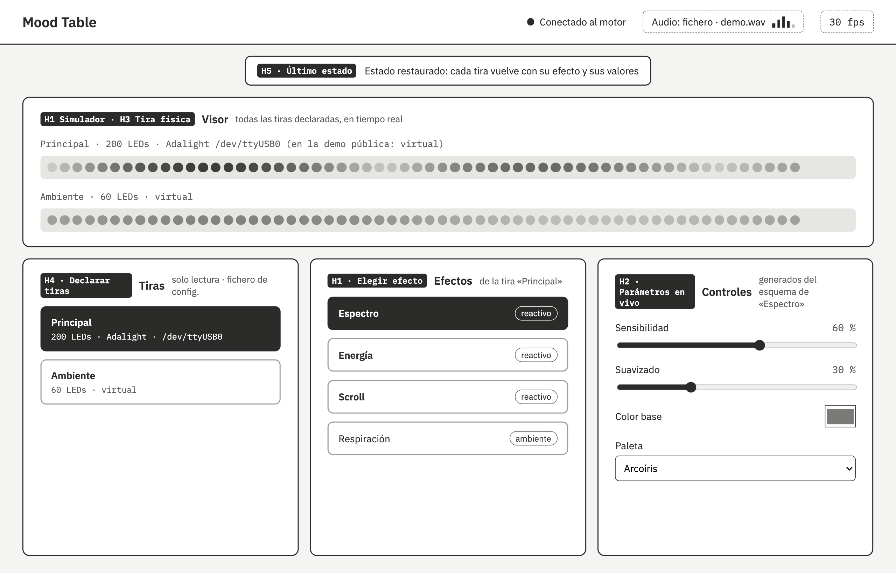
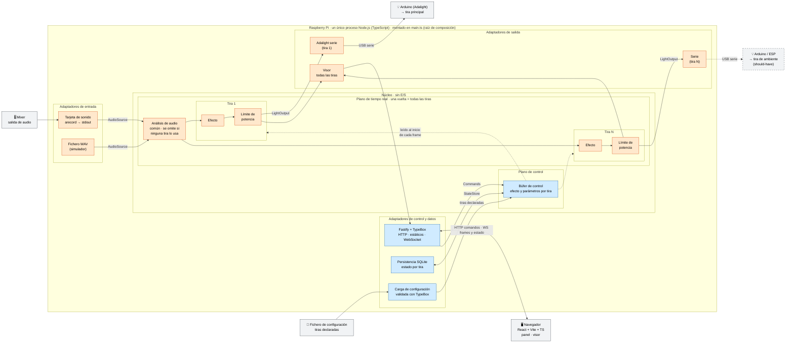
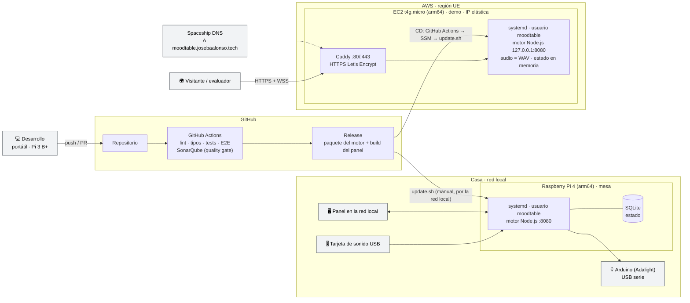
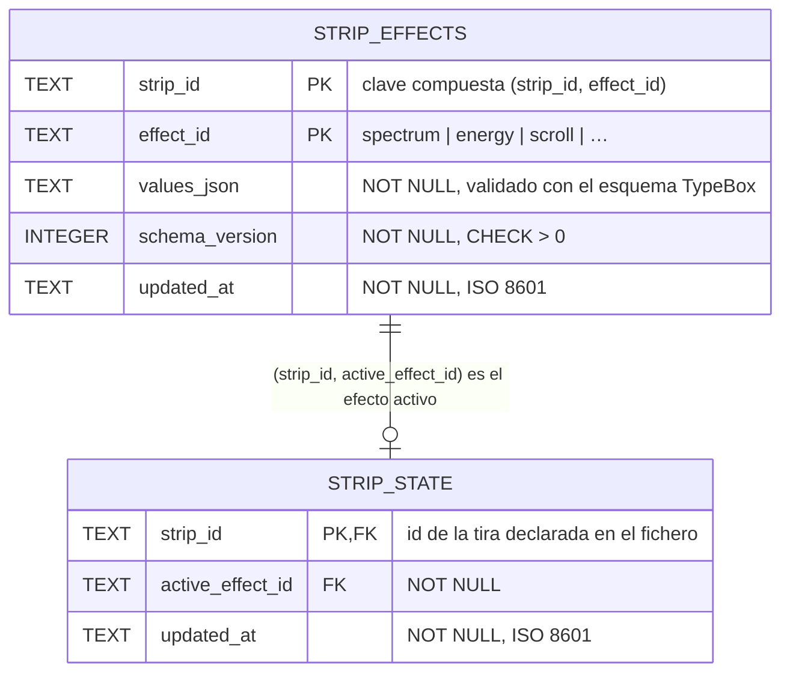

## Índice

0. [Ficha del proyecto](#0-ficha-del-proyecto)
1. [Descripción general del producto](#1-descripción-general-del-producto)
2. [Arquitectura del sistema](#2-arquitectura-del-sistema)
3. [Modelo de datos](#3-modelo-de-datos)
4. [Especificación de la API](#4-especificación-de-la-api)
5. [Historias de usuario](#5-historias-de-usuario)
6. [Tickets de trabajo](#6-tickets-de-trabajo)
7. [Pull requests](#7-pull-requests)

---

## 0. Ficha del proyecto

### **0.1. Tu nombre completo:**

Joseba Alonso

### **0.2. Nombre del proyecto:**

Mood Table

### **0.3. Descripción breve del proyecto:**

Instrumento de luz para la mesa de DJ: un motor de efectos propio, reactivo a la música, que se toca en vivo y funciona sin conexión. En el MVP se controla desde un panel web local; la visión es tocarlo con una pantalla táctil en la mesa o un controlador tipo Traktor F1, que se conectarán al mismo puerto de mandos. Un simulador (audio desde fichero + tiras virtuales en el visor del navegador) permite desarrollarlo y demostrarlo sin hardware.

### **0.4. URL del proyecto:**

*Pendiente.* Será la demo pública (el motor reproduciendo un fichero de audio y pintando tiras virtuales en el visor) y llegará con la entrega final.

> Puede ser pública o privada, en cuyo caso deberás compartir los accesos de manera segura. Puedes enviarlos a [alvaro@lidr.co](mailto:alvaro@lidr.co) usando algún servicio como [onetimesecret](https://onetimesecret.com/).

### 0.5. URL o archivo comprimido del repositorio

https://github.com/7daysofrain/mood-table-v2

> Puedes tenerlo alojado en público o en privado, en cuyo caso deberás compartir los accesos de manera segura. Puedes enviarlos a [alvaro@lidr.co](mailto:alvaro@lidr.co) usando algún servicio como [onetimesecret](https://onetimesecret.com/). También puedes compartir por correo un archivo zip con el contenido


---

## 1. Descripción general del producto

> Describe en detalle los siguientes aspectos del producto:

*La fuente de verdad del producto (problema, alternativas, usuarios, expectativas, historias y alcance) es el [PRD](docs/PRD.md). Esta sección lo resume.*

### **1.1. Objetivo:**

> Propósito del producto. Qué valor aporta, qué soluciona, y para quién.

**Propósito.** Mood Table convierte la mesa de DJ en un instrumento de luz: la tira LED reacciona a la música que suena y el DJ modula esa reacción en tiempo real, igual que modula el sonido con el mixer.

**Qué soluciona.** Es la reescritura de un proyecto personal (2021-2024) que funcionaba pero era una amalgama de piezas ajenas: Hyperion para el ambiente, dancyPi para la parte reactiva, un orquestador Node que las unía por sockets, y la configuración repartida en cuatro sitios, cada uno con su propia cuenta de LEDs. Añadir un efecto propio obligaba a meterse en las tripas de un tercero y, sobre todo, no se podía probar nada sin la mesa montada. Mood Table lo sustituye por una pieza central propia: un motor con un único modelo de tira y de estado, donde cada efecto es código con sus parámetros declarados.

**Alternativas.** Hay herramientas maduras que hacen buena parte de lo mismo; la más cercana es [LedFx](https://docs.ledfx.app/) (Python + React, en una Raspberry Pi, con panel web y salida Adalight). Mood Table no pretende competir con ellas: se construye por **propiedad** (un instrumento propio, pequeño y entendible de punta a punta) y por **aprendizaje** (hacerlo con Spec-Driven Development y agentes de código). Detalle en el PRD §1.2.

**Valor.**
- **Efectos propios**, fáciles de crear y de probar.
- **Control en vivo** de los parámetros mientras suena la música.
- **Autonomía**: se enciende la Pi y vuelve como estaba, sin portátil ni internet.
- **Desarrollo y demo sin hardware** gracias al simulador (audio desde fichero + tiras virtuales en el visor).

**Para quién.** DJs y makers con una Raspberry Pi y una tira LED que quieren una iluminación reactiva que puedan tocar y ampliar. El caso de referencia es la mesa del autor, pero nada está atado a ella: el número de LEDs, el orden de color y el límite de potencia se configuran, y los efectos se añaden como módulos de código.

### **1.2. Características y funcionalidades principales:**

> Enumera y describe las características y funcionalidades específicas que tiene el producto para satisfacer las necesidades identificadas.

**MVP (must-have)**. Cada historia lleva un código (H1-H5) con el que se cita en el resto del documento.

- **H1 · Probar el instrumento en el simulador.** Sin hardware, con un fichero de audio o la tarjeta de sonido como fuente, las tiras virtuales reaccionan a la música en el visor del navegador, en tiempo real, y si la fuente es un fichero, se oye en el panel.
- **H2 · Tocar los parámetros en vivo.** Mientras suena la música, eliges el efecto de cada tira y mueves sus controles, que el panel genera a partir del esquema que declara cada efecto; la luz responde al instante.
- **H3 · Pintar la tira física.** Lo que muestra el visor se reproduce en la tira real de la mesa, conectada a un Arduino con el sketch Adalight por protocolo Adalight (serie). Cualquier controlador Adalight sirve igual (D46).
- **H4 · Declarar mis tiras.** Las tiras se declaran en un fichero de configuración (salida, número de LEDs, orden de color y límites de potencia), y el motor, el límite de potencia y el visor lo respetan. El sistema admite varias tiras, cada una con su propio efecto.
- **H5 · Arrancar en el último estado.** Enciendes la Pi sin portátil y vuelve como estaba: el efecto de cada tira y sus valores.

**Efectos incluidos.** Los tres efectos reactivos de la v1, reescritos en el motor propio, y uno de ambiente. Así se demuestra que la nueva arquitectura cubre lo que hacía la anterior y que un efecto puede no usar el audio:

- **Espectro:** cada zona de la tira representa una banda de frecuencia.
- **Energía:** el brillo y la extensión de la luz siguen la energía del audio y los golpes.
- **Scroll:** la energía entra por un extremo de la tira y la recorre.
- **Respiración** (ambiente): un color que sube y baja despacio, sin audio.

**Should-have**

- **Tira de ambiente:** una segunda tira física con su propio efecto, que no necesita audio (por ejemplo, un color que respira despacio). Es la misma pieza del sistema que la tira principal, con otro efecto: el motor ya pinta varias tiras.
- **Firmware propio** (ESP8266/ESP32): un hardware de referencia barato y muy extendido, con más LEDs y fps de los que permite Adalight y con el camino abierto al WiFi. Es una de las dos formas de conectar la segunda tira; la otra es un Arduino con Adalight.

**Visión (fuera del MVP):** Traktor F1 como mando · firmware en ESP32 con WiFi · más de dos tiras o segmentos · conexión directa por GPIO de la Pi · pantalla táctil o encoder + pantalla pequeña (los mandos, sobre el mismo puerto de mandos). En el MVP se toca desde el panel en un portátil: es una solución provisional para contener el alcance.

**Fuera por decisión:** escenas y presets · sincronía con el tempo · cuentas y login · editar tiras desde el panel · crear efectos sin programar (motivos en el PRD §5.4).

### **1.3. Diseño y experiencia de usuario:**

> Proporciona imágenes y/o videotutorial mostrando la experiencia del usuario desde que aterriza en la aplicación, pasando por todas las funcionalidades principales.

*Diseño previsto para la Entrega 2. Las capturas y el vídeo del producto real llegarán con la entrega final.*

La interfaz del MVP es **un único panel web**, técnico y pensado para escritorio, que sirve igual para la **demo pública** y para la **mesa**. El panel no sabe si detrás hay una tira física: solo ve las tiras declaradas. Pasar del simulador a la mesa es cambiar la configuración del despliegue (fuente de audio y salidas), no la interfaz (§2.1).

La **interfaz de performance** para tocar en directo (pantalla táctil, Traktor F1 o un mando propio) queda **fuera del MVP**; se conectará al mismo puerto de mandos.


*Wireframe de baja fidelidad: estructura prevista, no diseño final.*

#### Zonas del panel

- **Cabecera:** estado de la conexión con el motor y, a su izquierda, la fuente de audio activa («Fichero: bouncer.wav», «Tarjeta de sonido: Mixer de la mesa», con el nombre que le da la configuración y nunca su cadena de ALSA, o «Sin fuente de audio») con un vúmetro de su nivel; si la tarjeta de sonido se pierde en plena sesión, una etiqueta roja «Desconectada» parpadea a su lado (fija si el sistema pide menos movimiento) hasta que el motor la recupera, también en un panel que se abre durante el corte; un silencio no la dispara; y, si la fuente es un fichero, el botón de oírlo en el panel: un altavoz tachado mientras el panel calla y con ondas mientras suena. Más adelante, los fps reales del motor. Sin conexión no muestra fuente, nivel ni botón.
- **Visor:** todas las tiras declaradas, una fila de LEDs por tira, pintadas en tiempo real con los mismos frames que recibe la tira física.
- **Tiras:** lista de las tiras declaradas en el fichero de configuración, en solo lectura: nombre, número de LEDs y salida (virtual o Adalight con su puerto). Al seleccionar una, el resto del panel actúa sobre ella.
- **Efectos:** los efectos disponibles para la tira seleccionada, etiquetados como *reactivo* o *ambiente*, con el activo marcado.
- **Controles:** generados a partir del esquema del efecto activo: un número con rango es un slider, un color es un selector de color y una lista de opciones es un desplegable.

#### Recorrido por las funcionalidades principales

1. **Probar en el simulador (H1).** Se abre la demo pública y se pulsa el botón de oír de la cabecera: suena el fichero de audio y las tiras virtuales reaccionan en el visor.
2. **Tocar los parámetros en vivo (H2).** Se elige otro efecto (espectro, energía, scroll o respiración) y la tira cambia al instante. Se mueve un slider (por ejemplo, la sensibilidad) y la luz responde mientras se arrastra.
3. **Pintar la tira física (H3).** En la mesa, la lista de tiras muestra la principal con salida *Adalight · /dev/ttyUSB0*. Lo que se ve en el visor es lo que pinta la mesa.
4. **Declarar mis tiras (H4).** Las tiras, su número de LEDs y su salida son las del fichero de configuración; el panel las muestra pero no las edita.
5. **Arrancar en el último estado (H5).** Al reiniciar el motor y volver a abrir el panel, cada tira tiene el efecto y los valores con los que se dejó, y el panel avisa de que el estado se ha restaurado.

### **1.4. Instrucciones de instalación:**
> Documenta de manera precisa las instrucciones para instalar y poner en marcha el proyecto en local (librerías, backend, frontend, servidor, base de datos, migraciones y semillas de datos, etc.)

*Diseño previsto para la Entrega 2. Los comandos definitivos se confirmarán con el código.*

Hay tres formas de probar Mood Table, de menos a más esfuerzo: la **demo pública** (sin instalar nada), el **simulador en local** (sin hardware) y la **mesa** (Raspberry Pi con una tira LED real).

> **Credenciales: no hay.** Mood Table no tiene login en ningún entorno (§2.5). La demo pública y el panel local se abren directamente.

#### 1. Probar la demo pública (sin instalar nada) — *disponible con la entrega final*

1. Abre `https://moodtable.josebaalonso.tech`.
2. Pulsa el botón de oír (el altavoz de la cabecera): suena una pista de ejemplo y las dos tiras virtuales reaccionan (**H1**).
3. En **Efectos**, cambia de *Espectro* a *Energía* o *Scroll*: la tira cambia al instante (**H2**).
4. En **Controles**, mueve *Sensibilidad*: la luz responde mientras arrastras (**H2**).
5. En **Tiras**, selecciona la otra tira: los controles pasan a ser los suyos (**H4**).

La demo comparte el estado entre todos los visitantes y lo reinicia cada cierto tiempo. La tira física (**H3**) y el arranque en el último estado (**H5**) se ven en el vídeo de la mesa (§2.4) o en local (abajo).

#### 2. Simulador en local (sin hardware)

**Requisitos:** Node.js 24 (la versión de `.nvmrc`; con otra, `pnpm install` falla) y pnpm (`corepack enable`). Linux, macOS o Windows.

```bash
git clone https://github.com/7daysofrain/mood-table-v2.git
cd mood-table-v2
pnpm install
pnpm dev
```

`pnpm dev` arranca el motor con la configuración de `config/local.json`. Si no existe, la crea copiando la de ejemplo (`config/demo.json`: una tira virtual con *energía*, que reacciona a *Bouncer*, un tema de electro CC0 incluido en `config/audio/`), y si ya existe no la toca: es la de tu instalación, y git la ignora. Cada tira declara el efecto con el que arranca (`effect`, obligatorio), y el fichero puede declarar una fuente de audio (`audioSource`): un fichero WAV PCM de 16 bits, mono o estéreo, con su ruta absoluta o relativa a la raíz del repositorio (§3). Al arrancar, el motor escribe qué fichero ha cargado, cuántas tiras y a qué fps; si el fichero no sirve, no arranca y dice qué falla. `pnpm dev` arranca también el panel con recarga en caliente: abre `http://localhost:5173`. Es el servidor de Vite, que reenvía al motor la conexión del visor; por eso, en desarrollo, el motor tiene que escuchar en el puerto `8080` (el que tiene por defecto). El motor sirve además el build del panel en `http://127.0.0.1:8080` (la dirección que dice su línea de log), si lo has construido antes con `pnpm --filter @moodtable/panel build`; es lo que se usa en la mesa y en la demo.

**Fuente de audio:** el simulador usa un fichero de audio en cualquier sistema. La tarjeta de sonido como fuente solo funciona en Linux (ALSA): en macOS y Windows se usa el fichero.

**Base de datos:** no hay que instalar nada. SQLite es un fichero que el motor crea al arrancar; **las migraciones se aplican solas** al arrancar y **no hay semillas**: la reconciliación crea el estado inicial de cada tira declarada con los valores por defecto de cada efecto (§3).

**Probar el arranque en el último estado (H5):** cambia el efecto y algún control, para el motor (`Ctrl+C`), vuelve a lanzar `pnpm dev` y recarga el panel: cada tira vuelve como la dejaste.

**Tests:**

```bash
pnpm test        # unitarios e integración (Vitest)
pnpm test:e2e    # flujo principal en el navegador (Playwright)
```

Antes del primer `pnpm test:e2e`, instala el navegador de los E2E (una sola vez, y otra cuando suba la versión de Playwright):

```bash
pnpm --filter @moodtable/e2e exec playwright install chromium
```

#### 3. En la mesa (Raspberry Pi con tira real)

**Hardware:** Raspberry Pi 4 con Raspberry Pi OS de 64 bits (una 3 B+ podría servir, pero no se ha medido: D47) · tira LED direccionable conectada a un **Arduino con el sketch Adalight** (u otro controlador Adalight, como un Light Box) por USB · fuente de alimentación adecuada para la tira · tarjeta de sonido USB con la salida del mixer en su entrada.

> **Montaje del hardware:** el cableado de la tira, su alimentación, el controlador Adalight (un Arduino con el sketch Adalight; el Light Box de la mesa se averió) y la tarjeta de sonido están paso a paso en [`HARDWARE_SETUP.md`](HARDWARE_SETUP.md), en la raíz del repositorio, con las comprobaciones con polímetro y cómo diagnosticar una tira que no enciende. Los pasos siguientes dan por hecho que el hardware ya está montado.

1. En la Pi, instala `git` (Raspberry Pi OS Lite no lo trae: `sudo apt install -y git`), clona el repositorio y ejecuta `sudo deploy/install.sh`. Crea el usuario `moodtable`, instala Node.js y deja el motor como servicio `systemd` (§2.4).
2. Copia `deploy/config/mesa.example.json` a `config/local.json` (en la raíz del repositorio) y declara tus tiras (**H4**): puerto serie (`ls /dev/ttyUSB*`), número de LEDs, orden de color y límites de potencia de tu fuente. Declara también la tarjeta de sonido como fuente de audio (`audioSource`, §3), con la cadena que da `arecord -l` (`HARDWARE_SETUP.md` §7). Si algo está mal, el motor no arranca y dice qué campo falla, o qué tarjeta no puede abrir.
3. `sudo systemctl start moodtable`.
4. Desde cualquier dispositivo de la red local, abre `http://<ip-de-la-pi>:8080`. Lo que ves en el visor lo pinta la tira real (**H3**).
5. Desenchufa la Pi y vuelve a enchufarla: arranca sola y vuelve al último estado (**H5**).

---

## 2. Arquitectura del Sistema

### **2.1. Diagrama de arquitectura:**
> Usa el formato que consideres más adecuado para representar los componentes principales de la aplicación y las tecnologías utilizadas. Explica si sigue algún patrón predefinido, justifica por qué se ha elegido esta arquitectura, y destaca los beneficios principales que aportan al proyecto y justifican su uso, así como sacrificios o déficits que implica.

Mood Table es **un único proceso Node.js (TypeScript)** que corre en la Raspberry Pi de la mesa. En su centro está el **motor**: un bucle que, en cada frame, analiza el audio una vez y pinta **todas las tiras declaradas**, cada una con su propio efecto, su límite de potencia y su salida. Todo lo que toca el mundo exterior (la tarjeta de sonido, los puertos serie, el navegador, el disco, el fichero de configuración) está fuera del núcleo, en adaptadores que se conectan a él por interfaces.



*Naranja: plano de tiempo real. Azul: plano de control y datos. Gris: fuera del proceso. Discontinuo: should-have. El MVP se demuestra con una tira física (la de la mesa, por Adalight), que el visor muestra en tiempo real, y con tiras virtuales en el simulador; el modelo admite N tiras.*

#### Patrón: hexagonal ligera (puertos y adaptadores)

El núcleo define **cuatro puertos** (interfaces de TypeScript) y no sabe qué hay detrás de ninguno:

| Puerto | Para qué | Adaptadores en el MVP | Adaptadores previstos |
|---|---|---|---|
| `AudioSource` | Entregar la ventana de audio que pide el bucle en cada pulso (*pull*: el ritmo lo marca el motor, D50) | Tarjeta de sonido (`arecord` → `stdout`) · Fichero WAV | — |
| `LightOutput` | Recibir los frames de una tira | Adalight por serie (una instancia por tira física) · Visor (WebSocket: una instancia por tira, todas por la misma conexión de cada navegador; D43) | Firmware propio ESP8266/ESP32 (should-have) |
| `Commands` | Cambiar el efecto y los parámetros de una tira | API HTTP del panel | Traktor F1 (HID) · pantalla táctil |
| `StateStore` | Guardar y recuperar el estado de cada tira | SQLite (ver §3) · En memoria (tests) | — |

Es una versión **ligera** de la hexagonal: los adaptadores se crean y se conectan **a mano** en un único punto de arranque (`main.ts`, la *raíz de composición*), que lee el fichero de configuración y decide, por ejemplo, "fuente = fichero, tira 1 → Adalight en `/dev/ttyUSB0`, todas → visor". **No hay contenedor de inyección de dependencias**, ni capas de casos de uso, ni mapeo de DTOs.

Dentro del proceso conviven **dos planos** con reglas distintas:

- **Plano de tiempo real** (naranja): audio → análisis → efecto de cada tira → límite de potencia de cada tira → salidas, a 30-60 fps. No puede retrasarse: trabaja con búferes preasignados y sin crear objetos en el bucle.
- **Plano de control** (azul): panel, API, configuración y persistencia. Puede ser lento, pero no debe estorbar: sus cambios se escriben en un **búfer de control** que el bucle lee **al inicio de cada frame**, nunca a mitad de un render.

**Reactivo o ambiente es cosa del efecto, no de la tira.** Todos los efectos implementan la misma interfaz y declaran si usan audio (patrón *Strategy*). Un efecto reactivo lee los rasgos del audio; uno de ambiente anima con el tiempo y los ignora. Cualquier efecto va en cualquier tira.

#### Justificación

- **Los puertos los pide el hardware, no la teoría.** Cada puerto tiene al menos dos implementaciones reales (tarjeta o fichero; Adalight o navegador; panel o F1). Sin la separación, el motor quedaría acoplado a ALSA, a los puertos serie y al navegador.
- **La tira es una entidad desde el principio.** La mesa real tiene dos tiras (una reactiva y otra de ambiente). Diseñar el bucle, los datos y la API para N tiras cuesta ahora lo mismo que para una, y evita rehacerlos cuando llegue la segunda.
- **Cada dato donde le corresponde.** Lo que sale de la hoja de características del hardware y no cambia (salida, número de LEDs, orden de color, límites de potencia) se **declara en un fichero de configuración** versionado y validado al arrancar. Lo que cambia mientras se toca (efecto activo y valores de cada tira) va en la **base de datos**. Una tira existe porque está cableada, así que no se da de alta desde el panel.
- **El simulador no es una pieza aparte.** Es el mismo motor con otros adaptadores (fichero WAV + tiras virtuales). Lo que se ve en la demo pública es exactamente el código que corre en la mesa.
- **El motor funciona sin audio.** Si ninguna tira tiene un efecto reactivo, el análisis se omite y la mesa puede quedarse en modo ambiente sin música.
- **Librería en el borde, no framework en el centro.** El servidor HTTP (Fastify) es un adaptador más. Se descartaron frameworks *full-stack* como AdonisJS porque imponen su estructura y su ciclo de vida alrededor de una aplicación web, y aquí el centro es un bucle de tiempo real. Se descartó también un contenedor de DI: son pocas dependencias elegidas una vez al arrancar, y no justifica la "magia" de decoradores y metadatos.
- **Un solo proceso, no servicios separados.** Un usuario, una Pi y latencia crítica: repartir el sistema en servicios solo añadiría red y puntos de fallo entre el mando y la luz.

**Stack:**

| Pieza | Tecnología | Por qué |
|---|---|---|
| Motor | TypeScript sobre Node.js (arm64) | El autor puede leer y corregir lo que genera el agente; tipos compartidos con el front. Confirmado por el spike de rendimiento en la Pi (`MOO-12`, D48). |
| Panel y visor | React + Vite + TypeScript + **Mantine 9** (solo tema oscuro) | Stack conocido; comparte tipos (esquemas de parámetros) con el motor. El motor sirve el build estático: no hay servidor aparte. Mantine trae los controles que se generan del esquema (slider, desplegable y selector de color) con estilos estáticos y sin recursos de internet ([D40](docs/idea-mood-table.md)). |
| API | Fastify + TypeBox | Un solo esquema da el tipo de TypeScript, la validación y el OpenAPI (§4). El mismo esquema describe los parámetros de cada efecto y el fichero de configuración. |
| Transporte | HTTP para comandos · WebSocket (motor → navegador) para frames binarios y estado | HTTP se documenta en OpenAPI; el WebSocket lleva el flujo continuo (300 LEDs × 3 bytes × 60 fps ≈ 54 KB/s por tira). |
| Persistencia | SQLite tras el puerto `StateStore` | Transacciones seguras ante cortes de luz (§3). |
| Salida física | Protocolo Adalight por serie | Protocolo abierto que habla cualquier Arduino con el sketch Adalight (el de la mesa, D46) y controladores como el Light Box. Sin GPIO ni software de terceros. |

#### Beneficios

- **Testabilidad determinista:** con fuente = fichero y salida = memoria, un efecto produce siempre los mismos frames, así que se puede comparar contra frames de referencia ("frames dorados").
- **Desarrollo y demo sin hardware:** el simulador sale gratis de la arquitectura.
- **Extensible sin tocar el núcleo:** una tira nueva es una entrada en el fichero de configuración; la F1, la pantalla táctil o el firmware propio son adaptadores nuevos. El motor no cambia.
- **Una sola fuente de verdad** para los esquemas: panel, API, configuración y documentación salen del mismo sitio.
- **Despliegue simple:** un proceso bajo `systemd` en la Pi, que arranca solo y recupera el último estado.

#### Sacrificios y déficits

- **Un solo hilo compartido.** El bucle de frames y las peticiones HTTP se turnan en el mismo *event loop* de Node: una petición lenta retrasaría un frame. Mitigación: el plano de control solo escribe en el búfer. El spike de rendimiento no mostró tirones (`MOO-12`, D48), así que por ahora no hace falta un *worker thread*.
- **Recolector de basura.** Node puede pausar para liberar memoria y provocar tirones. Mitigación: búferes preasignados y cero asignaciones en el bucle.
- **Latencia de HTTP en los sliders.** Mover un parámetro por HTTP es algo más lento que por WebSocket (milisegundos en red local; el panel limita el envío mientras arrastras). Si en uso real no se siente inmediato, `setParam` pasaría a WebSocket; el cambio es acotado porque `Commands` es un puerto.
- **Techo de Adalight por tira.** A 115.200 baudios, unos 19 fps con 200 LEDs en cada puerto serie. Limita el número de LEDs por tira en el MVP (≤ 200-300); el firmware propio es la salida.
- **Cambiar el hardware exige reiniciar.** La configuración de las tiras se lee al arrancar. Es aceptable en un aparato que se cablea una vez.
- **Sin clave foránea hacia las tiras.** Como las tiras viven en el fichero, la base de datos no puede apuntar a ellas. Al arrancar, el motor **reconcilia**: crea el estado de las tiras nuevas e ignora el de las que ya no existen.
- **Montaje manual.** Sin contenedor, `main.ts` crece con cada adaptador nuevo. Aceptable con el número de piezas previsto.
- **Proceso único = punto único de fallo.** Si el proceso cae, se apaga todo. `systemd` lo reinicia y vuelve al último estado guardado.

### **2.2. Descripción de componentes principales:**

> Describe los componentes más importantes, incluyendo la tecnología utilizada

*El porqué de cada tecnología está en §2.1. Aquí se describe qué hace cada componente por dentro. Es el diseño previsto para la Entrega 2.*

#### Núcleo (motor)

**Bucle de frames** — TypeScript, sin dependencias de E/S.
Marca el ritmo del sistema a una tasa objetivo configurable (30-60 fps). En cada vuelta: (1) lee el búfer de control, (2) si alguna tira tiene un efecto que usa audio, pide al análisis los rasgos del audio más reciente, y (3) para **cada tira declarada** llama a su efecto, aplica su límite de potencia y entrega el frame a su salida y al visor. Mide cuánto tarda cada vuelta; si llega tarde, **se salta el frame en lugar de acumular retraso**, porque en luz en vivo importa más ir a tiempo que no perder ninguno. Cada tira tiene su búfer preasignado (`Uint8Array` de `LEDs × 3`) y no se crean objetos dentro del bucle, para evitar pausas del recolector de basura.

**Análisis de audio** — TypeScript + FFT (`fft.js`, validada en el spike de rendimiento, D48).
En cada pulso pide a la fuente de audio la ventana que acaba en el instante del pulso: el puerto es *pull*, así que el ritmo lo marca el motor y no la fuente (D50). Mientras haya fuente, mide su **nivel** (el RMS de la ventana, antes de cualquier ajuste) en cada pulso, aunque ninguna tira use audio, y lo envía al panel. Cuando alguna tira lo necesita, calcula además los **rasgos** que consumen los efectos, como la v1 (D49): una ventana de Hamming de 40 ms y una FFT, **24 bandas mel** de 200 Hz a 12 kHz (una escala parecida a la del oído) normalizadas con una ganancia automática y suavizadas, y si la ventana es silencio digital. **No detecta golpes**: *energía* marca cada uno con la subida rápida y la caída suave de su luz, y ningún efecto del MVP necesita más. Se calcula **una vez por frame** y lo comparten todas las tiras. Si ninguna tira usa audio, no se calcula, y el motor puede funcionar sin fuente de audio.

**Efectos** — módulos de TypeScript con esquema TypeBox.
Cada efecto es un módulo con la misma forma, sea reactivo o de ambiente (patrón *Strategy*):

```ts
interface Effect<P, M> {
  id: string;                     // "spectrum", "energy", "scroll", …
  usesAudio: boolean;             // declarado: reactivo (true) o ambiente (false)
  paramsSchema: TSchema;          // TypeBox: tipos, rangos y valores por defecto
  createMemory(strip: StripConfig): M;   // memoria del efecto entre frames (no es el estado del instrumento)
  render(ctx: FrameContext, params: P, memory: M, out: Uint8Array): void;
}
// FrameContext = { time, dt, audio }: el ambiente anima con el tiempo; el reactivo, además, con el audio
```

El **esquema** es lo que permite que el panel genere los controles sin conocer el efecto y que la API rechace un valor fuera de rango. La **memoria explícita** del efecto (lo que recuerda entre frames, como la posición del scroll o el suavizado; no confundir con el estado del instrumento, que es lo que se guarda) es **por tira**, y hace que, con la misma entrada, un efecto produzca siempre los mismos frames, así que se puede testear. `usesAudio` le dice al panel cómo etiquetar el efecto y al bucle si hace falta analizar el audio. El MVP incluye tres efectos reactivos, **espectro**, **energía** y **scroll** (los de la v1, reescritos), y uno de ambiente, **respiración**.

**Límite de potencia** — TypeScript, uno por tira.
Estima el consumo del frame a partir del valor de cada canal y del consumo máximo por LED declarado para esa tira. Si supera el límite configurado para su fuente de alimentación, escala el brillo de todo el frame en proporción. Protege fuentes y tiras, algo que en la v1 hacían por debajo piezas de terceros.

**Búfer de control** — TypeScript.
Guarda lo que el bucle necesita **de cada tira**: efecto activo y valores de sus parámetros. Los comandos que llegan del plano de control (ya validados) se escriben aquí, y el bucle los recoge al inicio del frame siguiente. Cada cambio avisa al puerto de persistencia, que guarda con un pequeño retardo (agrupa los cambios mientras se arrastra un slider en lugar de escribir en disco cien veces).

#### Configuración de las tiras

**Carga de configuración** — TypeScript + TypeBox.
Al arrancar, lee el fichero de configuración del despliegue, que declara las tiras (identificador, nombre, salida y puerto, número de LEDs, orden de color y límites de potencia) y la fuente de audio. Lo valida contra su esquema TypeBox: si algo está mal, **el motor no arranca** y dice exactamente qué campo falla. Después **reconcilia** con la base de datos: crea el estado de las tiras nuevas (con el efecto que declaran y valores por defecto) e ignora el de las que ya no están declaradas.

#### Adaptadores

| Adaptador | Puerto | Tecnología | Qué hace |
|---|---|---|---|
| **Tarjeta de sonido** | `AudioSource` | `arecord` (ALSA) como proceso hijo | Lanza `arecord` con la cadena de dispositivo declarada (16 bits, mono, 48 kHz, periodos de 10 ms) y guarda lo que entrega por `stdout` en un búfer circular de medio segundo: cuando el bucle pide la ventana, da las últimas muestras, sin mirar el instante (D50). Tira los primeros 300 ms, el chasquido que hace la tarjeta al abrirse. El motor solo no arranca si `arecord` termina antes de entregar nada (no puede abrir la tarjeta, o no hay `arecord`: solo Linux); si termina en plena sesión, la fuente da silencio, lo dice en el log y cada segundo vuelve a lanzar `arecord` con la misma cadena hasta recuperarla, sin reiniciar el motor; al recuperarla, lo dice en el log y vuelve a tirar 300 ms (D57, D60). Avisa al servidor de si está conectada o perdida, para que lo sepan los paneles (D61). Declara su umbral de silencio, para que el ruido de fondo no encienda los efectos reactivos (D58). Sin binarios nativos en Node: lanzar el proceso está en `soundcard.hardware.ts`, y el resto, con tests. |
| **Fichero WAV** | `AudioSource` | Lector WAV en TypeScript | Lee y decodifica el fichero entero al arrancar (PCM de 16 bits, mono o estéreo, que se mezcla a mono). Suena en bucle con el reloj del motor: en cada pulso da el audio de ese instante, contado desde el arranque, y al llegar al final vuelve a empezar. También dice en qué punto del fichero acaba la ventana de cada pulso (`positionAt`), con la misma cuenta, para que el panel lo oiga por ese punto (D53). Guarda los bytes que leyó, que el servidor sirve en `/audio` sin volver a leer el disco. Es la fuente del simulador y de los tests. |
| **Adalight serie** | `LightOutput` | `serialport` | Una instancia **por tira física**, en su puerto. Añade la cabecera Adalight (`Ada` + número de LEDs + checksum), reordena los canales según el orden de color de la tira (RGB, GRB…) y escribe por USB serie. Si el puerto sigue ocupado con el frame anterior, descarta el nuevo en lugar de encolarlo. |
| **Visor** | `LightOutput` | WebSocket (`@fastify/websocket`) | Una instancia **por tira** (D43). Codifica cada frame con el [protocolo del visor](docs/instructions/viewer-protocol.md) y lo envía en binario a todos los navegadores conectados, por una sola conexión por navegador (D45). Por la misma conexión, cada navegador recibe la fuente de audio al conectarse y, en cada pulso, su nivel (D51) y, si la fuente es un fichero, el punto del fichero por el que va el motor (D53). Con la tarjeta de sonido, también su estado, al conectarse y cada vez que cambia (D61); más adelante, también los cambios de estado del instrumento. |
| **API HTTP** | `Commands` | Fastify + TypeBox | Rutas para listar las tiras (solo lectura) y los efectos con sus esquemas, y para cambiar el efecto y los parámetros de una tira. Valida cada petición y publica el OpenAPI. También sirve el build del panel. |
| **Persistencia** | `StateStore` | SQLite (§3) · en memoria para tests | Guarda y carga el estado de cada tira: efecto activo y valores de cada efecto. Al arrancar, el motor recupera el último estado desde aquí. |

**Raíz de composición (`main.ts`).** Carga la configuración (`config/local.json`), crea los adaptadores que indica (fuente de audio, las salidas de cada tira, API, persistencia), los conecta al núcleo y arranca el bucle con un temporizador. Cada tira tiene su lista de salidas: el visor siempre, más Adalight si es física (D43). Es el único punto del código que conoce todas las piezas.

#### Panel y visor (front)

**Tecnología:** React + Vite + TypeScript, servido por el propio motor. No contiene lógica de luces: solo muestra y envía comandos.

- **Selector de tira:** lista las tiras declaradas; lo que se toca se aplica a la tira seleccionada.
- **Panel de control:** muestra los efectos, etiquetados como reactivos o de ambiente, y **genera los controles a partir del esquema** del efecto activo de la tira (un número con rango se convierte en slider, un color en selector de color, una lista de opciones en desplegable). Al mover un control, envía el cambio por HTTP, limitando la frecuencia de envío mientras se arrastra.
- **Visor:** recibe los frames binarios por WebSocket ([protocolo del visor](docs/instructions/viewer-protocol.md)) y dibuja **todas las tiras** en un `<canvas>` del navegador, sin librería: una fila por tira, en el orden del fichero de configuración, con un punto de luz por LED. En cada `requestAnimationFrame` pinta el último frame recibido de cada tira, así que nunca acumula retraso. Sin conexión con el motor queda en negro, la cabecera lo avisa y el panel reintenta cada segundo hasta que el motor vuelve, sin recargar. Dibujar cada tira con su geometría declarada llega con H4.
- **Cabecera:** el estado de la conexión y, por la misma conexión del visor, la fuente de audio (D51): «Fichero: nombre», sin la ruta, o «Sin fuente de audio». Si hay fuente, un vúmetro pinta su nivel en cada `requestAnimationFrame`, como el visor, en una escala de −60 a 0 dB.
- **Reproductor:** cuando la fuente es un fichero, el maker puede oírlo en el navegador con el botón de la cabecera, porque los navegadores no reproducen audio sin un gesto del usuario. Dejar de oír solo calla el panel: el motor y la tira siguen. El motor sirve en `/audio` el mismo fichero que analiza, tal cual y sin decir su ruta en disco: los bytes que leyó al arrancar, desde memoria, así que aunque el fichero cambie en el disco el panel oye lo que se analiza; y en cada pulso dice por qué punto del fichero va; el panel hace sonar el punto del último frame que muestra el visor, así que el retraso de la red afecta igual a la luz y al sonido (D53). Lo reproduce con Web Audio, con el fichero entero en memoria y en bucle, arrancado en el punto exacto en cuanto el reloj de audio está en marcha; la referencia es la mediana del último segundo de posiciones, para no seguir el temblor de la red. Unas pocas veces por segundo compara lo que suena con el visor y, si se separan más de 20 ms (la deriva entre los dos relojes, unos ms por minuto), salta al punto bueno con un empalme programado (D54). Solo compensa el retraso de salida que declara el navegador (D55). Sin conexión, calla.

**Tipos compartidos.** Los esquemas TypeBox (efectos, comandos, configuración de las tiras) viven en un paquete común que importan el motor y el panel. Si cambia un parámetro, el compilador avisa en los dos lados.

#### PR Babysitter (herramienta de desarrollo)

No es parte del instrumento: es el sistema que sigue cada PR del repo hasta dejarla lista para integrar (épica PB, [`docs/pr-babysitter.md`](docs/pr-babysitter.md)). Vive en su propio paquete, `packages/pr-babysitter`, con la misma forma hexagonal que el motor y sin importar nada del producto (D72). TypeScript sobre LangGraph.js (D65), validación con zod. Hoy (BH1: `MOO-73` y `MOO-74`) solo avisa; no hay ningún LLM.

- **Driver** (núcleo). Cada 60 s lee GitHub y despierta el hilo de cada PR que sigue: las del mantenedor contra `main` que no son borrador. Arranca los hilos que faltan (también al arrancar el proceso, para las PR que ya estaban abiertas), olvida sin avisar los de las PR que se cierran, se integran o vuelven a borrador, vuelve a empezar el de una PR que ya tenía su estado final si llega un push nuevo, y reintenta en la vuelta siguiente el aviso que el canal no aceptó. Un fallo de GitHub salta la vuelta (o la PR cuya lectura falla); si GitHub rechaza el token, avisa una vez al buzón.
- **Detener y reanudar una PR** (driver, `MOO-74`, D74 y D75). Una PR con la etiqueta `babysitter:stop` no avanza: el driver nunca reanuda su hilo, así que ningún nodo corre en ella, tampoco los que traigan BH2-BH5. Al ver la etiqueta deja terminar el aviso pendiente, avisa una vez de que la detiene y olvida su hilo; si ya tenía su estado final, lo conserva para comparar el SHA. Al quitarla, avisa de que la reanuda y empieza una ejecución nueva desde el último push, sin el aviso de seguimiento y con la espera contada desde ese momento; si el estado final es de ese mismo push, solo avisa. Qué PR están detenidas lo guarda en memoria y, al arrancar, lo reconstruye de las etiquetas sin avisar de ellas. El sistema solo lee la etiqueta: la pone o la quita una persona con permiso de escritura.
- **Grafo** (núcleo). Un hilo por PR (`thread_id` = su número) que no consulta GitHub: recibe una **foto** de la PR (último SHA, borrador, las comprobaciones que exige `main`, el estado del revisor y la hora) cada vez que el driver lo reanuda con `Command({ resume })`. Avisa de que sigue la PR, espera a que terminen las comprobaciones, avisa, espera al revisor y avisa del estado final: **lista para integrar** o **necesita intervención**, con el motivo. Un push nuevo vuelve a la espera de las comprobaciones, y si algo no termina en 30 min desde que vio el push, la PR necesita intervención. Una ejecución puede empezar sin el aviso de seguimiento (`silent`), cuando el driver ya ha avisado de que la reanuda. Cada aviso va en su propio nodo y cada espera en otro, con `interrupt()`, porque LangGraph vuelve a ejecutar el nodo interrumpido al reanudarlo (D73). Estado en memoria (`MemorySaver`) hasta BE7.
- **Reglas** (núcleo). Qué toca tras cada espera, el estado final y su motivo, y el tiempo de espera son funciones puras sobre la foto, sin LangGraph ni reloj: el grafo solo traduce cada paso a su nodo.
- **Aviso de dominio y puertos** (núcleo). El aviso dice qué pasa (sigue la PR, comprobaciones terminadas, estado final, detenida, reanudada) sin nada del canal. El de seguimiento termina con cómo detener la PR, para que la etiqueta se descubra sin leer este README. Los puertos `GitHubReader`, `ReviewReader` y `Notifier` son interfaces del núcleo.

| Adaptador | Puerto | Tecnología | Qué hace |
|---|---|---|---|
| **GitHub** | `GitHubReader` | `octokit` | Lista las PR abiertas contra `main`, con sus etiquetas, lee las comprobaciones que exige `main` de sus reglas y, de los *check runs* de cada SHA, si cada una pasa, falla o no ha terminado (sin *check run*, no ha terminado). Todo validado con zod. Pide el token a un proveedor en cada petición (hoy el PAT del `.env`; con BH3, quizá el de una GitHub App). Un 401 da un error propio, que el driver convierte en aviso. |
| **Revisor (Codex)** | `ReviewReader` | zod | Lee los comentarios de la PR (a través del adaptador de GitHub), solo los de la cuenta del revisor, y saca del último bloque `codex-review-state` el commit revisado, si ha terminado y si ha tenido hallazgos. Sin bloque, o con uno que no se entiende, no hay revisión. Otro revisor sería otro adaptador (BA3). |
| **Linear** | `Notifier` | `@linear/sdk` | Publica cada aviso como comentario de la app «PR Babysitter» en la tarea que tiene la PR adjunta (`attachmentsForURL`), mencionando al mantenedor; sin tarea, en el issue buzón (D70). Pide el token con *client credentials* y lo renueva solo. Si Linear falla, lanza, y el aviso se reintenta. |
| **Configuración** | — | zod | Lee y valida las variables de entorno al arrancar: si falta una o no vale, el proceso dice cuál y no arranca. La cuenta del revisor, la cadencia y el tiempo de espera tienen valor por defecto. |

**Raíz de composición (`main.ts`).** Monta la configuración, los adaptadores y el driver, y da vueltas hasta que el contenedor la para.

**Depurar el grafo en LangGraph Studio** (solo en local). `pnpm --filter @moodtable/pr-babysitter studio` arranca el servidor de LangGraph en `localhost:2024` y abre Studio en el navegador (la primera vez, Chrome pide permiso para que la página acceda a la red local); no envía trazas a LangSmith. Se ven los nodos, el que se ejecuta en cada paso y el estado; cada hilo hace de una PR: se lanza con una foto escrita a mano, se para en cada `interrupt()` y se reanuda con la foto siguiente. Los avisos van al log del servidor, no a Linear (`src/studio.ts`).

### **2.3. Descripción de alto nivel del proyecto y estructura de ficheros**

> Representa la estructura del proyecto y explica brevemente el propósito de las carpetas principales, así como si obedece a algún patrón o arquitectura específica.

*Estructura prevista para la Entrega 2.*

El repositorio es un **monorepo con pnpm workspaces** y tres paquetes: `engine` (el motor), `panel` (el front) y `shared` (los esquemas comunes). Se descartó un único paquete porque con paquetes separados la frontera entre motor y navegador la impone la estructura: el panel **solo puede importar lo que exporta `shared`**, así que no puede acabar lógica de luces en el navegador. Además, cada lado tiene sus dependencias y su configuración de TypeScript (Node frente a DOM), y en la Pi solo se instala el motor. No se usa Nx ni Turborepo porque con tres paquetes no aportan nada que los workspaces no den ya.

```
mood-table-v2/
├── packages/
│   ├── shared/     # Esquemas TypeBox comunes: parámetros de efectos, comandos, config de la tira, formato de frames
│   ├── engine/     # Motor (un proceso Node en la Pi): núcleo y adaptadores, separados
│   ├── panel/      # Front (React + Vite): panel de control y visor
│   └── pr-babysitter/  # Herramienta de desarrollo, no producto: sigue cada PR y avisa por Linear (§2.2)
├── e2e/            # Tests E2E (Playwright) del flujo principal
├── firmware/       # (should-have) Firmware C++ para ESP8266/ESP32
├── openspec/       # Specs de SDD: specs vivas y cambios propuestos
├── config/         # Configuración de cada instalación: demo.json (ejemplo versionado), local.json (ignorado por git) y audio/ (el tema de la demo)
├── deploy/         # Servicio systemd y ejemplos de configuración de tiras (mesa y demo pública)
├── docs/           # PRD, instrucciones de trabajo (workflow, Linear), ficha y decisiones
├── .claude/        # Skills y subagentes de Claude Code
└── AGENTS.md       # Instrucciones para agentes de código (estándar abierto)
```

**Cómo refleja la arquitectura hexagonal (§2.1):**

- Dentro de **`engine`**, el **núcleo** (bucle, análisis de audio, efectos y los **puertos**, que son interfaces del núcleo) y los **adaptadores** (audio, luz, HTTP, persistencia) viven en carpetas separadas. El núcleo no conoce ALSA, el puerto serie, Fastify ni el disco; añadir la F1 o el firmware propio es añadir un adaptador.
- Solo la **raíz de composición** conoce a la vez el núcleo y los adaptadores.
- La regla "el núcleo no importa de los adaptadores" se comprueba con una **regla de lint** (restricción de rutas de import), así que no depende de la disciplina de quien escriba el código, sea persona o agente.

**Por qué un efecto vive en dos paquetes:** su **esquema** de parámetros está en `shared`, porque lo necesitan el panel (para generar controles) y la API (para validar). Su **render** está en `engine`, porque es lógica de luces y el navegador no debe tenerla.

**`e2e/` es un miembro del workspace, pero no un paquete del producto** (`@moodtable/e2e`): tiene sus propias dependencias (Playwright) y su `tsconfig`, y así el lint y la comprobación de tipos lo cubren como al resto. No importa código de los paquetes: prueba el sistema desde fuera, por el navegador. Los tests del flujo completo arrancan el motor con fuente = fichero y comprueban en el navegador que el visor reacciona y que mover un control cambia la luz.

**Carpetas fuera de los workspaces:**

- `firmware/`: proyecto C++ independiente (should-have).
- `openspec/`: las specs que guían cada cambio (Spec-Driven Development).
- `.claude/` y `AGENTS.md`: la configuración del agente de código es parte de la evidencia del uso de IA (ver `prompts.md`). Donde existe un estándar se usa: las instrucciones del proyecto van en **`AGENTS.md`**, que leen distintas herramientas (Claude Code lo recibe a través de un `CLAUDE.md` que lo importa). Donde no existe, se usa la ubicación de la herramienta: las skills (por ejemplo, "nuevo efecto") y los subagentes (por ejemplo, revisión contra spec) van en `.claude/`, que es donde Claude Code los busca.

### **2.4. Infraestructura y despliegue**

> Detalla la infraestructura del proyecto, incluyendo un diagrama en el formato que creas conveniente, y explica el proceso de despliegue que se sigue

*Diseño previsto para la Entrega 2.*

Mood Table se despliega en **dos entornos con el mismo artefacto y el mismo procedimiento**: la **mesa** (producción real, una Raspberry Pi 4 en la red local) y la **demo pública** (una instancia EC2 en AWS, para que cualquiera pueda probarla sin hardware). Los dos son una máquina Linux **arm64** con el motor como servicio `systemd`. Solo cambia el fichero de configuración: qué tiras hay, de dónde sale el audio y dónde se guarda el estado.



#### Los dos entornos

| | Mesa (producción) | Demo pública |
|---|---|---|
| **Máquina** | Raspberry Pi 4 (arm64) | AWS EC2 `t4g.micro`: 2 vCPU Graviton (arm64), 1 GB |
| **Tiras** | Tira de la mesa (Adalight), visible también en el visor | Solo tiras virtuales: sin puertos serie |
| **Audio** | Tarjeta de sonido USB (`arecord`) | Fichero WAV en bucle, con licencia libre |
| **Estado** | SQLite en la tarjeta SD (§3) | En memoria; se reinicia cada cierto tiempo (§2.5) |
| **Acceso** | Red local, sin autenticación | `https://moodtable.josebaalonso.tech`, sin login |
| **Despliegue** | Manual: se lanza `deploy/update.sh` desde la red local | **Continuo (CD) con GitHub Actions** al integrar en `main` |

**Por qué arm64 en los dos.** Es la arquitectura de la Pi. Con una instancia Graviton en la nube, el motor y sus dependencias nativas (`serialport`, SQLite) se instalan y se prueban igual en los dos sitios, y las medidas de rendimiento de la demo son representativas de la mesa. Es un único procedimiento de despliegue, no dos.

**Por qué una máquina virtual (EC2).** El motor es un proceso de larga duración con un bucle continuo y WebSocket, así que necesita una máquina siempre disponible y no un servicio que duerma la aplicación. Una EC2 replica la mesa (Linux + `systemd`), de modo que el procedimiento de despliegue es el mismo en los dos entornos.

#### Proceso de despliegue

1. **Integración continua (en cada PR).** GitHub Actions ejecuta lint (incluida la regla "el núcleo no importa de los adaptadores", §2.3), comprobación de tipos, tests unitarios y de integración, el E2E con Playwright (§2.6) y el análisis de SonarQube Cloud, con una comprobación propia que falla si el PR añade incidencias nuevas (el *quality gate* gratuito no las cuenta). Además, Codex revisa cada PR (D62) y no se integra con hilos de revisión sin resolver. Si algo falla o no se supera el *quality gate*, el PR no se integra. Los PR van contra `main`; la rama de cada entrega es una foto de `main` (D41).
2. **Release (al integrar en `main`).** Se construye el panel (build estático de Vite) y el motor, y se publica un paquete versionado como release de GitHub.
3. **Instalación inicial (una vez por máquina).** `deploy/install.sh` es idempotente: crea el usuario de sistema `moodtable` (en la Pi, con el grupo `dialout` para los puertos serie), instala Node.js LTS, copia el fichero de configuración del entorno e instala la unidad `systemd`. En la demo instala además Caddy.
4. **Despliegue continuo de la demo (al integrar en `main`).** Tras publicar la release, el mismo workflow de GitHub Actions la despliega en la EC2. Como Actions corre en servidores de GitHub, llega a la máquina por **AWS Systems Manager** (SSM), con un rol temporal (OIDC): no hay claves de AWS guardadas en GitHub ni puerto SSH abierto. Lo que ejecuta dentro de la máquina es `deploy/update.sh <versión>`.
5. **Despliegue de la mesa (manual).** Se lanza el **mismo** `deploy/update.sh` desde la red local. GitHub no puede llegar a la Pi, y es preferible no actualizar el instrumento en mitad de una sesión.

**Qué hace `update.sh`** (el paso que se ejecuta en la máquina, igual en los dos entornos): descarga la release indicada, instala las dependencias de producción y reinicia el servicio. Tras cada despliegue, el autor comprueba a mano que la demo funciona. **Volver atrás** es ejecutar el mismo script con la versión anterior.

**Por qué los pasos viven en un script y no en el YAML del workflow.** GitHub Actions **decide y lanza** el despliegue; el script es **lo que se hace dentro de la máquina**. Tenerlo en un script da un único procedimiento para la mesa y la demo (en el YAML habría dos versiones que acabarían divergiendo), se puede probar sin GitHub en la Pi de desarrollo y deja el workflow corto y legible: construir, publicar y pedir por SSM que se ejecute `update.sh`.

**Servicio `systemd`.** Arranca el motor al encender la máquina, lo reinicia si cae (`Restart=on-failure`) y le pasa la ruta del fichero de configuración. Junto con el guardado del estado en SQLite, es lo que permite que la mesa "vuelva como estaba" (H5) tras un corte de luz.

#### Detalles de la demo pública

- **HTTPS con Caddy.** Caddy recibe el tráfico en los puertos 80 y 443, obtiene y renueva solo el certificado de Let's Encrypt y reenvía HTTP y WebSocket al motor, que solo escucha en `127.0.0.1`. La configuración cabe en unas líneas:

  ```
  moodtable.josebaalonso.tech {
      reverse_proxy 127.0.0.1:8080
  }
  ```

- **DNS.** Un registro `A` en Spaceship apunta el subdominio a la **IP elástica** de la instancia. La IP elástica no cambia aunque la instancia se pare, y no cuesta más que una IP pública automática.
- **CPU.** Las `t4g` acumulan créditos de CPU cuando están ociosas y los gastan en ráfagas. Por eso, en la demo, **el bucle se pausa cuando no hay ningún navegador conectado** y corre a **30 fps**: acumula créditos mientras nadie mira y tiene CPU de sobra cuando alguien entra. La instancia va en modo de créditos *standard* (si se agotan, se ralentiza en lugar de facturar más). El consumo real en la instancia está por medir: el spike de rendimiento (`MOO-12`) midió la Pi.
- **Red y acceso.** El grupo de seguridad solo abre 80 y 443. La administración se hace por SSM Session Manager, sin SSH. Las actualizaciones de seguridad del sistema operativo se aplican solas (`unattended-upgrades`).
- **Coste previsto.** ~6 $/mes de instancia + ~3,6 $/mes de IPv4 pública + disco: **unos 10 $/mes**, con una **alerta de presupuesto** en AWS.

#### Evidencia de funcionamiento (entrega final)

- **URL pública** de la demo: suena un tema, las tiras virtuales reaccionan y el panel cambia los parámetros en vivo. Cómo probarla, en §1.4.
- **Vídeo de 2-3 minutos** del flujo completo en la mesa: panel → motor → tira física → apagar y encender → vuelve al último estado.

#### PR Babysitter

La herramienta de desarrollo que sigue las PR (§2.2) no se despliega con el instrumento ni en la Pi (D66): corre en un contenedor de Docker en una máquina de casa, mientras dure el desarrollo.

- **Imagen:** `packages/pr-babysitter/Dockerfile` se construye desde la raíz del monorepo y, con `pnpm deploy`, solo lleva ese paquete y sus dependencias de producción, sobre Node 24 y con el usuario `node`.
- **Arranque:** `docker compose up -d` en `packages/pr-babysitter/`, con su `.env` al lado (los nombres, en `.env.example`). `restart: unless-stopped` lo levanta si cae o si se reinicia la máquina; para quitarlo, `docker compose down`.
- **Sin puertos:** solo hace peticiones hacia fuera (polling a GitHub y comentarios en Linear), así que no abre nada hacia dentro.
- **Sin estado propio:** al reiniciarse reconstruye desde GitHub qué PR sigue y cuáles están detenidas (D73, D75). Pararlo no deja nada a medias, porque no escribe en GitHub.
- **Detener el seguimiento de una PR:** se le pone la etiqueta `babysitter:stop` (solo puede quien tiene permiso de escritura en el repo). En la vuelta siguiente, hasta 60 s después, llega a su tarea de Linear el aviso de que está detenida; quitándole la etiqueta, el de que se reanuda. Para parar el sistema entero, `docker compose down`.
- **Al desplegarlo por primera vez**, hay que crear la etiqueta en el repo: `gh label create "babysitter:stop" --description "El PR Babysitter deja de seguir esta PR mientras la tenga"`. Sin ella no se puede detener ninguna PR; el sistema funciona igual.
- **Trazas en LangSmith** (D76). Con `LANGSMITH_TRACING=true` y una API key en el `.env` (y `docker compose up -d` para recrear el contenedor), cada ejecución del grafo llega a [LangSmith](https://smith.langchain.com), al proyecto de `LANGSMITH_PROJECT` (`pr-babysitter`): los nodos por los que pasa, el estado de entrada y salida de cada uno y sus tiempos. En la pestaña *Threads* del proyecto, cada PR es un hilo que lleva su número, porque LangGraph copia el `thread_id` a la metadata de cada ejecución. Si la cuenta de LangSmith es de la región UE, hace falta además `LANGSMITH_ENDPOINT=https://eu.api.smith.langchain.com`: sin él, LangSmith rechaza cada envío (403) y no llega ninguna traza, sin nada en el log. Las envía la librería `langsmith`, que ya viene con `@langchain/core`: no hay código propio. En el contenedor de casa están siempre encendidas; en `.env.example`, apagadas. Studio (§2.2) no lee el `.env`, así que no las envía. Qué datos salen y el límite del plan gratuito, en §2.5.

#### Sacrificios

- **Operación a cargo del autor.** Sistema operativo, Caddy y la instancia se mantienen a mano; un PaaS lo daría hecho. Se compensa con scripts idempotentes y actualizaciones automáticas.
- **Una sola instancia, sin alta disponibilidad.** Si cae, la demo no está hasta que `systemd` la reinicia. Es suficiente para una demo.
- **Infraestructura sin código (IaC).** La instancia, el grupo de seguridad, la IP y el rol se crean una vez y se documentan paso a paso en `deploy/`; Terraform o CDK quedan fuera del MVP.
- **Coste fijo** de ~10 $/mes.

### **2.5. Seguridad**

> Enumera y describe las prácticas de seguridad principales que se han implementado en el proyecto, añadiendo ejemplos si procede

*Diseño previsto para la Entrega 2.*

La seguridad se plantea **por contexto**, porque el riesgo no es el mismo en la mesa que en internet. Buena parte la resuelven decisiones de arquitectura, sin código adicional.

#### En la mesa (red local)

- **Sin autenticación, por decisión explícita.** Es una red doméstica de confianza, el sistema no guarda datos personales y el peor caso es que alguien de la casa cambie las luces. Queda fuera del MVP.
- **La API no puede tocar el hardware.** Las tiras (puertos, número de LEDs, límites de potencia) se declaran en el fichero de configuración, no en la base de datos (§3). Desde la red solo se puede cambiar el efecto y sus parámetros, nunca a qué puerto se escribe ni cuánta corriente se permite.
- **El proceso no corre como root.** Se ejecuta con un usuario propio que solo tiene acceso a los puertos serie (grupo `dialout`). Es una de las razones para descartar la conexión por GPIO, que exige root.

#### En la demo pública (internet)

- **Estado compartido y volátil.** La demo usa el adaptador de persistencia **en memoria**: nada se escribe en disco y el estado vuelve al inicial cada cierto tiempo. Todos los visitantes ven el mismo visor; que uno vea lo que toca otro se asume como parte de la demo.
- **Sin hardware.** La configuración de la demo solo declara tiras virtuales, así que no hay puertos serie expuestos.
- **Límite de peticiones** por IP en la API (`@fastify/rate-limit`) y **máximo de conexiones WebSocket** simultáneas.
- **HTTPS** con Caddy y certificado de Let's Encrypt; la instancia solo abre los puertos 80 y 443 y se administra sin SSH, por AWS Systems Manager (§2.4).

#### En todo el sistema

- **Validación de todas las entradas** con los esquemas TypeBox: tipos, rangos y rechazo de campos desconocidos. Un parámetro fuera de rango se rechaza antes de llegar al motor. El fichero de configuración se valida igual al arrancar.
- **Mismo origen:** el panel lo sirve el propio motor, así que no se abre CORS.
- **Cabeceras de seguridad** HTTP con `@fastify/helmet`.
- **Tamaño máximo** de los mensajes WebSocket entrantes.
- **Sin secretos:** el instrumento no necesita claves ni credenciales. No hay login: el README lo indica expresamente en las instrucciones de prueba. La única pieza con secretos es la herramienta de desarrollo (abajo).

#### En el PR Babysitter (herramienta de desarrollo)

Necesita dos credenciales, y cada una tiene el mínimo de permisos que pide lo que hace (D71):

- **GitHub:** un PAT *fine-grained* limitado al repo `mood-table-v2` y de **solo lectura** (Metadata y Pull requests). El sistema no puede comentar, hacer push ni integrar: el merge sigue siendo solo del mantenedor (D64). Si el token caduca o se revoca, avisa al issue buzón en lugar de pararse en silencio.
- **Linear:** una app OAuth propia con los scopes `read` y `comments:create`: puede leer y comentar, pero no crear, editar ni mover issues (D70). Su token dura 30 días y el sistema lo renueva solo.
- **Dónde viven:** en el `.env` del contenedor, que no se commitea (está en el `.gitignore` y fuera del contexto de la imagen); el repo solo tiene `.env.example`, sin valores.
- **Todo lo que llega de fuera se valida** con zod antes de usarse: la configuración y las respuestas de GitHub y de Linear.
- **Riesgo apuntado para BH3:** para hacer push hace falta `Contents: write`, y en GitHub ese permiso también deja integrar. Cómo se separa una cosa de la otra es una pregunta abierta (PB, BQ7).

Las trazas (§2.4, D76) añaden una tercera credencial y un destino nuevo para los datos:

- **LangSmith:** una API key personal del plan gratuito, en el mismo `.env`. No da permisos sobre GitHub ni Linear: solo escribe trazas en la cuenta del mantenedor.
- **Qué sale de casa:** el estado del grafo en cada nodo, es decir, la foto de cada PR (`src/core/pull-request.ts`: número, título, URL, autor, rama base, borrador, SHA, etiquetas, comprobaciones y estado del revisor) y el push que espera. Todo es público en GitHub, y por eso se acepta para el grafo actual; BH2, cuando lleguen los agentes, lo revisa. **No salen** los textos de los avisos (se construyen dentro del nodo y no quedan en el estado) ni los tokens (la configuración no pasa por el grafo). Si un aviso falla, el mensaje de error de Linear sí queda en la traza.
- **Límite del plan gratuito:** sin tarjeta, LangSmith deja de aceptar trazas al llegar a 5.000 al mes, sin coste. El driver genera una por PR y por minuto mientras espera, así que en un mes con muchas PR se puede llegar al corte y dejar de ver las últimas. Si algún día se añade una tarjeta, hay que revisar antes ese volumen.
- **Al parar el contenedor se pueden perder las últimas trazas:** la librería las envía en segundo plano y `main.ts` no espera a que terminen (D76). Lo que importa, los avisos, ya está en Linear.

#### Análisis automático en cada PR

El código lo escribe en buena parte un agente, así que el análisis automático es **una puerta más** antes de aceptar un cambio, junto a los tests y el simulador.

| Herramienta | Qué revisa | Cómo actúa |
|---|---|---|
| **SonarQube Cloud** (plan gratuito para proyectos públicos) | Bugs, vulnerabilidades y *security hotspots* en el código, *code smells*, duplicados y cobertura de tests | **Quality gate** en cada PR: si el código nuevo no la supera, el PR no se integra |
| **Dependabot** (GitHub) | Vulnerabilidades conocidas en las dependencias | Alertas y PRs automáticos de actualización. Cubre lo que el plan gratuito de Sonar no analiza |

### **2.6. Tests**

> Describe brevemente algunos de los tests realizados

*Diseño previsto para la Entrega 2.*

La estrategia sigue la arquitectura (§2.1): el núcleo no tiene E/S, así que casi todo se prueba con entradas controladas y resultados deterministas. Con fuente = fichero y salida = memoria, un efecto produce siempre los mismos frames.

| Nivel | Qué se prueba | Herramienta |
|---|---|---|
| **Unitarios** | Efectos con **frames dorados**: una señal sintética entra y el frame se compara con uno de referencia. Análisis de audio (una sinusoide de 100 Hz cae en su banda). Límite de potencia. Protocolo Adalight (cabecera y checksum, byte a byte). | Vitest |
| **Integración** | API con `fastify.inject()`, sin abrir puertos. Tests de contrato de `StateStore` contra SQLite y en memoria. Reconciliación al arrancar. Arranque tras `kill -9` (§3). | Vitest |
| **E2E (flujo principal)** | El motor arranca con fuente = WAV; en el navegador, el visor reacciona a la música, mover un control cambia la luz y, tras reiniciar el motor, vuelve el último estado. | Playwright |
| **Hardware** | Tira física de la mesa: lista de comprobación manual (`HARDWARE_SETUP.md`) y vídeo. | Manual |

**Por qué así:**

- **Un solo runner (Vitest)** para el motor, el panel y `shared`: misma sintaxis y un único informe de cobertura, que es el que lee SonarQube.
- **Los frames dorados hacen testeable lo visual:** "la luz se ve bien" pasa a ser una comparación exacta. Es clave cuando el código lo escribe un agente.
- **El E2E recorre el circuito completo:** panel → motor → tira → persistencia → arranque.

Todos los niveles automáticos se ejecutan en cada PR (§2.4).

#### Cobertura

- **Quality gate de SonarQube:** ≥ 80 % de cobertura en el **código nuevo** de cada PR; si no se cumple, el PR no se integra.
- **Núcleo** (bucle, análisis, efectos, límite de potencia): objetivo cercano al 100 %, por ser lógica pura y determinista.
- **Adaptadores de hardware** (serie, `arecord`) y la raíz de composición: excluidos del cálculo; se prueban a mano (nivel "Hardware").
- **E2E:** no cuentan. La cobertura es la de los tests unitarios y de integración (Vitest). Un E2E recorre mucho código sin comprobarlo en detalle, e inflaría la del código nuevo, que es la que juzga el *quality gate*. SonarQube los analiza como código de test.

---

## 3. Modelo de Datos

*Diseño previsto para la Entrega 2.*

**Regla de reparto:** lo que sale de la hoja de características del hardware y no cambia se **declara en un fichero de configuración**; lo que cambia mientras se toca el instrumento se guarda en la **base de datos**.

| Dato | Ejemplos | Dónde vive | Quién lo cambia |
|---|---|---|---|
| **Declaración de las tiras** | salida y puerto, nº de LEDs, orden de color, límites de potencia | Fichero de configuración del despliegue (versionado, validado con TypeBox al arrancar) | El maker, al cablear; se aplica al reiniciar |
| **Estado del instrumento** | efecto activo de cada tira y valores de sus parámetros | Base de datos SQLite | El DJ, desde el panel, mientras toca |
| **Definición de los efectos** | parámetros, tipos, rangos, `render` | Código (§2.2) | El desarrollador |

Una tira existe porque está cableada, así que no se da de alta desde el panel. Y la definición de un efecto es código, así que no se duplica en la base de datos: **el código define, la base de datos guarda lo que decide el usuario.**

**Motor de persistencia: SQLite**, detrás del puerto `StateStore` (§2.1). La razón principal no es la rúbrica sino el aparato: **la Pi de una mesa de DJ se desenchufa sin apagarla**. Con las transacciones de SQLite, un corte de luz a mitad de un guardado deja el dato anterior o el nuevo, nunca uno a medias, y el arranque en el último estado (H5) sigue funcionando. Además, las restricciones viven en el esquema y los cambios se versionan con migraciones. Se descartó un fichero JSON: habría que implementar a mano la escritura segura y el modelo quedaría sin claves ni restricciones.

Hay dos adaptadores del puerto: **SQLite** (producción y demo) y **en memoria** (tests). La base de datos es un único fichero en la Pi, sin servidor.

### **3.1. Diagrama del modelo de datos:**

> Recomendamos usar mermaid para el modelo de datos, y utilizar todos los parámetros que permite la sintaxis para dar el máximo detalle, por ejemplo las claves primarias y foráneas.



### **3.2. Descripción de entidades principales:**

> Recuerda incluir el máximo detalle de cada entidad, como el nombre y tipo de cada atributo, descripción breve si procede, claves primarias y foráneas, relaciones y tipo de relación, restricciones (unique, not null…), etc.

#### `strip_state` — estado de cada tira (H5)

Lo que el motor restaura al arrancar: qué efecto tenía cada tira. Una fila por tira declarada.

| Atributo | Tipo | Restricciones | Descripción |
|---|---|---|---|
| `strip_id` | TEXT | PK | Identificador de la tira tal como aparece en el fichero de configuración (por ejemplo, `principal`). |
| `active_effect_id` | TEXT | NOT NULL; FK compuesta `(strip_id, active_effect_id)` → `strip_effects (strip_id, effect_id)` | Efecto activo de la tira. La FK compuesta garantiza que el efecto activo **siempre tiene valores guardados para esa tira**. |
| `updated_at` | TEXT | NOT NULL | Fecha del último cambio (ISO 8601). |

#### `strip_effects` — valores de cada efecto en cada tira (H2)

Una fila por cada combinación de tira y efecto. Guarda los valores **de todos los efectos**, no solo del activo: al volver a un efecto, la tira recupera cómo lo dejaste. Y son **por tira**: el mismo efecto puede tener valores distintos en una tira de 50 LEDs y en otra de 200.

| Atributo | Tipo | Restricciones | Descripción |
|---|---|---|---|
| `strip_id` | TEXT | PK (compuesta) | Tira a la que pertenecen los valores. |
| `effect_id` | TEXT | PK (compuesta) | Identificador del efecto (`spectrum`, `energy`, `scroll`…). |
| `values_json` | TEXT | NOT NULL | Valores de los parámetros en JSON. Se validan contra el esquema TypeBox del efecto al leer y al escribir. |
| `schema_version` | INTEGER | NOT NULL, `CHECK > 0` | Versión del esquema del efecto con la que se guardaron los valores. Si el esquema cambia, los valores se migran o se sustituyen por los valores por defecto. |
| `updated_at` | TEXT | NOT NULL | Fecha de la última modificación. |

**Relación:** `strip_effects` 1 — 0..1 `strip_state`. El estado de una tira apunta siempre a exactamente una fila de sus valores; cada fila de valores es la del efecto activo (1) o no (0). La clave foránea se hace cumplir con `PRAGMA foreign_keys = ON`.

**Por qué los valores van en una columna JSON y no en una fila por parámetro:** la definición de los parámetros (tipo, rango, valor por defecto) pertenece al código del efecto, en su esquema TypeBox. La base de datos solo guarda valores. Una fila por parámetro obligaría a duplicar en tablas lo que ya define el esquema y a guardar valores de tipos distintos (número, color, opción) en una misma columna. La integridad de los valores la garantiza la validación con el esquema.

#### Tira declarada — en el fichero de configuración, no en la base de datos (H4)

Se documenta aquí porque es la otra mitad del modelo. Su esquema TypeBox vive en el paquete compartido y se valida al arrancar.

| Campo | Tipo | Restricciones | Descripción |
|---|---|---|---|
| `id` | string | Obligatorio, único en el fichero | Identificador estable de la tira; es el `strip_id` de la base de datos. |
| `name` | string | Obligatorio | Nombre que muestra el panel. |
| `output` | objeto | Obligatorio | Tipo de salida (`adalight`, `virtual`) y puerto serie si aplica (por ejemplo, `/dev/ttyUSB0`). |
| `ledCount` | entero | > 0 | Número de LEDs. El máximo práctico con Adalight es ≈ 200-300 por tira. |
| `effect` | enum | Obligatorio; un id del catálogo de efectos (`breathing`…) | Efecto con el que arranca la tira (D52). Con H5, el estado guardado manda sobre él. |
| `colorOrder` | enum | RGB, RBG, GRB, GBR, BRG, BGR | Orden de los canales que espera la tira. |
| `maxCurrentMa` | entero | > 0 | Consumo máximo permitido (mA) según su fuente de alimentación. Lo usa el límite de potencia. |
| `ledMaxMa` | entero | > 0, por defecto 60 | Consumo de un LED en blanco a máximo brillo (mA), para estimar el consumo de cada frame. |

Además de las tiras, el fichero declara la **fuente de audio**, opcional (`audioSource`). Se discrimina por `type`, como `output`: `file` es un fichero WAV con su `path`, absoluta o relativa a la raíz del repositorio (como `config/local.json`, D44). `soundcard` es la tarjeta de sonido (solo Linux, D56):

| Campo | Tipo | Restricciones | Descripción |
|---|---|---|---|
| `name` | string | Obligatorio, no vacío | Nombre que muestra el panel. La cadena de dispositivo no sale del motor. |
| `device` | string | Obligatorio, no vacío | Cadena de dispositivo de ALSA, la que recibe `arecord -D`. Mejor por el nombre de la tarjeta que por su número, que puede cambiar: `plughw:CARD=Device,DEV=0` (`HARDWARE_SETUP.md` §7). |
| `silenceThreshold` | número | De −120 a 0; por defecto −60 | Umbral de silencio en dBFS: por debajo, el ruido de fondo cuenta como silencio y los efectos reactivos se apagan (D58). |

```json
"audioSource": {
  "type": "soundcard",
  "name": "Mixer de la mesa",
  "device": "plughw:CARD=Device,DEV=0"
}
```

Sin fuente de audio, solo funcionan los efectos de ambiente.

#### Reconciliación al arrancar

Como las tiras viven en el fichero, la base de datos no puede tener una clave foránea hacia ellas. La sustituye una reconciliación al arrancar, dentro de una transacción:

- **Tira nueva en el fichero:** se crean sus filas en `strip_effects` con los valores por defecto de cada efecto y su `strip_state` con el efecto que declara (`effect`).
- **Efecto nuevo en el código:** se crea su fila en `strip_effects` para cada tira, con sus valores por defecto.
- **Tira que ya no está en el fichero:** su estado se ignora (no se borra, por si vuelve a declararse).

#### Garantías y evolución del esquema

- **Durabilidad ante cortes de luz:** SQLite en modo WAL con `synchronous = FULL`; cada guardado es una transacción. El guardado se agrupa con un pequeño retardo (§2.2) para no escribir en la tarjeta SD con cada movimiento de un slider.
- **Migraciones versionadas:** el esquema se crea y evoluciona con migraciones numeradas que se aplican al arrancar; una tabla de control registra cuáles se han aplicado.
- **Sin datos personales:** la base de datos no guarda nada de usuarios, solo el estado del aparato.

#### Cómo se prueba la persistencia

1. **Tests de contrato del puerto:** el mismo conjunto de tests se ejecuta contra el adaptador SQLite y contra el adaptador en memoria. Guardar y leer devuelve lo mismo, y los valores fuera de esquema se rechazan.
2. **Tests de restricciones:** SQLite rechaza lo que el esquema prohíbe (un efecto activo sin valores guardados para esa tira, una versión de esquema no positiva).
3. **Test de reconciliación:** se añade y se quita una tira del fichero de configuración, se arranca, y se comprueba el estado resultante.
4. **Test de arranque tras corte:** se arranca el motor, se cambian el efecto y los parámetros de una tira por la API, **se mata el proceso sin cerrarlo** (`kill -9`, que simula desenchufar), se vuelve a arrancar y se comprueba que la API devuelve el mismo estado.
5. **Comprobación manual:** la base de datos se puede inspeccionar con `sqlite3` (por ejemplo, `SELECT * FROM strip_state;`).

---

## 4. Especificación de la API

> Si tu backend se comunica a través de API, describe los endpoints principales (máximo 3) en formato OpenAPI. Opcionalmente puedes añadir un ejemplo de petición y de respuesta para mayor claridad

**No entra en la Entrega 1.** LIDR confirmó que la E1 no incluye la especificación de la API. Se documentará en OpenAPI en la Entrega 2, generada desde los esquemas TypeBox (§2.1) junto al código. El alcance de la API ya está descrito en el §2.2 (componente *API HTTP*).

**Frames del visor (WebSocket).** Los frames que el motor envía al panel no van por la API HTTP, sino por un WebSocket con mensajes binarios. Su formato, byte a byte, está en [`docs/instructions/viewer-protocol.md`](docs/instructions/viewer-protocol.md).

---

## 5. Historias de Usuario

> Documenta 3 de las historias de usuario principales utilizadas durante el desarrollo, teniendo en cuenta las buenas prácticas de producto al respecto.

> **Copia para la entrega (25-sep-2026).** El backlog vive en **Linear** (proyecto [*Mood Table*](https://linear.app/7daysofrain/project/mood-table-d4004b9e3c3d), clave `MOO`), que es su fuente de verdad (`docs/instructions/workflow.md` §3). Aquí se reproduce completo para que se pueda leer sin acceso a Linear.

#### Cómo se ha construido el backlog

- **Jerarquía** (curso, módulo 4): **PRD → épica → historia (1-2 días) → tarea (una PR)**. Cada historia del PRD (H1-H5, S1-S2) es una **épica** en Linear; se descompone en historias, y cada historia en tareas de un área (`engine`, `panel`, `db`…).
- **Refinamiento justo a tiempo.** Solo se ha descompuesto la épica que se construye primero, **H1 · Probar el instrumento en el simulador** (`MOO-5`). El resto se refinará durante el desarrollo, cuando toque: descomponer todo el alcance el primer día es trabajo que el propio desarrollo haría cambiar.
- **Flujo de tres skills de Claude Code** (`.claude/skills/`), una por estado de Linear:
  1. `/create-story`: la IA propone las historias (Como/Quiero/Para, non-goals, talla de camiseta para priorizar) y el humano valida cada una → *Backlog*.
  2. `/refine-story`: **el humano describe el caso feliz**; la IA lo traduce a Gherkin y el subagente **`poke-holes`** (Opus, sin ver la conversación) busca casos límite; el humano se queda con 3-5. Se añaden DoD por tipo, contexto técnico, INVEST y tareas.
  3. `/estimate-story`: **planning poker a ciegas** entre el humano (su carta primero) y el subagente **`estimator`** (Sonnet); la diferencia se discute, no se promedia → *Todo*.
- **Escala:** Fibonacci 1-13; una historia vale como mucho 8 y un 13 obliga a dividirla (`docs/instructions/linear.md` §4).

| Épica | Historias | Estado |
|---|---|---|
| **H1 · Probar el instrumento en el simulador** (`MOO-5`) | `MOO-12` spike de rendimiento en la Pi · **`MOO-13`** · **`MOO-14`** · **`MOO-15`** · `MOO-22` oír el fichero en el panel | Las tres de abajo, refinadas y estimadas (*Todo*); el resto en *Backlog* |
| H5 · Arrancar en el último estado (`MOO-9`) | `MOO-25` volver al último estado tras reiniciar el motor | *Backlog*, sin refinar; creada para el ticket de base de datos (§6, `MOO-26`) |
| EN · Base técnica (*enablers*, `MOO-27`) | Sin historias: tareas directas `MOO-28` monorepo, lint, tests y CI · `MOO-29` layout del panel | *Backlog*; épica técnica, no sale del PRD |
| H2-H4 (must) · S1-S2 (should) (`MOO-6`…`MOO-8`, `MOO-10`, `MOO-11`) | Sin descomponer | *Backlog*: se refinan durante el desarrollo |

**Definition of Done** de las tres (tipo *Feature*, igual para todas las historias de ese tipo):

- [ ] OpenSpec change aprobado; archivado tras el merge
- [ ] Tests que cubren todos los escenarios (GIVEN/WHEN/THEN) de la historia
- [ ] Lint, tipos, E2E y quality gate de SonarQube en verde
- [ ] Glosario del PRD actualizado si aparece un término nuevo
- [ ] README actualizado si cambia el diseño, la instalación o la API (OpenAPI)

Los criterios de aceptación están en **Gherkin en español**, con el vocabulario del glosario del PRD (§8). Al especificar cada historia en OpenSpec (Entrega 2), se convierten en los escenarios de su spec.

**Historia de Usuario 1**

### HU1 · `MOO-13` · Ver una tira virtual respirando en el visor

| Épica | Rol | Prioridad | Estimación | Estado |
|---|---|---|---|---|
| H1 (expectativa E7) | Maker | Alta | **8** puntos | Todo · [ver en Linear](https://linear.app/7daysofrain/issue/MOO-13/ver-una-tira-virtual-respirando-en-el-visor) |

**Como** maker, **quiero** arrancar el instrumento sin hardware y ver en el visor una tira virtual con el efecto *respiración*, **para** comprobar de punta a punta que el instrumento funciona antes de añadir audio.

**Justificación.** Es el esqueleto de todo el sistema: motor → salida virtual → visor. Sin ella no se ve nada, y todas las historias siguientes se apoyan en ella. Va sin audio a propósito, para separar el riesgo del recorrido completo del riesgo del análisis del audio (HU2).

**Criterios de aceptación**

```gherkin
Escenario: El maker ve la tira virtual respirando en el visor
  Dado que el instrumento funciona sin hardware, con una sola tira virtual declarada
    Y la tira tiene el efecto "respiración"
  Cuando el maker abre el panel
  Entonces ve la tira virtual en el visor
    Y ve la tira animarse con el efecto "respiración"

Escenario: El panel avisa si el motor no está en marcha
  Dado que el motor no está en marcha
  Cuando el maker abre el panel
  Entonces el panel avisa de que no hay conexión con el motor

Escenario: El visor se recupera solo tras un reinicio del motor
  Dado que el maker tiene el panel abierto
    Y el motor se ha reiniciado
  Cuando el motor vuelve a estar en marcha
  Entonces el visor vuelve a mostrar la tira animándose, sin que el maker recargue el panel

Esquema del escenario: El instrumento no arranca si el fichero de configuración no sirve
  Dado que el fichero de configuración <problema>
  Cuando el maker arranca el instrumento
  Entonces el instrumento no arranca
    Y dice qué falla en el fichero de configuración
  Ejemplos:
    | problema                |
    | no existe               |
    | no declara ninguna tira |

Escenario: Dos paneles ven lo mismo
  Dado que el maker tiene el panel abierto en un navegador
  Cuando abre el panel en un segundo navegador
  Entonces los dos visores muestran la tira con como mucho un frame de diferencia (asumido)
```

**Non-goals**

- Sin audio: llega en HU2.
- Sin elegir efecto ni mover controles: es H2.
- Sin tira física: es H3.
- El fichero de tiras es mínimo (nombre, nº de LEDs y salida virtual); orden de color, límite de potencia y la validación completa de cada campo van en H4 *(asumido)*.
- Sin montaje del repositorio ni layout del panel (sus zonas): van en la épica de *enablers* (`MOO-27`), tareas `MOO-28` y `MOO-29`.
- El panel solo muestra el visor y la conexión con el motor; la fuente de audio y su nivel llegan con HU2 y HU3.

**Tareas** (una PR cada una): `MOO-16` Arrancar el motor con una tira virtual y el efecto respiración (`engine`, **Ticket 1**) · `MOO-17` Enviar los frames de las tiras al visor (`engine`) · `MOO-18` Dibujar las tiras en el visor y mostrar la conexión con el motor (`panel`, **Ticket 2**).

**Estimación.** Primera ronda: humano 13 / IA 8. El humano contaba el layout de todo el panel, que la historia no pedía; se sacó a la épica de *enablers* (`MOO-29`) y ambos votaron 8. **Bloqueada por** `MOO-28` y `MOO-29`. El spike de rendimiento en la Pi (`MOO-12`) bloquea a HU2, no a esta (D42).

**Historia de Usuario 2**

### HU2 · `MOO-14` · La tira virtual reacciona a un fichero de audio

| Épica | Rol | Prioridad | Estimación | Estado |
|---|---|---|---|---|
| H1 (expectativas E7, E2) | Maker | Alta | **8** puntos | Todo · [ver en Linear](https://linear.app/7daysofrain/issue/MOO-14/la-tira-virtual-reacciona-a-un-fichero-de-audio) |

**Como** maker, **quiero** usar un fichero de audio como fuente y ver la tira virtual reaccionar con el efecto *energía*, **para** probar la parte reactiva sin tarjeta de sonido ni mesa.

**Justificación.** Es el núcleo de la expectativa E2 (*la luz sigue a la música*) y la pieza de más incertidumbre de H1: el análisis del audio. Con un fichero, además, el resultado es determinista y se puede testear con frames dorados.

**Criterios de aceptación**

```gherkin
Escenario: La tira virtual reacciona a un fichero de audio
  Dado que el instrumento funciona sin hardware, con un fichero de audio como fuente de audio
    Y el fichero de configuración indica el efecto "energía" para la tira virtual (asumido)
  Cuando el maker abre el panel
  Entonces ve en el visor cómo la tira reacciona al audio
    Y el panel indica que la fuente de audio es un fichero, con su nombre
    Y el panel muestra el nivel de la fuente de audio en tiempo real

Escenario: La tira marca cada golpe
  Dado que el fichero de audio tiene golpes aislados, separados por silencio
    Y la tira virtual tiene el efecto "energía"
  Cuando llega un golpe
  Entonces la tira se ilumina con el golpe
    Y vuelve a apagarse antes del siguiente

Esquema del escenario: En silencio, cada efecto hace lo suyo
  Dado que la tira virtual tiene el efecto <efecto>
  Cuando el fichero de audio llega a un tramo en silencio
  Entonces la tira <comportamiento>
  Ejemplos:
    | efecto      | comportamiento   |
    | energía     | se apaga         |
    | respiración | sigue animándose |

Escenario: El fichero de audio vuelve a empezar al acabarse
  Dado que la tira virtual reacciona al fichero de audio
  Cuando el fichero de audio llega al final
  Entonces el fichero vuelve a empezar desde el principio
    Y la tira sigue reaccionando al audio
```

**Non-goals**

- Solo el efecto *energía*: *espectro* y *scroll* van con H2 *(asumido)*.
- Sin tarjeta de sonido: es HU3.
- Sin sincronía con el tempo (PRD §5.4).
- Sin controles de sensibilidad: es H2.
- Sin subir ficheros desde el panel: el fichero es local y se declara en la configuración.
- El audio no se oye en el panel: va en `MOO-22`.
- Sin controles de reproducción ni cambio de fichero en caliente.

**Tareas:** `MOO-19` Leer un fichero WAV como fuente de audio (`engine`) · `MOO-20` Analizar el audio y pintar el efecto energía (`engine`, **ticket adicional** del §6) · `MOO-21` Mostrar la fuente de audio y su nivel en el panel (`panel`).

**Estimación.** Humano 8 / IA 5. La IA usaba HU1 como techo (menos piezas nuevas); el humano pesó el ajuste iterativo del análisis (detectar golpes, umbrales). Decide el humano: 8. **Bloqueada por** `MOO-13` y por el spike de rendimiento en la Pi (`MOO-12`, D42).

**Historia de Usuario 3**

### HU3 · `MOO-15` · Usar la tarjeta de sonido como fuente de audio

| Épica | Rol | Prioridad | Estimación | Estado |
|---|---|---|---|---|
| H1 (expectativa E2) | Maker | Media | **3** puntos | Todo · [ver en Linear](https://linear.app/7daysofrain/issue/MOO-15/usar-la-tarjeta-de-sonido-como-fuente-de-audio) |

**Como** maker, **quiero** usar la tarjeta de sonido como fuente de audio, **para** ver el instrumento reaccionar a la música que suena de verdad.

**Justificación.** Es la fuente de audio de la mesa: la música que sale del mixer. Cierra H1 con audio real y sin tiras físicas. Prioridad media porque el simulador ya funciona con fichero (HU2), y reutiliza todo su análisis.

**Criterios de aceptación**

```gherkin
Escenario: La tira virtual reacciona a la tarjeta de sonido
  Dado que el fichero de configuración declara la tarjeta de sonido como fuente de audio
    Y a la tarjeta de sonido le llega música
    Y la tira virtual tiene el efecto "energía"
  Cuando el maker abre el panel
  Entonces ve en el visor cómo la tira reacciona a la música
    Y el panel indica que la fuente de audio es la tarjeta de sonido
    Y el panel muestra el nivel de la fuente de audio en tiempo real

Esquema del escenario: El instrumento no arranca si la tarjeta de sonido declarada no está
  Dado que el fichero de configuración declara una tarjeta de sonido como fuente de audio
    Y esa tarjeta de sonido <problema>
  Cuando el maker arranca el instrumento
  Entonces el instrumento no arranca
    Y dice qué tarjeta de sonido no encuentra
  Ejemplos:
    | problema                 |
    | no está conectada        |
    | no existe con ese nombre |

Escenario: La tira no llega tarde a la música
  Dado que a la tarjeta de sonido le llega música con golpes marcados
    Y la tira virtual tiene el efecto "energía"
  Cuando suena un golpe
  Entonces la tira se ilumina con el golpe, sin que se note retraso (umbral de referencia: 45 ms, E2)

Escenario: Con varias tarjetas de sonido, usa la declarada
  Dado que hay varias tarjetas de sonido conectadas
    Y el fichero de configuración declara una de ellas como fuente de audio
  Cuando el maker abre el panel
  Entonces el panel indica qué tarjeta de sonido se usa
    Y la tira reacciona solo a la música que llega a esa tarjeta
```

**Non-goals**

- La fuente de audio no se elige desde el panel ni se cambia en caliente: se declara en configuración *(asumido)*.
- Sin conexión directa por GPIO (PRD §6.2).
- Solo Linux (ALSA): en macOS y Windows el simulador usa el fichero. En la demo pública no hay tarjeta de sonido.
- Si la tarjeta se desconecta en plena sesión, no se reconecta sola: el motor sigue con silencio. La reconexión y el aviso en el panel van en `MOO-59`.

**Tareas:** `MOO-23` Leer la tarjeta de sonido como fuente de audio (`engine`, con el esquema y el protocolo del visor en `shared`) · `MOO-60` Mostrar la tarjeta de sonido en la cabecera (`panel`). La exploración separó la cabecera en su propia tarea, por la regla de un área por tarea (`design.md` del change `soundcard-audio-source`, decisión 2).

**Estimación.** Humano 3 / IA 5. La IA contaba montar el *loopback* de ALSA en CI para probar los escenarios sin hardware. Se saca como deuda técnica (`MOO-24`) y el escenario del retraso se verifica a mano en la mesa, como **excepción explícita al DoD**. **Bloqueada por** `MOO-14`.

---

## 6. Tickets de Trabajo

> Documenta 3 de los tickets de trabajo principales del desarrollo, uno de backend, uno de frontend, y uno de bases de datos. Da todo el detalle requerido para desarrollar la tarea de inicio a fin teniendo en cuenta las buenas prácticas al respecto. 

> **Copia para la entrega (25-sep-2026).** Un ticket es una **tarea** de Linear: un cambio de **una sola área** que se integra en **una PR** (`workflow.md` §2). En Linear, la tarea tiene una o dos líneas y enlaza su historia; el paso a paso vivirá en el `tasks.md` del **OpenSpec change** de la historia, que se escribe en la Entrega 2 (un paso = un commit). Esta ficha reúne lo que ya existe (criterios de la historia, diseño de §2-§3, riesgos) y marca como ***previsto*** lo que fijará la spec.

**Ticket 1**

### Ticket 1 · Backend · `MOO-16` · Arrancar el motor con una tira virtual y el efecto respiración

| Campo | Valor |
|---|---|
| **Tipo / área** | Backend · `engine` |
| **Historia** | HU1 · `MOO-13` (8 puntos, compartidos por sus tres tareas) |
| **Prioridad** | Alta (heredada de la historia) |
| **Estado** | Backlog · [ver en Linear](https://linear.app/7daysofrain/issue/MOO-16/arrancar-el-motor-con-una-tira-virtual-y-el-efecto-respiracion) |
| **Rama / PR** | `7daysofrain/moo-16-…` · PR con `Fixes MOO-16`; commits con `Refs MOO-16` |

**Descripción.** Primer código del motor. Lee un fichero de configuración mínimo, arranca el bucle de frames y pinta una tira virtual con el efecto *respiración*. Los frames todavía no salen del motor (eso es `MOO-17`): se comprueban con una salida en memoria.

**Objetivos**

- Dejar montado el **núcleo hexagonal** (§2.1) con su primer puerto, `LightOutput`, y un adaptador en memoria.
- Fijar el **contrato `Effect`** (§2.2) con un efecto de ambiente. Es el mismo que usará *energía* (ticket adicional), así que se diseña pensando en los dos.
- Que un error en el fichero de configuración **impida arrancar y diga qué falla**.

**Requisitos técnicos**

- TypeScript sobre Node LTS. Código en `packages/engine` (núcleo sin E/S; adaptadores aparte) y `packages/shared` (esquema TypeBox de la configuración).
- **Configuración mínima:** `id`, `name`, `output: { type: "virtual" }`, `ledCount`. En esta tarea, toda tira arrancaba con *respiración* (efecto por defecto en el código); desde `MOO-19`, cada tira declara su `effect` en el fichero (D52), y el resto de campos del §3 llega con H4. El esquema se escribe para crecer.
- **Bucle de frames** (§2.2): tasa objetivo configurable (30-60 fps); si una vuelta llega tarde, **salta el frame** en lugar de acumular retraso; búfer preasignado por tira (`Uint8Array` de `ledCount × 3`); sin crear objetos dentro del bucle (pausas del recolector).
- **Reloj inyectable** en el bucle y en los efectos, para que los tests sean deterministas.
- **Efecto *respiración*:** `usesAudio: false`, esquema de parámetros con valores por defecto, memoria por tira (`createMemory`). Los valores concretos (color, periodo) se fijan al escribir el efecto (PRD Q2); cualquier animación cumple la historia.
- **Raíz de composición** (`main.ts`): carga la configuración, crea los adaptadores y arranca el bucle. Regla de lint: el núcleo no importa de los adaptadores.

**Tareas de desarrollo** *(previstas; el detalle definitivo será la sección `MOO-16` del `tasks.md`, un paso = un commit)*

1. Esquema TypeBox de la configuración mínima en `shared`, con carga y validación (fichero inexistente, sin tiras).
2. Contrato `Effect` y efecto *respiración*, con su test de frames dorados.
3. Bucle de frames con reloj inyectable y salto de frames.
4. Puerto `LightOutput`, adaptador en memoria y raíz de composición.
5. Arranque con `pnpm dev` y `config/demo.json`.

**Criterios de aceptación** (de HU1, los que cubre esta tarea)

- *Esquema del escenario:* **El instrumento no arranca si el fichero de configuración no sirve** (los dos ejemplos).
- La precondición del caso feliz: con una tira virtual declarada, el motor produce frames de *respiración* (se comprueba en la salida en memoria; que se vean en el visor lo cierran `MOO-17` y `MOO-18`).

**Dependencias**

- **Bloqueada por:** `MOO-28` (monorepo, lint, CI; épica de *enablers*). El spike de rendimiento (`MOO-12`: librería FFT, fps alcanzables, si hace falta un *worker thread*) bloquea al audio, no a esta tarea (D42).
- **Desbloquea:** `MOO-17` (visor), `MOO-19` y `MOO-20` (audio).

**Riesgos y mitigaciones**

| Riesgo | Mitigación |
|---|---|
| Node no llega a tiempo real en la Pi (supuesto A1) | El spike `MOO-12` va antes del audio, donde está el coste de CPU (D42); el bucle salta frames en vez de acumular retraso. ✅ **Validado el 17-oct (D48):** 0,46 ms por frame en la Pi |
| Pausas del recolector de basura | Búferes preasignados; nada se crea dentro del bucle |
| El contrato `Effect` queda hecho a la medida de *respiración* | Se diseña con `usesAudio` y `FrameContext.audio` desde el principio; la spec lo revisa pensando en *energía* |
| El fichero mínimo se queda corto para H4 | Esquema TypeBox extensible; los campos nuevos se añaden sin romper los existentes |

**Tests**

- **Unitarios (Vitest):** *respiración* con reloj fijo contra frames dorados; bucle con reloj falso (respeta la tasa, salta frames si llega tarde); carga de configuración (válida, inexistente, sin tiras) con el mensaje de error.
- **Integración:** arranque con `demo.json` y un adaptador en memoria que recibe frames.
- **Cobertura:** núcleo cercano al 100 % (§2.6).

**Ticket 2**

### Ticket 2 · Frontend · `MOO-18` · Dibujar las tiras en el visor y mostrar la conexión con el motor

| Campo | Valor |
|---|---|
| **Tipo / área** | Frontend · `panel` |
| **Historia** | HU1 · `MOO-13` (8 puntos, compartidos por sus tres tareas) |
| **Prioridad** | Alta (heredada de la historia) |
| **Estado** | Backlog · [ver en Linear](https://linear.app/7daysofrain/issue/MOO-18/dibujar-las-tiras-en-el-visor-y-mostrar-la-conexion-con-el-motor) |
| **Rama / PR** | `7daysofrain/moo-18-…` · PR con `Fixes MOO-18` |

**Descripción.** El **visor** del panel: recibe los frames binarios que emite el motor por WebSocket y dibuja cada tira en un `<canvas>`, un punto de luz por LED. Muestra si hay conexión con el motor y se reconecta solo cuando el motor vuelve.

**Objetivos**

- Que el visor pinte **exactamente lo que emite el motor**, sin lógica de luces en el navegador (§2.2).
- Que el maker sepa en todo momento si el panel está conectado al motor.
- Que un reinicio del motor no obligue a recargar el panel.

**Requisitos técnicos**

- `packages/panel`: React + Vite + TypeScript. Solo importa de `shared` (el formato de los frames lo define `shared`; la frontera la impone la estructura, §2.3).
- **WebSocket binario** con tres estados: *conectado*, *sin conexión* y *reconectando*. Reintento con espera creciente *(asumido; la spec fija los tiempos)*.
- **Dibujo:** en cada `requestAnimationFrame` se pinta el **último** frame recibido; los intermedios se descartan (no se acumula retraso).
- **Indicador de conexión** en la cabecera. El layout completo del panel (zonas) no es de esta tarea: es `MOO-29` (épica de *enablers*).

**Tareas de desarrollo** *(previstas; el detalle definitivo será la sección `MOO-18` del `tasks.md`)*

1. Cliente WebSocket con su máquina de estados y la reconexión.
2. Decodificador de frames con el formato de `shared`.
3. Componente *Visor* en `<canvas>`, una fila de LEDs por tira.
4. Indicador de conexión.
5. Test E2E del recorrido de HU1.

**Criterios de aceptación** (de HU1, los que cubre esta tarea)

- **El maker ve la tira virtual respirando en el visor** (caso feliz).
- **El panel avisa si el motor no está en marcha.**
- **El visor se recupera solo tras un reinicio del motor.**
- **Dos paneles ven lo mismo.**

**Dependencias**

- **Necesita:** `MOO-17` (adaptador *Visor* del motor y formato de los frames) y `MOO-29` (layout del panel; épica de *enablers*).

**Riesgos y mitigaciones**

| Riesgo | Mitigación |
|---|---|
| El navegador no da abasto con muchos LEDs a 60 fps | `<canvas>` en lugar de un elemento por LED; solo se dibuja el último frame |
| Tormenta de reconexiones si el motor tarda en volver | Espera creciente entre intentos |
| Dos paneles desfasados | Los dos dibujan los frames del motor; ninguno calcula nada por su cuenta |

**Tests**

- **Unitarios (Vitest):** decodificador de frames; máquina de estados de la conexión con un WebSocket falso.
- **E2E (Playwright):** arrancar el motor → el visor se anima; parar el motor → aparece el aviso; volver a arrancarlo → el visor se recupera sin recargar; dos contextos de navegador ven el mismo frame.

**Ticket 3**

### Ticket 3 · Base de datos · `MOO-26` · Crear la base de persistencia del estado del instrumento (SQLite + `StateStore`)

| Campo | Valor |
|---|---|
| **Tipo / área** | Base de datos · `db` |
| **Historia** | `MOO-25` · Volver al último estado del instrumento tras reiniciar el motor (épica H5, `MOO-9`). Sin refinar ni estimar: se refina justo a tiempo, como el resto de H5 |
| **Prioridad** | Alta (heredada de la épica, must-have) |
| **Estado** | Backlog · [ver en Linear](https://linear.app/7daysofrain/issue/MOO-26/crear-la-base-de-persistencia-del-estado-del-instrumento-sqlite) |
| **Rama / PR** | `7daysofrain/moo-26-…` · PR con `Fixes MOO-26`; commits con `Refs MOO-26` |

**Descripción.** La base técnica de la persistencia del **estado del instrumento** (efecto activo y valores de cada tira, §3): el esquema con sus migraciones, el modelo en TypeScript, el puerto `StateStore` con sus dos adaptadores y la conexión al arrancar. No incluye la lógica que decide *cuándo* se guarda ni la reconciliación con el fichero de tiras: son tareas `engine` de la misma historia. Esta tarea deja la persistencia lista y probada para que esas tareas solo tengan que usarla.

**Objetivos**

- Que el **modelo del §3 exista en el esquema**, con sus restricciones: lo que el modelo prohíbe, SQLite lo rechaza.
- Que el núcleo dependa solo del **puerto `StateStore`**, nunca de SQLite (§2.1), y que el adaptador en memoria sirva para los tests y para la demo pública (§2.5).
- Que **los dos adaptadores se comporten igual**, comprobado con el mismo conjunto de tests.

**Requisitos técnicos**

- **Esquema** (§3): `strip_state` (PK `strip_id`; FK compuesta `(strip_id, active_effect_id)` → `strip_effects`) y `strip_effects` (PK compuesta `(strip_id, effect_id)`; `values_json` NOT NULL; `schema_version` con `CHECK > 0`), más la tabla de control de migraciones.
- **Migraciones versionadas:** ficheros numerados que se aplican al arrancar, en orden y dentro de una transacción; una migración aplicada no se vuelve a aplicar.
- **Conexión:** `PRAGMA foreign_keys = ON`, modo WAL y `synchronous = FULL` (§3, durabilidad ante cortes de luz). La ruta del fichero `.db` sale de la configuración del motor. Librería de SQLite para Node *(se decide en la spec: que funcione en arm64 sin compilar en la Pi)*.
- **Modelo TypeScript:** tipos del estado del instrumento en `packages/shared`, derivados de esquemas TypeBox. El puerto `StateStore` es una interfaz del núcleo (`packages/engine`, carpeta de puertos); los adaptadores van en la carpeta de adaptadores (§2.3).
- **Validación:** `values_json` se valida contra el esquema TypeBox del efecto al leer y al escribir; un valor fuera de esquema se rechaza con un error que dice qué campo falla.
- **Raíz de composición** (`main.ts`): elige el adaptador SQLite en la mesa y el de memoria en la demo pública.

**Tareas de desarrollo** *(previstas; el detalle definitivo será la sección `MOO-26` del `tasks.md` del change de `MOO-25`, un paso = un commit)*

1. Tipos del estado del instrumento en `shared` y puerto `StateStore` en el núcleo.
2. Adaptador en memoria y conjunto de tests de contrato del puerto.
3. Migración inicial y ejecutor de migraciones con su tabla de control.
4. Adaptador SQLite (conexión, pragmas, transacciones) que pasa los mismos tests de contrato.
5. Montaje en la raíz de composición según el entorno.

**Criterios de aceptación** *(previstos; los definitivos saldrán de `/refine-story` sobre `MOO-25`)*

- **Guardar y leer devuelve lo mismo** en los dos adaptadores, para varias tiras y varios efectos por tira.
- **Un valor fuera de esquema se rechaza** y no llega a la base de datos.
- **SQLite rechaza lo que el modelo prohíbe:** un efecto activo sin valores guardados para esa tira y una versión de esquema no positiva.
- **Las migraciones son idempotentes:** arrancar dos veces con la misma base de datos no cambia el esquema ni los datos.
- **La base de datos se puede inspeccionar** con `sqlite3` (`SELECT * FROM strip_state;`).

**Dependencias**

- **Bloqueada por:** `MOO-16` (núcleo hexagonal y raíz de composición) y `MOO-28` (monorepo, lint, CI; épica de *enablers*).
- **Desbloquea:** las tareas `engine` de `MOO-25` (guardar desde los comandos con retardo, reconciliación al arrancar y el test de arranque tras `kill -9`).

**Riesgos y mitigaciones**

| Riesgo | Mitigación |
|---|---|
| La librería de SQLite necesita compilar código nativo en la Pi | Se elige en la spec con ese criterio; la CI compila también para arm64 |
| El adaptador en memoria y el de SQLite divergen con el tiempo | Un solo conjunto de tests de contrato para los dos |
| Un corte de luz a mitad de una escritura corrompe el estado | Transacciones + WAL + `synchronous = FULL` |
| Escrituras constantes desgastan la tarjeta SD | El adaptador escribe cuando se le pide; agrupar cambios es responsabilidad del motor (retardo, §2.2) |
| Cambia el esquema de un efecto y los valores guardados dejan de ser válidos | `schema_version` por fila; al leer, valores de otra versión se migran o se sustituyen por los por defecto |

**Tests**

- **Contrato (Vitest):** el mismo conjunto contra el adaptador en memoria y contra SQLite (en un fichero temporal): ida y vuelta, rechazo de valores fuera de esquema, varias tiras.
- **Restricciones:** inserciones directas que violan la FK compuesta y el `CHECK` fallan.
- **Migraciones:** base vacía → esquema completo; segunda ejecución → sin cambios.
- **Cobertura:** adaptadores y ejecutor de migraciones cercanos al 100 % (§2.6).

**Ticket adicional**

*Un segundo ticket de backend, fuera de los tres que pide la plantilla: es el que mejor enseña el núcleo del motor (el análisis del audio).*

### Ticket adicional · Backend · `MOO-20` · Analizar el audio y pintar el efecto energía

| Campo | Valor |
|---|---|
| **Tipo / área** | Backend · `engine` |
| **Historia** | HU2 · `MOO-14` (8 puntos, compartidos por sus tres tareas) |
| **Prioridad** | Alta (heredada de la historia) |
| **Estado** | Backlog · [ver en Linear](https://linear.app/7daysofrain/issue/MOO-20/analizar-el-audio-y-pintar-el-efecto-energia) |
| **Rama / PR** | `7daysofrain/moo-20-…` · PR con `Fixes MOO-20` |

**Descripción.** El análisis del audio en el núcleo y el primer efecto reactivo. A partir de las muestras de la fuente de audio calcula, una vez por frame, los **rasgos** que consumen los efectos, y el efecto *energía* los convierte en luz. El motor envía además al panel el tipo de fuente y su nivel.

**Objetivos**

- Que la tira **reaccione a la música**: marca cada golpe y vuelve al reposo (E2).
- Aplicar la regla del silencio (PRD Q4, resuelta): un efecto reactivo se apaga; uno de ambiente sigue.
- Que el análisis **solo se calcule si alguna tira lo necesita** (`usesAudio`).

**Requisitos técnicos** (§2.2)

- **Análisis:** en cada pulso pide a la fuente la ventana de audio que acaba en ese instante (*pull*, D50); ventana y **FFT** sobre esas muestras (`fft.js`, validada en el spike `MOO-12`); rasgos: 24 bandas mel y si la ventana es silencio, como en la v1 (D49), **sin detector de golpes**; el nivel de la fuente, siempre que haya fuente. Se calcula una vez por frame y lo comparten todas las tiras.
- **Efecto *energía*:** el de la v1 (D49); `usesAudio: true`; recibe los rasgos en `FrameContext.audio`; en silencio, la tira se apaga. **Sin parámetros**, como la v1: la sensibilidad llega con H2.
- **Nivel y fuente** al panel por el mismo WebSocket del visor, como mensajes del protocolo (D51).

**Tareas de desarrollo** *(previstas; el detalle definitivo será la sección `MOO-20` del `tasks.md`)*

1. Ventana del pulso y FFT.
2. Rasgos: bandas mel, silencio y nivel.
3. Efecto *energía*, con la regla del silencio.
4. Cálculo condicionado a que alguna tira use audio.
5. Publicar la fuente de audio y su nivel hacia el panel.

**Criterios de aceptación** (de HU2, los que cubre esta tarea)

- **La tira marca cada golpe.**
- **En silencio, cada efecto hace lo suyo** (los dos ejemplos).
- La parte de motor del caso feliz: la tira reacciona al audio y el nivel se envía al panel (el panel lo muestra en `MOO-21`).

**Dependencias**

- **Necesita:** `MOO-19` (fuente de audio: fichero WAV), `MOO-16` (bucle y contrato `Effect`) y `MOO-12` (librería FFT y coste en la Pi).
- **Desbloquea:** `MOO-21` (nivel en el panel) y HU3 (`MOO-15`), que reutiliza este análisis.

**Riesgos y mitigaciones**

| Riesgo | Mitigación |
|---|---|
| Ajustar umbrales y suavizado es iterativo (motivo de la estimación de 8) | Fichero WAV sintético de golpes aislados y frames dorados: cada ajuste se comprueba en segundos |
| Coste de CPU en la Pi | Una sola FFT por frame, compartida; medido en el spike |
| La luz llega tarde respecto al sonido | Ventana corta; el umbral (~100 ms) lo fija la spec |

**Tests**

- **Unitarios (Vitest):** un tono de 400 Hz cae en el tercio inferior de las bandas y uno de 8 kHz en el superior; *energía* los pinta de rojo y de azul; silencio → *energía* apagada; *respiración* no cambia con audio; sin tiras con audio, no se calculan las bandas.
- **Integración:** WAV de golpes aislados → la tira se enciende con cada golpe y se apaga antes del siguiente, y frames dorados; el servidor envía la fuente y el nivel a cada panel.

---

## 7. Pull Requests

> Documenta 3 de las Pull Requests realizadas durante la ejecución del proyecto

**Llegan con la entrega final.** Las PRs salen de las tareas de Linear (una tarea, una PR; ver [`docs/instructions/workflow.md`](docs/instructions/workflow.md)).

